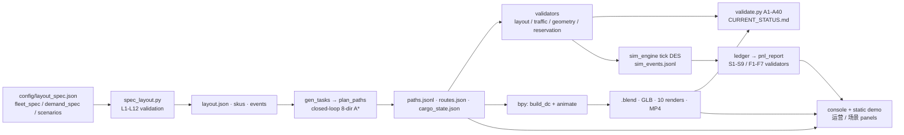

# Distribution Center Digital Twin


**Blender-based digital twin for a 4-warehouse distribution center with 21 AGVs,
closed-loop A\* tasks, a reproducible data chain and 40 independent acceptance checks.**

[](LICENSE)
[](pyproject.toml)
[](docs/getting-started.md)
[](out/CURRENT_STATUS.md)

**English** · [简体中文](README.zh-CN.md) · [Live static demo](demo/index.html)

---

## See it in 30 seconds


<table>
<tr>
<td width="50%"><b>Closed-loop AGV routes</b><br>

<br><sub>Blue = outbound deadhead · orange = loaded · green = return · purple = HOME</sub></td>
<td width="50%"><b>ABC/COI slotting heatmap</b><br>

<br><sub>High-turnover SKUs are placed near the docks</sub></td>
</tr>
<tr>
<td width="50%"><b>Time–space diagram</b><br>

<br><sub>WAIT / MOVE / ROTATE / FACE / PICK / DROP / PARK per agent</sub></td>
<td width="50%"><b>Dock view</b><br>

<br><sub>Procedural Blender 5.2 scene, no external model files</sub></td>
</tr>
</table>

All images are WebP under 110 KB. Sources are the 1920×1080 PNGs regenerated by
`dc run --scope full`; `scripts/build_docs_assets.py` rebuilds these assets.

---

## Run it

```bash
pip install -e .
dc doctor                 # 17 environment checks, pasteable into an issue
dc demo                   # data layer + 8 scenarios + local console. NO Blender needed
dc run --scope full       # full 31-step chain, requires Blender 5.2 (~2-5 min)
```

`dc demo` completes in ~10 s for the data layer and opens
`http://127.0.0.1:8765/`. On Windows `.\run_all.ps1`, on POSIX `bash run.sh`,
are thin wrappers around the same `run.py` driver. See
[getting started](docs/getting-started.md) and the [CLI reference](docs/cli.md).

---

## What it is / What it is not

| ✅ What it is | ⛔ What it is not |
|---|---|
| 4 warehouses (W + F1/F2/F3), 196 racks, 441 locations, 21 AGVs, generated from one [`layout_spec.json`](config/layout_spec.json) | A production WMS / fleet manager; SKU velocities and orders are **synthetic** |
| 21 closed-loop orders (`HOME → PICK → DROP → HOME`), 5 business types, cargo state machine, 0 pending | Real order data; CSV / UCI / WMS **adapters** exist but are not connected to live systems |
| 8-direction A\* on a 0.5 m grid with AGV-radius obstacle inflation, no corner cutting, arc-length timing at 1.5 m/s | A formal collision *proof*: verification is 0.05 s sampling + an independent reservation-table replay, not CBS/WHCA\* |
| **A — tick-level DES**: continuous order arrivals, 9-state FSM, battery/charging, fault injection & reassignment, L1 space-time reservation; 8 scenarios really executed | Full physics (dynamics/LiDAR/Gazebo), VDA 5050 MQTT, multi-floor elevators, or a continuous-time zero-collision *proof* |
| **B — event-sourced ledger → P&L**: measured kWh/orders → postings → income statement, breakeven, sensitivity; F1–F7 independent recomputation | An external financial statement or tax-compliant books; all prices are `demo` and badged as such |
| **C — user-defined scenarios** (console UI + CLI: validate → 600 s dry-run → save → run), `fleet_spec` L13 capacity guard, LIF-like import/export, WMS adapter framework | A 3D drag-and-drop editor (G1), complex/binary DXF auto-import (G2), or a **verified** live WMS integration (G3); the 2D editor and ASCII DXF import **are** implemented |
| Independent validators: layout, traffic, geometry, reservation, A1–A40, S1–S9, F1–F7, 21 negative tests | Mixing analytic and measured KPIs: the two engines are separate, each metric carries `source` |
| Blender 5.2 procedural `.blend` + GLB + 10 renders + MP4 + local 2D/3D console + static demo | An animated GLB (`export_animations=False`); animation lives in the MP4 / `.blend` |
| Four-layer config, 8 frozen + custom scenarios, 27 measured KPIs with definitions/formulas | CBS/L3 solver in the default chain (D3: `experimental`, see [implementation status](docs/COMPLETION_STATUS.md)) |

> Stage A/B/C implementation status, degradation register and honest limitations:
> [`docs/COMPLETION_STATUS.md`](docs/COMPLETION_STATUS.md). GitHub reference audit (16 repos
> re-checked, 5 licence corrections): [`docs/GITHUB_REFERENCE_AUDIT.md`](docs/GITHUB_REFERENCE_AUDIT.md).
>
> **Zero-backend submission web app** (open directly in a browser, no server / no network):
> [`submission/index.html`](submission/index.html) ·
> [submission guide](submission/%E6%8F%90%E4%BA%A4%E8%AF%B4%E6%98%8E.md) ·
> rebuild its data snapshot with `python scripts/build_submission.py`.

Current measured numbers are always generated from JSON into
[`out/CURRENT_STATUS.md`](out/CURRENT_STATUS.md); the prose in this README
deliberately avoids hard-coded counts.

---

## Architecture



Every arrow is a real file on disk; see [data contracts](docs/data-contracts.md).

---

## Documentation

| Document | Contents |
|---|---|
| [Getting started](docs/getting-started.md) | Install, first run, Blender discovery, troubleshooting |
| [CLI reference](docs/cli.md) | `doctor / demo / run / validate / serve / export / compare` |
| [Data contracts](docs/data-contracts.md) | Input schemas, report envelopes, manifest, traceability |
| [Parameter guide](docs/PARAMETER_GUIDE.md) | Every knob in the four-layer config |
| [Scenarios & enterprise setup](docs/ENTERPRISE_SETUP.md) | Running what-if scenarios, deployment notes |
| [Real data sources](docs/REAL_DATA_SOURCES.md) | CSV / UCI Retail / WMS adapters and licensing |
| [Open-source plan](docs/OPEN_SOURCE_PLAN.md) | The assessment that produced this release |
| [Full project report](docs/PROJECT_REPORT.md) | Historical stage-by-stage record (Chinese, from the course project) |
| [Third-party notices](THIRD_PARTY_NOTICES.md) | cargoTwin MIT assets, Three.js, UCI CC BY 4.0 |

---

## Reproducing a result

```bash
dc validate --tier data --json              # CI-friendly subset, no Blender
dc validate --check                        # compare reports to out/manifest.json
pytest -m "not blender"                    # unit / contract / integration tests
dc compare runs/peak/<ts> runs/baseline/<ts> --format md
```

The seed lives in `config/layout_spec.json → site.seed` and `data/config.json → seed`
(both must match; `dc doctor` checks this). `dc run --seed N` updates both.

---

## Contributing & release

See [CONTRIBUTING.md](CONTRIBUTING.md), [CHANGELOG.md](CHANGELOG.md),
[SECURITY.md](SECURITY.md) and [CITATION.cff](CITATION.cff).
`dc export --target release` builds a checksum-verified bundle
(`.blend`, `.glb`, `.mp4`, renders) for a GitHub Release; no remote/tag is
configured in this local repository yet, so none of the badges above pretend
to point at a live CI.

Licensed under [MIT](LICENSE). Synthetic sample data contains no real customer data.
