# Distribution Center Digital Twin

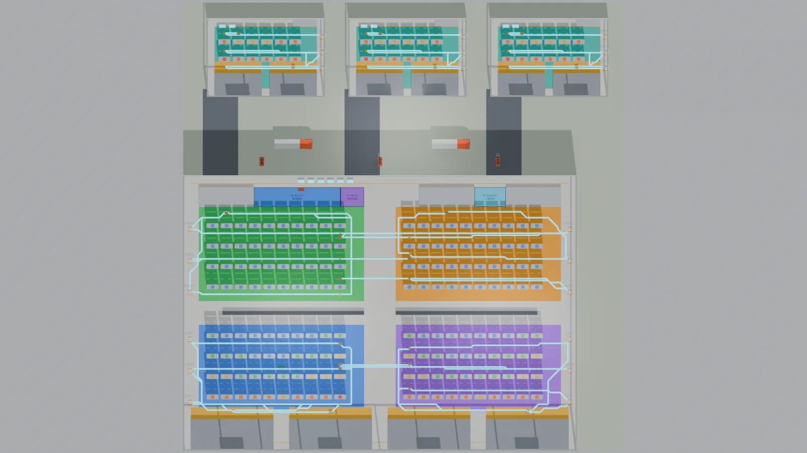

**Blender-based digital twin for a 4-warehouse distribution center with 21 AGVs,
closed-loop A\* tasks, 21 validated functional areas, a tick-level station
queue layer, a reproducible data chain, 39 measured tick KPIs and 40 independent
acceptance checks.**

[](LICENSE)
[](pyproject.toml)
[](docs/getting-started.md)
[](out/CURRENT_STATUS.md)
[](https://github.com/ruanruanxiaomao/dc-twin/actions/workflows/ci.yml)
[](https://ruanruanxiaomao.github.io/dc-twin/app/index.html?view=3d)

**English** · [简体中文](README.zh-CN.md) · [Live static demo](demo/index.html)

---

## One window for the whole project

```bash
python dc_app.pyw          # or double-click 启动驾驶舱.bat
```

`dc_app.pyw` merges the old Tk cockpit and the web console into a single native
window (pywebview → WebView2): it starts the console server in-process and loads
the same UI described below. Ten panes cover the whole project — 3D twin,
vehicles, orders, acceptance, parameters, artefacts, operations, scenarios,
the 50-metric dictionary, the 21 functional areas, and the full plan document.
The pane list is a fixed 5 x 2 grid, so it does not reflow as the sidebar width
changes between tabs.

If pywebview/WebView2 is unavailable it falls back to an Edge/Chrome `--app`
window, then to the default browser. `启动驾驶舱_Tk经典版.bat` still opens the
legacy Tk cockpit.

## Policies are data now, not constants

Dispatch and charging used to be literals inside the engine — `min(idle, key=distance)`
and "charge below critical". That made the console a viewer with a sliders panel.
Both are now lookup tables, and the choice lives in the scenario document:

```json
{"overrides": {"dispatch.policy": "highest_soc",
               "battery.charge_policy": "threshold",
               "dispatch.battery_reserve_pct": 25}}
```

`DISPATCH_RULES` ships nearest_first / farthest_first / highest_soc / lowest_soc /
least_completed; `CHARGE_POLICIES` ships opportunistic / threshold. An unknown
name raises instead of falling back, because a silent fallback turns an A/B run
into two copies of the same experiment. Saving a policy is saving a scenario —
there is no second config format to keep in sync.

Same 1800 s baseline, only the rule changed:

| rule | completed | distance | charge starts |
|---|---|---|---|
| nearest_first | 38 | 3561 m | 3 |
| highest_soc | 27 | 3164 m | 3 |
| farthest_first | 23 | 3330 m | 3 |

## Where the money goes

The 运营 pane is a full-width workspace, not a card in a 400 px column: six KPI
cards, a revenue → variable → fixed → operating-profit waterfall, a cost donut,
a sensitivity tornado, per-run profit comparison, the P&L statement with
subtotals, and a diagnosis paragraph that says how far the shift is from
breakeven and which lever moves the number. Charts are hand-written SVG so the
packaged exe works with no network.

On the 1 h baseline the honest reading is uncomfortable and therefore useful:
revenue 192.90, fixed cost 750.73, operating profit −566.63, breakeven 155
orders against 38 completed. Fixed cost is 98.8% of total cost, so "run longer"
cannot close the gap — only more orders or a higher price per order can.

## Docks have a duration now

A dock used to be blockable and nothing else: an AGV arrived, waited 2 s and left,
so five doors and one door were the same simulation. `sim_engine.py` now loads each
dock zone as a time-window resource — an (un)load occupies a door for 150 s
outbound / 180 s inbound, read from `process_spec.process_steps` — with parallel
slots equal to the layout's real door count (10 zones, 38 doors).

No free door means the order waits in the dispatch queue rather than driving to the
apron, which keeps the single-lane dock corridor clear. New events
`DOCK_RESERVED` / `DOCK_HANDOFF` / `DOCK_REFUSED` and 11 `dock_*` metrics make it
auditable:

```bash
python scripts/check_dock.py     # event-level recompute + 1-vs-8-door contrast
python -m pytest tests/test_dock_queue.py tests/test_fault_preempt.py -q
```

Measured on the baseline: 23 transfers, 163.5 s mean, **2.8% door occupancy**, no
queue — the dock has ~36x headroom, so the constraint in this layout is aisle
traffic, not doors. Under 300 outbound orders/h the contrast is sharp: 1 door per
zone gives a 19-order queue and 355 s of waiting (15 completed), 8 doors gives no
queue and 28 completed.

## Reproduce from scratch

```bash
python scripts/bootstrap.py                     # .venv + locked deps + doctor
python -m dc_twin run --scope scenarios         # data + 8 scenarios, ~110 s, no Blender
python scripts/kpi_baseline.py --check          # 8 scenarios / 192 metrics must match
```

`requirements.lock` pins the exact versions that both this machine and CI have
been tested with; `bootstrap.py --check` verifies an existing environment without
installing, and runs as a CI step.

The KPI baseline is a deliberate ratchet: change a service time or a dispatch rule
and CI fails until you either fix the regression or re-freeze with
`python scripts/kpi_baseline.py --freeze` and say why in the commit message.

## The local console can write, so it checks who is asking

`console/server.py` can rewrite `data/config.json`, trigger the whole pipeline and
generate layout variants. "It only binds 127.0.0.1" is not a security boundary:
any web page can POST to loopback. `console/security.py` therefore enforces three
things — Host must be loopback (DNS rebinding), any POST carrying an Origin or
Referer must be same-origin (CSRF), and if `DC_CONSOLE_TOKEN` is set every request
needs `X-DC-Token`. Binding a non-loopback address **without** a token refuses to
start.

```bash
DC_CONSOLE_TOKEN=$(python -c "import secrets;print(secrets.token_hex(16))") \
  python -m console.server      # then send X-DC-Token on requests
python -m pytest tests/test_console_security.py -q   # 8 tests
```

## Functional areas, visible and editable

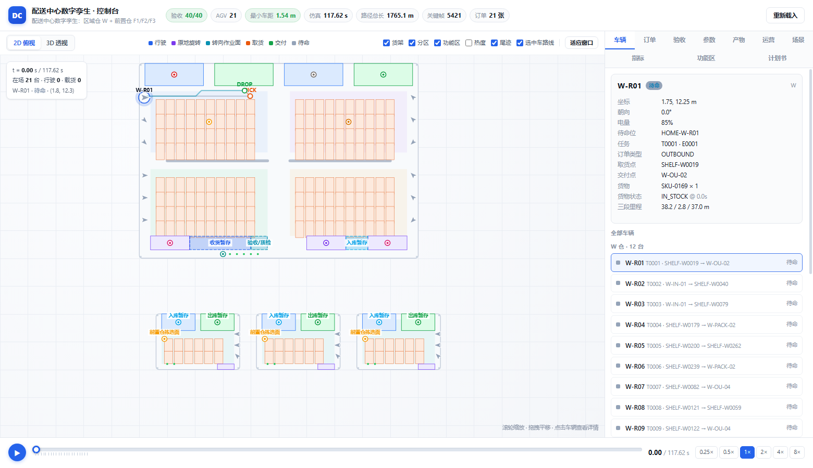

All 21 functional areas (`data/areas.json`) are drawn on both views: 3 physical
areas as dashed footprints, 18 logical ones as markers on the rack/dock/station
they hang off. The **功能区** pane lists them with capacity and derived
throughput; clicking a row pans the 2D plan to that area. In 3D the same data
becomes a toggleable overlay (`AREA_OVERLAY`) with clickable name plates — the
GLB itself only contains the three physical slabs.

**自定义扩仓** (same pane, second tab) is the area picker that used to live only
in the legacy Tk cockpit: tick any of the 14 templates, watch the required depth
and footprint update live (`POST /api/areas/plan`, same `pack()` as the real
build), then generate the variant spec (`POST /api/areas/apply`).

## Windows app (one exe, no Python needed to look)

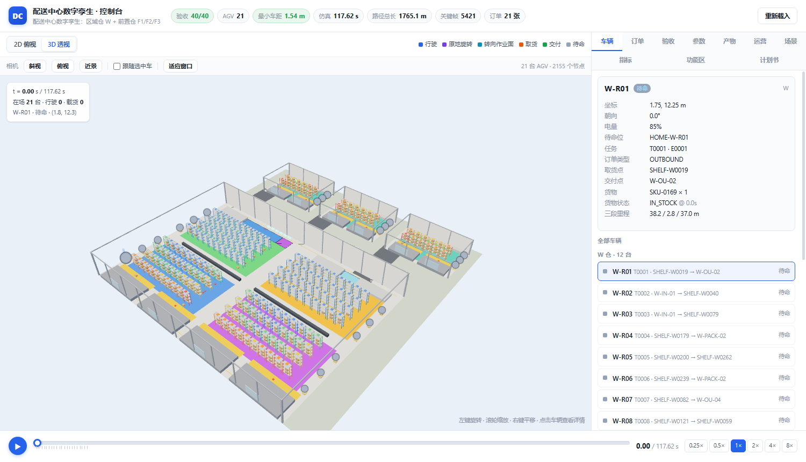

```bash
python scripts/build_exe.py          # → dist/DC Twin/DC Twin.exe   (~72 MB folder)
python scripts/build_exe.py --clean  # same, wiping the old build first
```

`dist/DC Twin/` is a PyInstaller **onedir** build: the UI and the Python runtime
live inside `_internal/`, while `out/`, `data/`, `runs/` sit next to the exe so
the model, the renders and the reports stay visible and writable. Double-click
`DC Twin.exe` and you get the same ten-pane window as `dc_app.pyw`.

Re-running the pipeline from the packaged app still needs a real interpreter
(`DC_PYTHON`, a `.venv`, or `python` on PATH) and, for the Blender steps,
`blender.exe`. When either is missing the run log says which one — it does not
fail silently.

Verify a build end to end (endpoints + a real 10-step rerun + scenario save/delete
+ a headless 3D screenshot):

```bash
python scripts/check_exe.py --ops --shot out/exe_3d.png
```

## Open the 3D twin in a browser

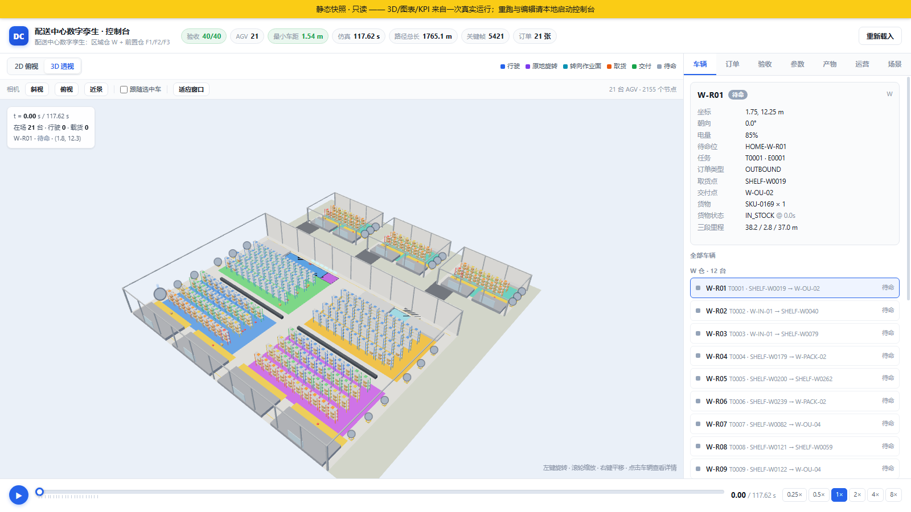

`console/` is a zero-dependency web cockpit: three.js renders `dc_preview.glb`
in real time, with orbit/zoom, six camera presets, AGV playback driven by the
same `paths.jsonl` as the desktop app, and per-agent inspection.

```bash
python -m console.server        # → http://127.0.0.1:8765/?view=3d
```

It is also published as a **read-only static snapshot** on GitHub Pages, built by
`scripts/build_webapp.py` (the REST endpoints are frozen into `docs/app/api/*.json`
and a 90-line fetch shim rewrites `/api/*` to those files):

- 3D console: https://ruanruanxiaomao.github.io/dc-twin/app/index.html?view=3d
- landing page: https://ruanruanxiaomao.github.io/dc-twin/

The desktop cockpit (**DC Twin Studio**) opens the same page from
*工具箱 → 界面入口 → 3D 网页版*, falling back to the static snapshot if the
full console cannot start.

## See it in 30 seconds

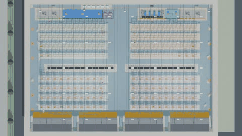

<table>
<tr>
<td width="50%"><b>Closed-loop AGV routes</b><br>
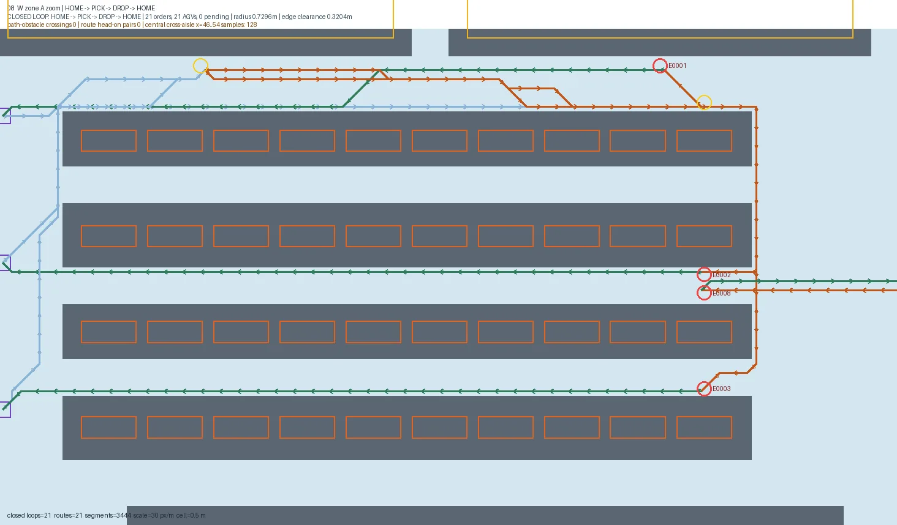
<br><sub>Blue = outbound deadhead · orange = loaded · green = return · purple = HOME</sub></td>
<td width="50%"><b>ABC/COI slotting heatmap</b><br>
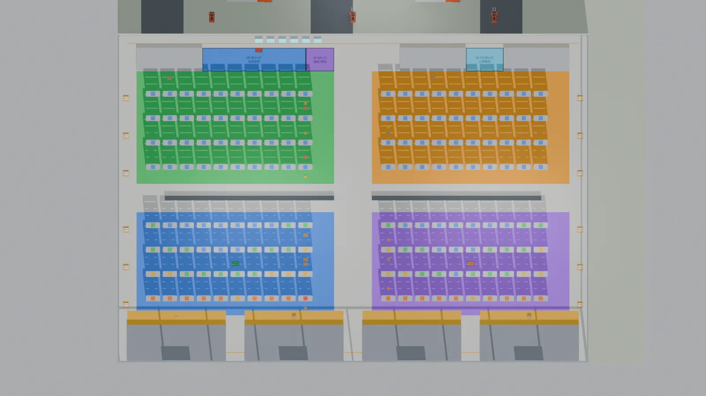
<br><sub>High-turnover SKUs are placed near the docks</sub></td>
</tr>
<tr>
<td width="50%"><b>Time–space diagram</b><br>
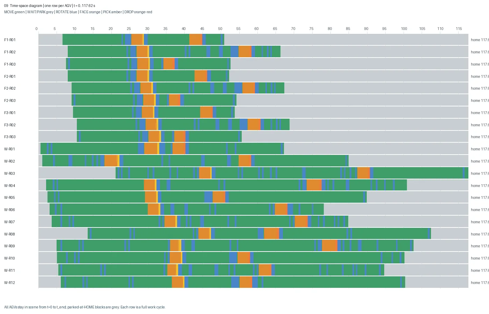
<br><sub>WAIT / MOVE / ROTATE / FACE / PICK / DROP / PARK per agent</sub></td>
<td width="50%"><b>Dock view</b><br>
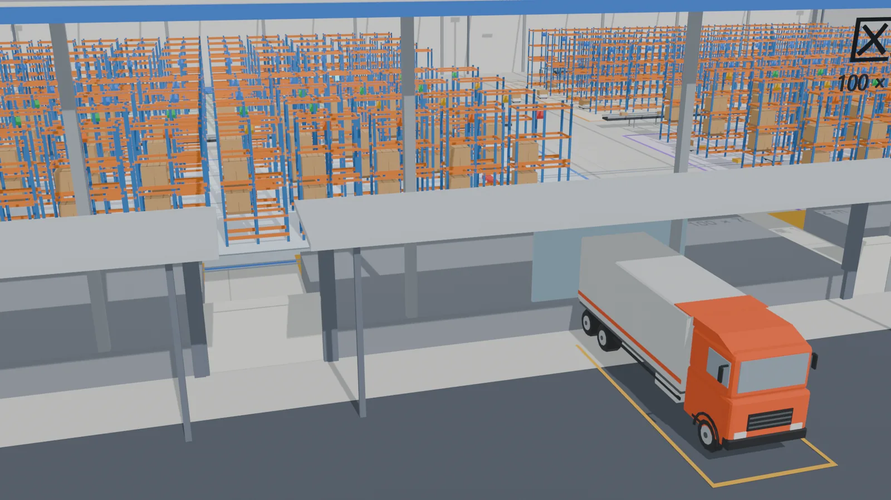
<br><sub>Procedural Blender 5.2 scene, no external model files</sub></td>
</tr>
</table>

All images are WebP under 110 KB. Sources are the 1920×1080 PNGs regenerated by
`dc run --scope full`; `scripts/build_docs_assets.py` rebuilds these assets.

---

## Run it

```bash
pip install -e .
dc doctor                 # 17 environment checks, pasteable into an issue
dc demo                   # data layer + 8 scenarios + local console. NO Blender needed
dc run --scope full       # full 31-step chain, requires Blender 5.2 (~2-5 min)
```

`dc demo` completes in ~10 s for the data layer and opens
`http://127.0.0.1:8765/`. On Windows `.\run_all.ps1`, on POSIX `bash run.sh`,
are thin wrappers around the same `run.py` driver. See
[getting started](docs/getting-started.md) and the [CLI reference](docs/cli.md).

### Desktop cockpit (DC Twin Studio)

Double-click `启动驾驶舱.bat` (or run `python desktop_app.pyw`) to open a
zero-backend Tkinter cockpit: overview, a 2D layout sandbox with AGV replay,
an **area picker** (tick which functional areas your DC needs and watch
footprint / depth / throughput update live), the 8-scenario lab, a searchable
KPI dictionary, an in-app Markdown reader and a toolbox that streams the
existing pipeline. It reads local artefacts only — no server, no network, no
writes unless you press a run button.

### 3D follows the functional areas

`build_dc.py` reads `data/areas.json` and draws what actually occupies floor:
the 3 physical areas get coloured floor pads, a dark outline and a bilingual
name plate (CJK font auto-detected, ASCII fallback), while the 18 logical areas
get a small anchor tag instead of a fake rectangle — a pick face *is* the rack
face plus an aisle, so drawing a box there would be a lie.

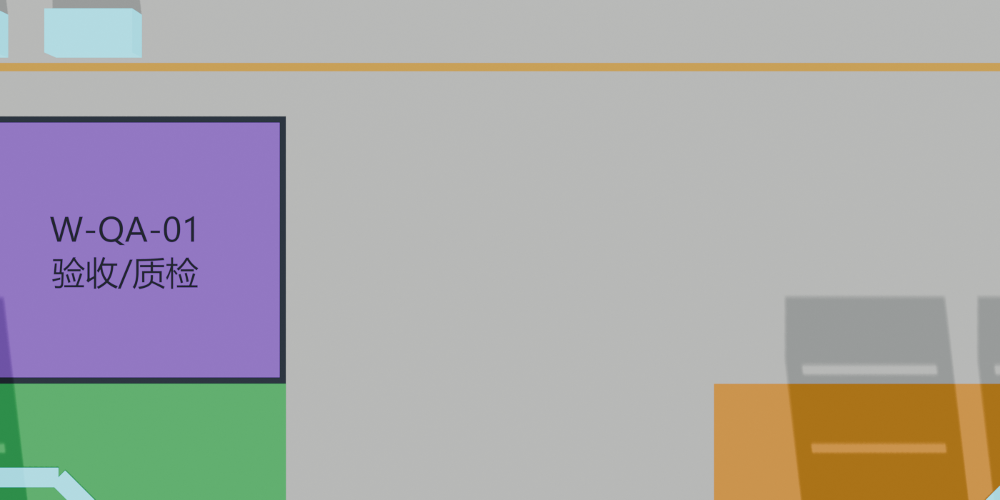

### Pick your own functional areas

```bash
python scripts/build_variant.py --list          # 14 area templates
python scripts/build_variant.py --preset ecommerce
python scripts/build_variant.py --build         # writes config/layout_spec_areas.json
python run.py --scope scenarios --spec config/layout_spec_areas.json
```

W grows 100×70 → 100×88 m to win a northern 18 m working band; the 441 storage
locations, docks, stations and racks stay untouched, so A1–A40 still hold.
13 physical areas (704 m²) land on real floor at the default *ecommerce*
preset. The main chain (`config/layout_spec.json` → `data/layout.json`) is
never modified — the variant is a second, side-by-side spec. Selecting areas
in the cockpit does exactly the same thing, and writes only
`config/areas_selection.json`.

---

## What it is / What it is not

| ✅ What it is | ⛔ What it is not |
|---|---|
| 4 warehouses (W + F1/F2/F3), 196 racks, 441 locations, 21 AGVs, generated from one [`layout_spec.json`](config/layout_spec.json) | A production WMS / fleet manager; SKU velocities and orders are **synthetic** |
| 21 closed-loop orders (`HOME → PICK → DROP → HOME`), 5 business types, cargo state machine, 0 pending | Real order data; CSV / UCI / WMS **adapters** exist but are not connected to live systems |
| 8-direction A\* on a 0.5 m grid with AGV-radius obstacle inflation, no corner cutting, arc-length timing at 1.5 m/s | A formal collision *proof*: verification is 0.05 s sampling + an independent reservation-table replay, not CBS/WHCA\* |
| **A — tick-level DES**: continuous order arrivals, 9-state FSM, battery/charging, fault injection & reassignment, L1 space-time reservation; 8 scenarios really executed | Full physics (dynamics/LiDAR/Gazebo), VDA 5050 MQTT, multi-floor elevators, or a continuous-time zero-collision *proof* |
| **B — event-sourced ledger → P&L**: measured kWh/orders → postings → income statement, breakeven, sensitivity; F1–F7 independent recomputation | An external financial statement or tax-compliant books; all prices are `demo` and badged as such |
| **C — user-defined scenarios** (console UI + CLI: validate → 600 s dry-run → save → run), `fleet_spec` L13 capacity guard, LIF-like import/export, WMS adapter framework | A 3D drag-and-drop editor (G1), complex/binary DXF auto-import (G2), or a **verified** live WMS integration (G3); the 2D editor and ASCII DXF import **are** implemented |
| Independent validators: layout, traffic, geometry, reservation, A1–A40, S1–S9, F1–F7, 21 negative tests | Mixing analytic and measured KPIs: the two engines are separate, each metric carries `source` |
| Blender 5.2 procedural `.blend` + GLB + 10 renders + MP4 + local 2D/3D console + static demo | An animated GLB (`export_animations=False`); animation lives in the MP4 / `.blend` |
| Four-layer config, 8 frozen + custom scenarios, 27 measured KPIs with definitions/formulas | CBS/L3 solver in the default chain (D3: `experimental`, see [implementation status](docs/COMPLETION_STATUS.md)) |

> Stage A/B/C implementation status, degradation register and honest limitations:
> [`docs/COMPLETION_STATUS.md`](docs/COMPLETION_STATUS.md). GitHub reference audit (16 repos
> re-checked, 5 licence corrections): [`docs/GITHUB_REFERENCE_AUDIT.md`](docs/GITHUB_REFERENCE_AUDIT.md).
>
> **Zero-backend submission web app** (open directly in a browser, no server / no network):
> [`submission/index.html`](submission/index.html) ·
> [submission guide](submission/%E6%8F%90%E4%BA%A4%E8%AF%B4%E6%98%8E.md) ·
> rebuild its data snapshot with `python scripts/build_submission.py`.
>
> The 9-tab app is a **complete project showcase**: an interactive software-3D twin
> (rotatable / zoomable, real rack geometry driven by inlined keyframes),
> project map with real deliverables and data contracts, Blender model/renders
> (MP4 + downloadable `.blend` / `.glb` / 10 WebP), 8 scenarios, P&L ledger samples,
> visual layout editor, and per-check A/S/F validation evidence. Dark/light themes,
> no CDN, `file://` works. Published: <https://dc-twin-studio.app.workbuddy.host/?sharecode=SRGROMS4ZA>.

Current measured numbers are always generated from JSON into
[`out/CURRENT_STATUS.md`](out/CURRENT_STATUS.md); the prose in this README
deliberately avoids hard-coded counts.

---

## Architecture

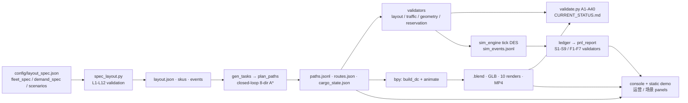

Every arrow is a real file on disk; see [data contracts](docs/data-contracts.md).

---

## Documentation

| Document | Contents |
|---|---|
| [Getting started](docs/getting-started.md) | Install, first run, Blender discovery, troubleshooting |
| [CLI reference](docs/cli.md) | `doctor / demo / run / validate / serve / export / compare` |
| [Data contracts](docs/data-contracts.md) | Input schemas, report envelopes, manifest, traceability |
| [Parameter guide](docs/PARAMETER_GUIDE.md) | Every knob in the four-layer config |
| [Scenarios & enterprise setup](docs/ENTERPRISE_SETUP.md) | Running what-if scenarios, deployment notes |
| [Real data sources](docs/REAL_DATA_SOURCES.md) | CSV / UCI Retail / WMS adapters and licensing |
| [Open-source plan](docs/OPEN_SOURCE_PLAN.md) | The assessment that produced this release |
| [DC expansion plan](docs/DC_EXPANSION_PLAN.md) | Area taxonomy, GitHub reference audit, gap analysis, tunables, user customization and phased roadmap (Chinese) |
| [Master plan v2.0](docs/DC_MASTER_PLAN.md) | Full plan: domain model, field-level data dictionary, parameter tables, 57-day backlog, A41–A60 acceptance, risk register (Chinese) |
| [Full project report](docs/PROJECT_REPORT.md) | Historical stage-by-stage record (Chinese, from the course project) |
| [Third-party notices](THIRD_PARTY_NOTICES.md) | cargoTwin MIT assets, Three.js, UCI CC BY 4.0 |

---

## Reproducing a result

```bash
dc validate --tier data --json              # CI-friendly subset, no Blender
dc validate --check                        # compare reports to out/manifest.json
pytest -m "not blender"                    # unit / contract / integration tests
dc compare runs/peak/<ts> runs/baseline/<ts> --format md
```

The seed lives in `config/layout_spec.json → site.seed` and `data/config.json → seed`
(both must match; `dc doctor` checks this). `dc run --seed N` updates both.

---

## Contributing & release

See [CONTRIBUTING.md](CONTRIBUTING.md), [CHANGELOG.md](CHANGELOG.md),
[SECURITY.md](SECURITY.md) and [CITATION.cff](CITATION.cff).
`dc export --target release` builds a checksum-verified bundle
(`.blend`, `.glb`, `.mp4`, renders) for a GitHub Release. The remote is
`origin` → `github.com/ruanruanxiaomao/dc-twin`, so the CI badge above points at
a workflow that actually runs.

Licensed under the [Apache License 2.0](LICENSE); attribution notices in [NOTICE](NOTICE). Synthetic sample data contains no real customer data.
