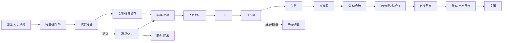

# 配送中心数字孪生 · 能力扩展与完善计划书

> **版本**：v1.0 · 2026-11-10  
> **审计对象**：`dc_project/`（Blender 5.2 + Python 3.10+，区域仓 W + 前置仓 F1/F2/F3）  
> **结论依据**：`README.md`、`README.zh-CN.md`、`docs/COMPLETION_STATUS.md`、`docs/COMPLETION_PLAN.md`、`config/layout_spec.json`、`config/fleet_spec.json`、`config/demand_spec.json`、`config/sim_spec.json`、`scripts/sim_engine.py`、`scripts/gen_tasks.py`、`scripts/spec_layout.py`、`scripts/demand_source.py`、`console/server.py`、`submission/editor.js`、`out/CURRENT_STATUS.md`  
> **GitHub 数据口径**：2026-11-09 / 2026-11-10 通过 GitHub REST API 实测。star 数会变化；许可证以仓库 `LICENSE` 为准，API 无 SPDX 字段的一律按“未核实”处理，不直接复制代码。

---

## 0. 一页结论

### 0.1 五条判断

1. **这已经是一个“运输层”很强的数字孪生**：4 仓、196 货架、441 库位、38 扇门、21 台 AGV、闭环 A*、9 态 FSM、电量/充电/故障/改派、L1 时空预约、8 个场景、A/B/C 三阶段验收、25–27 类实测 KPI（文档口径待统一）、事件溯源账本与损益表，工程完整度明显高于常见“3D 仓库展示项目”。
2. **但它离“配送中心”还差一个中间层——过程层**：当前订单本质上是“从货架搬到月台/打包台”的搬运任务；收货、验收、上架、补货、拆零、分拣、包装、装车、退货等环节没有容量、工时、队列和资源约束。`PACKING` / `SORTING` 目前是落点，不是有产能的工位；`conveyor` 目前是几何障碍物，不是运输资源；月台门只做元数据，不参与碰撞与排队。
3. **当前最大瓶颈不是模型不够漂亮，而是“资源—容量—队列”不完整**：没有人工、叉车、月台门、拖车、输送线、分拣机、周转箱、托盘、电池间、维修位等共享资源。没有这些，仿真只能回答“车怎么走”，不能回答“这个仓一天能不能发出去 2 万单、瓶颈在哪、加人还是加门”。
4. **下一步不应先堆更多 3D 区域，而应先补“收货 → 上架 → 储存 → 拣选 → 补货 → 分拣 → 包装 → 出库 → 退货”的流程骨架**，再让新区域挂在流程骨架上。否则只是把静态模型做大，运营问题仍然答不了。
5. **GitHub 上没有可以直接拿来当“完整配送中心孪生”的成熟开源项目**。可复用件集中在四类：tick 仿真骨架（WareTwin）、MAPF/调度（RHCR、LaCAM3、Continuous-CBS、openTCS）、WMS/WES 领域模型（ModernWMS、open-wes、OpenBoxes）、布局/货位/订单批次算法（warehouse_layout_editor、ezdxf、picking-route、batching-benchmarks）。正确用法是“借领域模型与算法，不整体嵌入”。

### 0.2 目标成熟度

| 等级 | 定义 | 当前 | 说明 |
|---|---|---|---|
| L1 几何可视化 | 能看见仓、货架、月台、车辆 | ✅ 已达到 | Blender 5.2 程序化场景 + GLB + 10 张渲染 + 网页 3D |
| L2 单车路径 | 单车 A*、时间线、避障 | ✅ 已达到 | 8 向 A*、0.5 m 栅格、AGV 半径膨胀、闭环三段路径 |
| L3 多车调度 | 多车派单、预约、故障、电量 | ✅ 基本达到 | 21–50 车 tick DES、L1 预约、充电、故障改派 |
| L4 流程级运营孪生 | 收货到发货全流程 + 资源容量 + 库存 + 成本 | ◐ 部分达到 | 有运输与账本，缺过程链、库存、人/叉车/门/输送线 |
| L5 实时闭环/自适应 | 接真实 WMS/设备、在线优化、预测 | ○ 未达到 | 适配器为只读框架，未接生产系统；无在线优化 |

**目标**：从 L3.5 升到 L4；L5 作为企业试点阶段，不纳入本期承诺。

### 0.3 十个立即动作

| # | 动作 | 产出 | 为什么现在做 |
|---|---|---|---|
| 1 | 统一“当前状态”口径 | 重新生成 `out/CURRENT_STATUS.md`，修正 25/27 KPI、解析/实测、离线回放等旧表述 | 现在文档之间互相矛盾，会让评审和后续开发失去单一真相源 |
| 2 | 写领域模型文档 | `docs/DOMAIN_MODEL.md`：区域、流程、资源、库存、订单、KPI 六类实体 | 先统一语言，再改代码，避免“加一个区域改一次 Python” |
| 3 | 收紧布局 Schema | `config/schemas/layout_spec.schema.json` 覆盖 zones / docks / stations / conveyors / chargers | 当前 Schema 只强校验少量必填字段，新增区域容易静默写错 |
| 4 | 新增过程配置 | `config/process_spec.json`：工位产能、服务时间、缓冲区、班次 | 没有过程参数，仿真无法产生排队与瓶颈 |
| 5 | 新增库存配置 | `config/inventory_spec.json`：SKU、批次、效期、货主、安全库存、补货策略 | 当前 `cargo_state.json` 只是订单级货物状态，不是库存 |
| 6 | 增加首批区域 | `RCV-01`、`QA-01`、`STG-IN-01`、`FWD-01`、`STG-OUT-01`、`RET-01`、`EMP-01`、`BATT-01` | 这 8 个区域能串起最小完整流程链 |
| 7 | 仿真接过程图 | `scripts/sim_engine.py` 从“点到点搬运”升级为“流程节点 + 资源队列” | 这是从 L3 到 L4 的核心一步 |
| 8 | 扩展 KPI | dock-to-stock、订单周期、拣选效率、完美订单、月台利用率、单均成本等 | 没有过程 KPI，就无法判断新增区域是否有效 |
| 9 | 补编辑器 | 区域调色板、工位/充电桩/输送线、多边形仓库、导入导出、保存到 spec | 当前 2D 编辑器只能加 zone/rack/door/home，且只导出草稿 |
| 10 | 新验收 + 负测试 | P1/P2/P3 系列，含库存守恒、容量、队列、负测试 | 延续项目“验证器必须能失败”的文化 |

---

## 1. 项目现状审计

### 1.1 它已经是什么

| 能力 | 当前实现 | 证据 |
|---|---|---|
| 布局参数化 | `config/layout_spec.json` 是唯一输入，支持 zones、racks、docks、stations、chargers、spawns、pillars、conveyors | `spec_layout.py` L1–L12 校验后展开 `data/layout.json` |
| 多仓 | W 区域仓 + F1/F2/F3 前置仓，矩形单层 | `layout_spec.json → warehouses[]` |
| 货架/库位 | 196 货架、441 库位（含 392 SHELF、21 HOME 等） | `out/CURRENT_STATUS.md` |
| 月台 | 10 个月台区、38 扇门，分 INBOUND / OUTBOUND | `layout_spec.json → docks` |
| 工位 | PACKING ×5、SORTING ×1，带 AP 与矩形 | `layout_spec.json → stations` |
| 充电 | 12 个充电位，3 kW，参与仿真充电 | `layout_spec.json → chargers`；`sim_engine.py` 电池模型 |
| 车队 | 21 台 AGV，单车 1.12×0.77×0.435 m，1.5 m/s，1.6 kWh | `fleet_spec.json`、`layout_spec.json → defaults.agv` |
| 路径 | 8 向 A*、禁止切角、0.5 m 栅格、AGV 半径膨胀、闭环三段 | `plan_paths.py`、`geometry.py` |
| 交通 | L1 时空预约 + 0.05 s 采样复核，`MIN_SEP=1.4592 m` | `sim_engine.py`、`reservation_check.py`、`traffic_check.py` |
| 仿真 | tick DES、9 态 FSM、持续订单流、nearest-first 派单、电量/充电/故障/改派 | `sim_engine.py`、`docs/COMPLETION_STATUS.md` §1 |
| 场景 | 8 个冻结场景 + 用户自定义场景，可断言、可试算、可保存、可运行 | `config/scenarios/`、`scenario_tools.py`、控制台“场景”面板 |
| 账本/损益 | 事件 → 分录 → P&L、单均成本、盈亏平衡、敏感性 | `ledger.py`、`pnl_report.py`、`config/cost_spec.json` |
| 3D/表现 | Blender `.blend`、GLB、MP4、10 张渲染、2D/3D 控制台、零后端静态作品页 | `out/`、`console/`、`submission/` |
| 验收 | A1–A40、S1–S9、F1–F7、C 系列、17 个负测试 | `validate.py`、`validate_sim.py`、`validate_pnl.py`、`tests/` |

### 1.2 现有区域与资源清单

图例：✅ 有模型且参与仿真；◐ 有模型但只是落点/障碍物/装饰；○ 没有。

| 对象 | 当前实现 | 状态 | 说明 |
|---|---|---|---|
| 仓库 W / F1 / F2 / F3 | 矩形 footprint、单层 | ✅ | 不支持多边形、夹层、多楼层、电梯 |
| 存储区 A/B/C/D | W 仓 4 个矩形分区 | ✅ | 分区只用于布局与派单，不承载温区/危化/货主属性 |
| 前置仓 Z1 | F1/F2/F3 各 1 个分区 | ✅ | 只做存储与拣选落点 |
| 货架/库位 | 196 货架 / 441 库位 | ✅ | 支持排数、bay 数、层数、通道宽；不支持货架类型、承重、混存约束 |
| 月台区 | 10 个区，38 扇门，IN/OUT | ◐ | 门只做元数据，不参与地面碰撞；无门占用、预约、装卸工时 |
| 月台门 | door_width / door_height / door_pitch | ◐ | 不能单独占用/排队/故障 |
| 打包台 PACK-01/02 | 矩形 + AP + location | ◐ | 可作为 PICK 单落点，但没有打包工时、工位容量、人员 |
| 分拣台 SORT-01 | 矩形 + AP + location | ◐ | 可作为 PICK 单落点，但没有滑道、合流、分拣产能 |
| 充电桩 | 12 个，line 模式 | ✅ | 仿真有充电，但没有排队、换电、电池间、消防隔离 |
| HOME/待命位 | 21 个显式点 | ✅ | 对齐 0.5 m 栅格，参与路径软代价 |
| 输送线 | CV-W01/02，几何线段 | ◐ | 目前是障碍物，不进入任务路径与运力模型 |
| 柱子 | corners 模式 | ✅ | 作为障碍物参与栅格 |
| 园区道路 | 3 条矩形道路 | ◐ | 几何装饰，不参与车辆/卡车调度 |
| 园区卡车 | 2 辆静态 | ◐ | 装饰，不参与月台预约与装卸 |
| 园区叉车 | 3 辆静态 | ◐ | 装饰，不参与收货/上架/装车 |
| 收货区 | 无 | ○ | 没有独立收货/卸货/暂存节点 |
| 验收/质检区 | 无 | ○ | 没有抽样、隔离、放行逻辑 |
| 退货区 | 无 | ○ | 没有逆向物流 |
| 增值服务区 | 无 | ○ | 没有贴标、组套、kitting、重新包装 |
| 空托盘/周转箱区 | 无 | ○ | 没有容器循环 |
| 电池间/换电站 | 无 | ○ | 只有充电位，没有电池安全与换电 |
| 维修/备件区 | 无 | ○ | 没有维修工位、备件、MTTR 资源 |
| 办公/员工/司机设施 | 无 | ○ | 没有人员与班次空间 |
| 消防/安防/弱电 | 无 | ○ | 没有消防分区、疏散、监控 |
| 冷链/危化/高价值/保税 | 无 | ○ | 没有温区、危险品、安防、海关属性 |

### 1.3 现有可配置项

| 配置文件 | 可配置内容 | 现状评价 |
|---|---|---|
| `config/layout_spec.json` | 站点尺寸、种子、AGV 尺寸/速度/电量、托盘、货架、通道、AP、月台、分区、货架排、工位、充电桩、待命位、柱子、输送线 | 几何覆盖较好；缺过程、库存、资源、温区、承重、货架类型 |
| `config/fleet_spec.json` | 车型、部署数量、速度、加速度、电量、充电、MTBF/MTTR、派单上限 | 已有字段，但主链仍偏“单车型、单任务/车” |
| `config/demand_spec.json` | 合成/CSV 来源、SKU 数、ABC、Zipf、立方/重量、订单/h、类型混合、数量分布、优先级、截止时间、波次、班次、CSV 映射 | 需求侧较完整；缺退货率、订单行、渠道、承运商、批次/效期 |
| `config/sim_spec.json` | tick、时长、种子、交通等级、重规划窗口、最大等待、预约半径、派单策略、队列上限、电量阈值、充电策略、故障、输出频率 | 引擎侧较完整；缺过程资源、班次、随机服务时间、多副本 |
| `config/cost_spec.json` | 收入单价、按行加价、SLA 罚金、丢单罚金、电价、耗材、人工、折旧、维护、租金、IT、分摊基准 | 账本侧较完整；缺叉车/设备/包装/退货/仓储面积细分 |
| `config/scenarios/*.json` | 布局/车队/需求引用、种子、时长、dt、fps、覆盖项、扰动、断言 | 8 个冻结 + 自定义，机制好 |
| `data/config.json` | 渲染尺寸、动画、相机、灯光、园区车辆/道路 | 只影响表现层 |
| 控制台“参数”面板 | seed、AGV 速度、角速度、取货停靠、最大调度等待、动画 fps/交通采样、渲染尺寸/采样 | **只有 14 个左右渲染/运动参数**，不能改布局/车队/需求/流程 |
| 控制台“场景”面板 | 新建/复制/校验/600 s 试算/保存/运行/删除 | 可用，但只覆盖场景层 |
| 控制台“运营”面板 | P&L、账本、成本参数 | 可用，但成本模型是演示价格 |
| 2D 布局编辑器 | 选择/移动、加分区/货架排/月台门/待命位、删除、撤销、实时校验、背景描图、导出草稿 | 只能编辑 4 类对象，现有货架只作参考不可编辑，不能保存回 `layout_spec.json` |
| CLI | `doctor / demo / run / validate / serve / export / compare` | 工程化较好 |

### 1.4 主要缺口（按层）

| 层 | 缺什么 | 直接后果 |
|---|---|---|
| 几何层 | 多边形 footprint、夹层、多楼层、电梯、AS/RS、AutoStore、温区、危化区、承重/净高 | 只能模拟规则矩形单层仓，真实厂房/CAD 很难直接落地 |
| 过程层 | 收货、验收、上架、补货、拣选、分拣、包装、装车、退货的节点、容量、工时、队列、缓冲区 | 只能回答“车怎么走”，不能回答“流程是否通、瓶颈在哪” |
| 资源层 | 人工、叉车、拖车、月台门、输送线、分拣机、托盘、周转箱、电池、维修位 | 没有共享资源竞争，排队与利用率失真 |
| 库存层 | SKU 库存、批次/效期、货主、安全库存、补货点、盘点、损溢 | `cargo_state.json` 只是订单级货物状态，不能做库存仿真 |
| 订单层 | 订单头/行、多行订单、多腿任务、波次、批次、渠道、承运商、退货单 | 一单一车、一单一腿，无法模拟真实波次与合单 |
| 决策层 | 拍卖/后悔值派单、订单批次、波次、动态货位、月台预约、人力排班 | 目前只有 nearest-first 与静态货位 |
| 交通层 | L2 WHCA*、L3 CBS、死锁检测、拥堵热力图、动态限速、电梯 | L1 预约可用，但大规模/复杂布局下缺升级路径 |
| 表现层 | 新区域 3D 几何、标签、热力图、KPI 下钻、告警、角色视图 | 新区域只在 2D/数据里，3D 不完整 |
| 数据层 | 严格 Schema、过程/库存/资源契约、主数据同步、事件版本迁移 | 新增字段容易静默错误，跨版本兼容性弱 |
| 文档层 | 状态口径不一致、KPI 数量 25/27、解析/实测/回放表述混用 | 评审与后续开发容易误判现状 |

### 1.5 文档与口径问题（必须先修）

| 问题 | 证据 | 建议 |
|---|---|---|
| `CURRENT_STATUS` 仍写“场景层是解析 what-if”“运营层是离线回放”“未实现 tick 级预约” | `out/CURRENT_STATUS.md` 第 41–43 行 | 重新运行 `report_status.py`；或在文档中明确“该文件生成于 A/B 阶段之前，以 `COMPLETION_STATUS.md` 为准” |
| KPI 数量 25 / 27 不一致 | `README.md` 写 27 measured；`PARAMETER_GUIDE.md`、`CURRENT_STATUS.md` 写 25 | 以 `sim_kpi.json` 实际 key 数量为准，生成文档时自动计数 |
| 中英文 README 对“已知限制”的描述不同步 | `README.md` 的 “What it is / What it is not” 与 `README.zh-CN.md` §7 | 建立一份 `docs/KNOWN_LIMITS.md`，两边只引用 |
| 月台门“只做元数据，不参与地面碰撞”只在参数指南里写 | `PARAMETER_GUIDE.md` L1 | 在 README 的“已知限制”里明确，避免被误解为门可排队 |
| 2D 编辑器“导出草稿”不等于“保存布局” | `submission/editor.js` 导出 `DRAFT_ONLY` | UI 上明确“草稿 → 校验 → 保存并重跑”的三步，不允许静默覆盖 |

---

## 2. 配送中心应该具备什么

### 2.1 一条完整的作业链



配套的六条流：

| 流 | 内容 | 当前项目 |
|---|---|---|
| 实物流 | 托盘/箱/件、容器、退货、废弃物 | 只有订单级货物，随 AGV 移动 |
| 信息流 | 订单、任务、库存、事件、KPI | 有事件流、账本、KPI；缺主数据与库存台账 |
| 资金流 | 收入、成本、罚金、分摊、计费 | 有演示级 P&L；缺按客户/货主/面积/操作计费 |
| 逆向流 | 退货、维修、报废、容器回收 | 无 |
| 人流/车流 | 员工、叉车、卡车、AGV、行人 | 只有 AGV 动态；叉车/卡车是装饰 |
| 安全/能源流 | 消防、安防、充电、能耗、碳排 | 有电耗；缺消防分区、安防、碳排 |

### 2.2 必备区域清单

图例：✅ 已有并参与；◐ 有模型无逻辑；○ 缺。

#### A. 园区与月台

| 区域 | 作用 | 关键参数 | 现状 |
|---|---|---|---|
| 园区大门/门卫 | 车辆进出、预约核验、安检 | 车道数、门禁、预约窗口、平均放行时间 | ○ |
| 地磅 | 收货/发货称重、超载检查 | 量程、精度、称重时间、缓冲车位 | ○ |
| 待泊/回车场 | 卡车排队、倒车、临时停放 | 车位、回转半径、排队策略、等待区 | ◐ 有道路/卡车装饰 |
| 收货月台 | 卸货、暂存、交接 | 门数、门宽/高、月台高、装卸工时、门占用 | ◐ 有月台/门元数据 |
| 发货月台 | 装车、复核、封车 | 门数、装车工时、月台门分配、发运波次 | ◐ 有月台/门元数据 |
| 月台雨棚/封闭月台 | 防雨、温控、安全 | 封闭方式、门封、照明 | ○ |
| 园区道路/人车分流 | 安全、通行效率 | 车道、限速、人行道、消防通道 | ◐ 有 3 条矩形道路 |
| 司机休息/卫生间/停车 | 司机等待、交接 | 车位、休息位、卫生间 | ○ |
| 园区充电/加油 | 卡车/叉车能源 | 充电桩、加油位、消防 | ○ |

#### B. 收货与入库

| 区域 | 作用 | 关键参数 | 现状 |
|---|---|---|---|
| 收货区 RCV | 卸货、点数、贴标、交接 | 卸货位、托盘位、卸货工时、收货门 | ○ |
| 验收/质检 QA | 抽样、外观/功能/温控检查、放行 | 抽样比例、检验工时、不合格率、隔离位 | ○ |
| 入库暂存 STG-IN | 等待上架的缓冲 | 托盘位、停留时间、FIFO/FEFO | ○ |
| 上架/储存 STOR | 上架策略、库位分配 | 上架工时、库位类型、承重、混存规则 | ◐ 有货架/库位，无上架过程 |
| 越库/交叉转运 XDOCK | 不入库直接换装 | 越库门、暂存位、车辆衔接窗口 | ○ |
| 退货 RET | 退货收货、检验、翻新、再上架/报废 | 退货率、检验工时、处置比例、隔离位 | ○ |

#### C. 储存

| 区域 | 作用 | 关键参数 | 现状 |
|---|---|---|---|
| 常温存储 | 大多数 SKU | 货架类型、层数、承重、通道 | ✅ 有矩形分区/货架 |
| 恒温/冷藏/冷冻 | 食品、医药、生鲜 | 温区、前室、冷量、门帘、除霜 | ○ |
| 危化品库 | 危险品隔离、防爆、通风 | 危化等级、隔离距离、防爆、消防 | ○ |
| 高价值/保税库 | 安防、海关监管 | 双人双锁、监控、保税账册 | ○ |
| 不合格/隔离区 | 待处理、退货、召回 | 隔离位、状态、审批 | ○ |
| 空托盘/周转箱区 | 容器循环 | 托盘位、箱位、清洗、维修 | ○ |

#### D. 拣选与出库

| 区域 | 作用 | 关键参数 | 现状 |
|---|---|---|---|
| 拣选区 PICK | 摘果/播种/波次/分区拣选 | 拣选策略、拣选点、拣选工时、拣选车 | ◐ 有货架落点，无拣选策略 |
| 补货区 REP | 从储备区补到拣选面 | 补货点、min/max、补货工时、补货批量 | ○ |
| 分拣/合流 SORT | 按订单/线路/承运商分流 | 滑道数、分拣能力、合流规则、错分率 | ◐ 有 SORT 落点，无分拣机 |
| 包装/贴标 PACK | 装箱、封箱、贴标、称重 | 工位数、包装工时、包材、称重 | ◐ 有 PACK 落点，无工时/容量 |
| 增值服务 VAS | 组套、贴标、重新包装、质检 | 工位、工时、BOM、耗材 | ○ |
| 出库暂存 STG-OUT | 按线路/波次集货 | 车道数、停留时间、复核 | ○ |
| 装车/发运 | 装车、封车、交接 | 装车工时、门分配、车位、发运波次 | ◐ 有月台，无装车过程 |

#### E. 支持与安全

| 区域 | 作用 | 关键参数 | 现状 |
|---|---|---|---|
| 充电/电池间 | AGV/叉车充电、换电、电池安全 | 充电位、功率、换电、消防、温控 | ◐ 有充电位，无电池间 |
| 维修/备件 | 车辆/设备维修、备件 | 维修位、MTTR、备件库存、工具 | ○ |
| 消防/安防 | 喷淋、烟感、防火分区、监控 | 防火分区、疏散、监控、门禁 | ○ |
| 办公/会议/培训 | 管理、会议、培训 | 工位、会议室、培训室 | ○ |
| 员工设施 | 更衣、休息、餐厅、卫生间 | 人数、班次、面积 | ○ |
| 废弃物/打包 | 纸箱、缠绕膜、废料 | 压缩打包机、分类、清运 | ○ |
| IT/弱电 | 服务器、网络、WMS/WCS 接口 | 机房、网络、备份、UPS | ○ |
| 参观通道 | 参观、评审、安全隔离 | 玻璃隔断、路线、讲解点 | ○ |

#### F. 自动化与扩展

| 区域/能力 | 作用 | 关键参数 | 现状 |
|---|---|---|---|
| AS/RS 立体库 | 高密度、高吞吐存储 | 巷道、堆垛机、层高、出入库能力 | ○ |
| AutoStore / 货到人 G2P | 高密度小件、货到人拣选 | 机器人数量、料箱、站点、网格 | ○ |
| 输送线 | 跨区运输、合流、分流 | 节点/边、速度、积放、堵塞 | ◐ 有 2 条几何线段 |
| 分拣机 | 高速分拣 | 滑道、能力、错分率、包裹尺寸 | ○ |
| 机械臂 | 码垛/拆垛/拣选 | 节拍、抓取、视觉、安全 | ○ |
| 无人叉车/AMR | 托盘搬运、上架、装车 | 载重、举升、速度、任务 | ◐ 只有 AGV 与静态叉车 |
| 夹层/电梯/提升机 | 多层存储、垂直运输 | 层高、载重、节拍、消防 | ○ |

### 2.3 可附加能力（按价值/复杂度）

| 能力 | 业务价值 | 复杂度 | 适合本项目 | 建议 |
|---|---|---|---|---|
| 月台预约/园区调度 | 减少排队、提高门利用率 | 低 | 高 | **优先做**，数据模型简单，收益直观 |
| 退货/逆向物流 | 电商必备、减少损耗 | 中 | 高 | 与正向流程共用 QA/上架 |
| 增值服务 VAS | 增收、差异化 | 中 | 高 | 先做贴标/组套/重新包装 |
| 空托盘/周转箱循环 | 减少停线、容器可视化 | 低 | 高 | 与收货/拣选/装车一起做 |
| 冷链/温区 | 食品/医药市场 | 高 | 中 | 作为可选模块，先做温区约束与能耗 |
| 危化品 | 合规市场 | 高 | 低 | 只做隔离与合规检查，不做化工工艺 |
| 保税/海关 | 跨境/保税仓 | 高 | 低 | 作为标签与账册属性，不做海关申报 |
| 交叉转运/越库 | 快消、快递、零售补货 | 中 | 中 | 在月台两侧做 XDOCK 节点 |
| AS/RS | 高密度、高吞吐 | 高 | 中 | 先做能力/节拍抽象，不做机械细节 |
| AutoStore/G2P | 小件高密度 | 高 | 中 | 先做“货到人”任务模式，不做网格机器人 |
| 输送线/分拣机 | 跨区搬运、分拣 | 中高 | 高 | 先把 conveyor 变成图资源 |
| 机械臂/无人叉车 | 替代人工、托盘搬运 | 高 | 中 | 先做资源抽象与节拍，不做运动学 |
| 多楼层/夹层 | 土地紧张 | 高 | 中 | 先做楼层/电梯资源，不做建筑结构 |
| 能源/光伏/储能 | 降本、碳排 | 中 | 中 | 先做电价/碳排/充电调度 |
| 数字孪生实时同步 | 运营监控 | 高 | 中 | 先做只读 WMS/设备事件接入 |
| 3PL 多货主计费 | 第三方物流 | 中 | 中 | 在库存/成本模型加 owner 维度 |
| AI 视觉/质检 | 质检、盘点 | 高 | 低 | 作为外部服务接口，不内置模型 |

### 2.4 判断一个 DC 模型是否完整的 12 个问题

1. 能不能收货、卸货、点数、贴标？
2. 能不能验收、抽样、隔离不合格品？
3. 能不能上架、分配库位、记录库存？
4. 能不能盘点、调整损溢、追溯批次/效期？
5. 能不能补货、设置 min/max、避免缺货？
6. 能不能拆零、按单/按波次拣选？
7. 能不能分拣、合流、按线路集货？
8. 能不能包装、贴标、称重、增值服务？
9. 能不能分配月台门、装车、发运、回单？
10. 能不能处理退货、翻新、报废、容器回收？
11. 能不能算清人工、设备、面积、能耗、单均成本？
12. 能不能在故障/爆单/封门/缺人时给出可执行的应对？

> 当前项目对 1–3、6、9、11 只有部分能力；4、5、7、8、10、12 基本为空。

---

## 3. GitHub 调研

### 3.1 方法与口径

- 检索主题：warehouse digital twin、warehouse simulation、warehouse layout optimization、WMS open source、AS/RS、VDA5050、order batching、cross docking、goods to person、discrete event simulation、openTCS、yard management 等。
- 数据：GitHub REST API `/search/repositories` 与 `/repos/{owner}/{repo}`，按 star 排序取前 8–10；star、许可证、最近推送均为 2026-11-09/10 快照。
- 使用纪律：**代码衍生**（MIT/Apache/BSD，需登记）、**概念/架构参照**（GPL/AGPL/研究许可/无 SPDX，只读不抄）、**仅核查未采用**（技术栈或目标不符）。
- 与项目已有文档的关系：`docs/GITHUB_REFERENCE_AUDIT.md` 已记录 16 个仓库的源码级复核；本文在其基础上补充 2026-11-10 的新检索结果，并给出“用于哪个区域/功能”的映射。

### 3.2 仿真 / 数字孪生

| 项目 | ★ | 许可证 | 可借鉴内容 | 建议 |
|---|---:|---|---|---|
| [WayneChou-bot/WareTwin](https://github.com/WayneChou-bot/WareTwin) | 160 | MIT | tick 引擎、确定性 PRNG、9 态 FSM、电量/充电、故障注入、KPI 时间序列、事件环形缓冲 | **已在用**（结构衍生，见 `THIRD_PARTY_NOTICES.md`）；继续借“资源占用/充电桩/故障”模式 |
| [semitable/robotic-warehouse (RWARE)](https://github.com/semitable/robotic-warehouse) | 446 | MIT | 多机器人仓库网格环境、任务生成、拥堵/奖励基准 | 作为 **多车拥堵/调度基准**，不嵌入生产仿真 |
| [merschformann/RAWSim-O](https://github.com/merschformann/RAWSim-O) | 265 | GPL-3.0 | RMFS（Kiva 式）仿真：订单、机器人、货架、拣选站 | **仅概念**；GPL 隔离，不抄代码 |
| [AndreVale69/simulator-automatic-warehouse](https://github.com/AndreVale69/simulator-automatic-warehouse) | 9 | MIT | Python + Dash 自动仓数字孪生、可视化 | 参考轻量可视化/状态面板 |
| [ayush-kr-repo/ShelfSense](https://github.com/ayush-kr-repo/ShelfSense) | 6 | MIT | FastAPI + OR-Tools CP-SAT + YOLO + Three.js | 参考“优化 + 视觉 + 3D”组合；本项目不内置视觉模型 |
| [aws-samples/twinmaker-dynamicscenes-crossdock-demo](https://github.com/aws-samples/twinmaker-dynamicscenes-crossdock-demo) | 2 | MIT-0 | 越库场景的数字孪生、托盘追踪 | 参考 **越库/托盘事件模型** |
| [wh200720041/warehouse_simulation_toolkit](https://github.com/wh200720041/warehouse_simulation_toolkit) | 316 | BSD-3-Clause | ROS/Gazebo 仓储环境、SLAM/导航 | **不采纳**：物理级单车仿真，与多车运营目标不符 |
| [Unity-Technologies/Robotics-Warehouse](https://github.com/Unity-Technologies/Robotics-Warehouse) | 94 | Apache-2.0 | Unity 仓储机器人环境 | **不采纳**：引擎/技术栈不符 |

### 3.3 WMS / WES / WCS

| 项目 | ★ | 许可证 | 可借鉴内容 | 建议 |
|---|---:|---|---|---|
| [fjykTec/ModernWMS](https://github.com/fjykTec/ModernWMS) | 1807 | Apache-2.0 | 收货、上架、拣选、复核、盘点、库存、波次等 WMS 模块划分 | **领域清单**：用来检查本项目缺哪些单据/状态；不整体嵌入 |
| [jingsewu/open-wes](https://github.com/jingsewu/open-wes) | 335 | MIT | WES/WCS 编排、任务路由、设备调度、低代码扩展 | **架构参照**：过程层/资源层如何分层 |
| [openboxes/openboxes](https://github.com/openboxes/openboxes) | 923 | EPL-1.0 | 真实 WMS、库存移动、批次/有效期、REST API | **适配器目标**（只读）；需核对 EPL 边界 |
| [OCA/wms](https://github.com/OCA/wms) | 226 | AGPL-3.0 | Odoo 高级仓储：入库、出库、波次、库位 | **适配器目标**；AGPL 隔离，不抄代码 |
| [openTCS/opentcs](https://github.com/openTCS/opentcs) | 603 | 无 SPDX | 工业 AGV 调度：transport order → drive order、资源锁、路由/派单/调度分层 | **仅借架构**；GitHub API 无许可证字段，不引入代码 |
| [BarneyD66/open-warehouse-system](https://github.com/BarneyD66/open-warehouse-system) | 134 | MIT | 中文优先的 WMS starter：跨境、履约、库存、计费、退货、3PL | 参考 **3PL/计费/退货** 领域模型 |

### 3.4 MAPF / 调度 / VDA5050

| 项目 | ★ | 许可证 | 可借鉴内容 | 建议 |
|---|---:|---|---|---|
| [Jiaoyang-Li/RHCR](https://github.com/Jiaoyang-Li/RHCR) | 223 | NOASSERTION（USC 研究） | Rolling-Horizon Collision Resolution、lifelong MAPF、Kiva 式任务派发 | **仅概念**；许可证限制，不抄代码 |
| [Kei18/lacam3](https://github.com/Kei18/lacam3) | 139 | MIT | 大规模、近实时 MAPF | L3/L4 备选；需 C++ 工具链，默认不进主链 |
| [PathPlanning/Continuous-CBS](https://github.com/PathPlanning/Continuous-CBS) | 272 | MIT | 连续时间 CBS（move/wait 任意时长） | 二期替换“0.05 s 采样”的候选 |
| [open-rmf/mapf](https://github.com/open-rmf/mapf) | 82 | Apache-2.0 | ROS2 多智能体规划、交通协商 | 仅架构参考；引入 ROS2 成本高 |
| [GavinPHR/Multi-Agent-Path-Finding](https://github.com/GavinPHR/Multi-Agent-Path-Finding) | 448 | MIT | Python CBS + Space-Time A* | **experimental**：非自包含、依赖外部 `stastar`，不进默认链 |
| [VDA5050/VDA5050](https://github.com/VDA5050/VDA5050) | 538 | MIT | AGV 与主控的 order/state/visualization 协议 | **语义对齐目标**；不构成代码衍生 |
| [nvidia-isaac/isaac_mission_dispatch](https://github.com/nvidia-isaac/isaac_mission_dispatch) | 106 | Apache-2.0 | VDA5050 兼容的云端车队派单 | 参考任务/状态机/接口设计 |
| [NVIDIA-ISAAC-ROS/isaac_ros_cloud_control](https://github.com/NVIDIA-ISAAC-ROS/isaac_ros_cloud_control) | 80 | Apache-2.0 | VDA5050 mission controller | 参考协议适配层 |
| [bekirbostanci/vda5050_lif_editor](https://github.com/bekirbostanci/vda5050_lif_editor) | 62 | GPL-3.0 | LIF 布局交换格式编辑器 | **仅概念**；GPL 隔离，LIF 解析器自研 |
| [bekirbostanci/vda5050_vehicle_simulator](https://github.com/bekirbostanci/vda5050_vehicle_simulator) | 30 | 无 SPDX | VDA5050 车辆模拟器 | 许可证未核实；可作为未来协议测试思路 |

### 3.5 布局 / 货位 / 订单批次

| 项目 | ★ | 许可证 | 可借鉴内容 | 建议 |
|---|---:|---|---|---|
| [Stegocode/warehouse_layout_editor](https://github.com/Stegocode/warehouse_layout_editor) | 3 | MIT | 浏览器 2D/3D 布局编辑器、工具栏、双端同规则校验、背景描图、JSON 导入导出 | **交互参照**；代码自研 |
| [mozman/ezdxf](https://github.com/mozman/ezdxf) | 1524 | MIT | Python 读写 DXF（LWPOLYLINE/LINE/INSERT/图层） | **可选依赖**：真实 CAD 导入 |
| [gokhanozden/gabak](https://github.com/gokhanozden/gabak) | 9 | MIT | 货架布局优化、订单拣选对比 | 参考布局/拣选联合评估 |
| [samirsaci/picking-route](https://github.com/samirsaci/picking-route) | 156 | MIT | 订单批次 + 拣选路径优化 | **算法参照**：S 形/最大间隙/启发式 |
| [zalandoresearch/batching-benchmarks](https://github.com/zalandoresearch/batching-benchmarks) | 13 | MIT | 订单选择、分配、批次、拣选的联合基准 | 参考批次算法评测方法 |
| [samirsaci/pareto-warehouse-layout](https://github.com/samirsaci/pareto-warehouse-layout) | 23 | 无 SPDX | Pareto/ABC 货位分析 | **仅概念**；无许可证不抄代码 |

### 3.6 财务 / 账本

| 项目 | ★ | 许可证 | 可借鉴内容 | 建议 |
|---|---:|---|---|---|
| [frappe/erpnext](https://github.com/frappe/erpnext) | 41113 | GPL-3.0 | Stock Ledger Entry → GL Entry、永续库存、成本中心 | **仅概念**；GPL 隔离，账本自研 |
| [beancount/beancount](https://github.com/beancount/beancount) | 6155 | GPL-2.0 | 文本复式记账、账户树、借贷平衡 | **仅概念**；校验规则自研 |

### 3.7 采用 / 降级 / 不采用

| 决策 | 项目 | 理由 |
|---|---|---|
| **直接采用/已采用** | WareTwin（MIT，结构衍生） | tick 引擎骨架与故障/电量模式成熟，已登记 |
| **可选用依赖** | ezdxf（MIT） | DXF 导入，锁版本，主链保持可选 |
| **实验性** | MAPF-CBS、LaCAM3、Continuous-CBS | 算法强，但集成成本/依赖/性能需实测，默认不进主链 |
| **领域参照** | ModernWMS、open-wes、OpenBoxes、OCA/wms、openTCS | 借模块划分、状态机、适配器接口，不整体嵌入 |
| **仅概念** | RHCR、RAWSim-O、ERPNext、beancount、LIF editor | 许可证或技术栈限制，只读不抄 |
| **不采用** | ROS/Gazebo、Unity、物理级单车仿真 | 目标是运营级多车 DES，不是机器人物理仿真 |
| **未来适配** | VDA5050、isaac_mission_dispatch、isaac_ros_cloud_control | 真车/车队系统对接时再用 |

### 3.8 许可证红线

- **GPL-3.0**：RAWSim-O、vda5050_lif_editor、ERPNext。只可概念参照，不复制代码；如必须集成，走独立进程/独立仓库边界并做法务确认。
- **AGPL-3.0**：OCA/wms。网络服务使用也会触发开源义务，适配器只做只读 HTTP 客户端，不修改/分发其代码。
- **EPL-1.0**：OpenBoxes。作为外部系统对接，不静态链接。
- **无 SPDX**：openTCS、pareto-warehouse-layout、vda5050_vehicle_simulator 等。一律按“未核实”处理，不抄代码。
- **MIT/Apache/BSD**：WareTwin、RWARE、ModernWMS、open-wes、ezdxf、picking-route、batching-benchmarks、VDA5050 等，可作为代码/依赖候选，但必须更新 `THIRD_PARTY_NOTICES.md` 并保留版权声明。

---

## 4. 本项目要完善什么

### 4.1 P0：先补过程层（最重要）

| 编号 | 问题 | 现状 | 目标 | 验收 |
|---|---|---|---|---|
| P0-01 | 没有流程节点 | 只有货架→月台/工位的搬运 | 建立 `AREA/PROCESS` 图：收货→QA→暂存→上架→储存→补货→拣选→分拣→包装→出库→装车→退货 | 每个节点有容量、工时、缓冲、资源、AP；校验器能拒绝悬空节点 |
| P0-02 | 工位没有产能 | PACK/SORT 只是落点 | 工位有工位数、服务时间分布、班次、故障、队列 | 队列长度/等待时间可复算；容量为 0 时任务阻塞 |
| P0-03 | 没有库存 | `cargo_state.json` 是订单级货物 | `inventory_spec.json` + 库存台账：SKU、批次、效期、货主、库位、数量 | 入库+出库+退货+调整后库存守恒；负库存拒绝 |
| P0-04 | 一单一车一腿 | `gen_tasks.py` 每事件 1 车 1 腿 | 订单头/行、多腿任务、合单、拆单、波次 | 一车可执行多腿；订单行可拆；任务状态机可重入 |
| P0-05 | 没有月台门容量 | 门只做元数据 | 门占用、预约、装卸工时、排队、封门 | 门占用不超 1；封门后改派；排队时间可复算 |
| P0-06 | 没有人工/叉车 | 只有 AGV | 人员、叉车、托盘搬运、班次、效率 | 资源不足时任务等待；工时/成本进账本 |
| P0-07 | 没有退货 | 无 | 退货收货→检验→再上架/翻新/报废 | 退货率、处置比例、库存影响可复算 |
| P0-08 | 没有过程 KPI | 只有运输/财务 KPI | dock-to-stock、订单周期、拣选效率、完美订单、月台利用率等 | 每个 KPI 有定义/公式/来源；可从事件流独立复算 |
| P0-09 | Schema 太松 | `layout_spec.schema.json` 只强校验少量字段 | zones/docks/stations/conveyors/chargers/areas 全部有 Schema | 缺字段/类型错/越界必须 FAIL |
| P0-10 | 文档口径不一致 | 25/27 KPI、解析/实测混用 | 单一真相源 + 自动生成 | `report_status.py` 生成后无手写数字 |

### 4.2 建议增加的区域（首批 12 个）

| 区域 | 建议位置/规模 | 关键流程参数 | 与现有链路接口 | 验收 |
|---|---|---|---|---|
| **RCV-01 收货暂存** | W 仓南侧 IN-01/IN-03 内侧，12 个托盘位 | 卸货 20 min/车，收货 5 min/托，2 名收货员，1 台叉车 | 连接 INBOUND 月台与 QA-01 | 收货队列可见；月台门占用 ≤1；收货量进库存 |
| **QA-01 验收/质检** | RCV-01 旁，2 个检验台 | 抽样 10%，15 min/托，不合格率 2%，隔离位 4 | 连接 RCV-01、STG-IN-01、RET-01 | 不合格品进入隔离；放行后才可上架 |
| **STG-IN-01 入库暂存** | QA-01 与货架区之间，24 个托盘位 | FIFO，最大停留 4 h，上架任务每 10 min 批量 | 连接 QA-01 与 STOR | 超时告警；暂存满时阻塞收货 |
| **FWD-01 前拣选区** | A/B 区第 1–2 层，300 个 SKU | 拣选 45 s/行，拣选车 2 台，波次 30 min | 连接 STOR、SORT-01、PACK | 拣选效率 lines/h；缺货时触发补货 |
| **REP-01 补货站** | FWD-01 端部，4 个补货位 | min/max 补货，补货 3 min/箱，2 台叉车 | 连接 STOR 与 FWD-01 | 补货等待时间；缺货率下降 |
| **SORT-01 分拣扩展** | 现有 SORT-01，8 个滑道 | 1200 件/h，错分率 0.1%，合流 2 条 | 连接 FWD-01、PACK、STG-OUT | 分拣产能/滑道占用/错分率可复算 |
| **PACK-03/04 包装线** | PACK-01/02 旁，4 个打包台 | 90 s/单，2 名包装员，包材库存 | 连接 SORT-01、STG-OUT | 打包队列；包材缺料阻塞 |
| **VAS-01 增值服务** | PACK 旁，2 个工位 | 贴标/组套 5 min/件，BOM 领料 | 连接 PACK、STOR | VAS 工时/耗材进成本 |
| **STG-OUT-01 出库暂存** | 南侧 OUTBOUND 月台内侧，12 条车道 | 按线路/波次集货，停留 30 min，复核 2 min/托 | 连接 PACK、装车月台 | 车道占用；超时告警；装车顺序 |
| **RET-01 退货区** | 西侧独立入口，6 个工位 | 退货率 5%，检验 10 min/件，再上架/翻新/报废比例 60/30/10 | 连接 QA-01、STOR、废弃物 | 退货库存守恒；处置路径可追溯 |
| **EMP-01 空托盘/周转箱** | 月台与拣选区之间，40 托/60 箱 | 容器回收、清洗、维修 | 连接 RCV、PICK、STG-OUT | 容器不足时阻塞；循环次数可算 |
| **BATT-01 电池间/换电** | 现有充电区旁，独立防火分区 | 12 充电位、2 换电位、30 min 充电、消防隔离 | 连接 AGV 充电策略 | 充电排队；电池温度/消防约束 |

### 4.3 建议增加的功能

| 编号 | 功能 | 说明 | 优先级 |
|---|---|---|---|
| F-01 | 过程图引擎 | 节点 + 边 + 容量 + 服务时间 + 缓冲区 + 资源需求；任务沿图流转 | P0 |
| F-02 | 资源池/队列 | 人、叉车、门、工位、输送线、托盘、周转箱统一建模；抢占/排队/班次 | P0 |
| F-03 | 库存台账 | SKU/批次/效期/货主/库位/数量/状态；入库、出库、移库、盘点、损溢 | P0 |
| F-04 | 订单头/行/波次 | 多行订单、拆单、合单、波次、优先级、SLA、渠道、承运商 | P0 |
| F-05 | 收货/上架/补货 | 收货预约、卸货、QA、上架策略、min/max 补货、FEFO | P0 |
| F-06 | 拣选策略 | 摘果、播种、分区、波次、批量、拣选路径（S 形/最大间隙/优化） | P1 |
| F-07 | 分拣/输送线 | 输送线图、合流/分流、滑道、积放、堵塞、分拣能力 | P1 |
| F-08 | 包装/VAS | 工位容量、包装工时、包材、贴标、组套、称重 | P1 |
| F-09 | 月台/园区 | 门预约、卡车排队、装卸工时、封门、改派、yard 车位 | P0 |
| F-10 | 退货/逆向 | 退货收货、检验、再上架/翻新/报废、退款/换货 | P1 |
| F-11 | 人力/叉车 | 班次、休息、效率、技能、工时成本、叉车任务 | P1 |
| F-12 | 温区/危化 | 温区约束、危化隔离、消防分区、合规检查 | P2 |
| F-13 | 多楼层/电梯 | 楼层、电梯/提升机、垂直运输节拍、跨层任务 | P2 |
| F-14 | 交通升级 | L2 WHCA*、L3 CBS、死锁检测、拥堵热力图、动态限速 | P2 |
| F-15 | 货位优化 | ABC/COI、cube-per-order、订单共现、动态货位 | P1 |
| F-16 | 批次/波次优化 | 订单选择、分配、批次、拣选联合优化 | P1 |
| F-17 | 月台预约优化 | 时间段分配、门-车-货匹配、迟到/早到处理 | P1 |
| F-18 | 成本到服务 | 按客户/订单/线路/货主/面积分摊，cost-to-serve | P2 |
| F-19 | WMS/VDA5050 | 只读拉单、回执、库位同步；VDA5050 消息语义 | P2 |
| F-20 | 3D/编辑器 | 新区域几何、标签、热力图、相机、2D/3D 编辑、导入 | P1 |
| F-21 | 看板/告警 | KPI 下钻、瓶颈、阈值告警、班次对比、场景对比 | P1 |
| F-22 | 权限/分享 | 角色、只读分享、审计日志、项目模板 | P2 |
| F-23 | 数据质量/导入 | CSV/Excel 主数据导入、字段映射、校验、去重 | P0 |
| F-24 | 实验/优化 | 多副本、置信区间、敏感性、DOE、批量 what-if | P2 |

### 4.4 建议的数据模型

| 实体 | 当前 | 建议新增字段/关系 | 为什么 |
|---|---|---|---|
| Site | 尺寸、种子、气候、园区 | 多边形边界、门禁、地磅、消防分区、时区、货币 | 真实站点 |
| Building/Floor | 无 | 楼层、净高、承重、柱网、电梯/提升机、防火分区 | 多楼层/夹层 |
| Area | 只有 zone/rack/dock/station | `kind`（RCV/QA/STG/STOR/PICK/SORT/PACK/VAS/OUT/RET/EMP/BATT/MNT/OFF/WASTE）、多边形、容量、温区、危化、货主 | 统一区域模型 |
| Zone | 矩形、颜色 | 类型、温区、ABC、货主、拣选策略 | 分区策略 |
| Rack | 长/深/层/高 | 类型（选择性/驶入/推入/流利/ASRS）、承重、货架孔位、混存规则 | 真实存储 |
| Location | id/kind/AP/face | 体积/承重、混存、批次/效期、货主、状态、容量 | 库存与上架 |
| Dock/Door | 尺寸/间距/IN/OUT | 门类型、月台高、门封、预约槽、装卸工时、占用状态 | 月台调度 |
| Station | 矩形/AP/kind | 工位数、服务时间分布、资源需求、缓冲区、班次、故障率 | 过程产能 |
| Conveyor | 线段/宽度/速度 | 图节点/边、积放、合流/分流、滑道、堵塞、可靠性 | 输送线仿真 |
| Charger | 位置/功率 | 队列、换电、电池温度、消防、优先级 | 充电调度 |
| Vehicle | 车型/数量/速度/电量 | 载具类型、举升、货叉、任务能力、维护计划 | 异构车队 |
| Resource | 无 | 人/叉车/托盘/周转箱/门/工位/拖车；技能、班次、成本 | 共享资源 |
| SKU | sku/abc/cube/weight | 名称、条码、批次/效期、温区、危化、货主、价格/成本、包装 | 主数据 |
| Inventory | 无 | SKU/批次/货主/库位/数量/状态/锁定量 | 库存仿真 |
| Order/Line | 事件单行 | 订单头、行、渠道、承运商、SLA、退货标记、优先级 | 真实订单 |
| Task | 单腿 | 多腿、工序、前置依赖、资源、状态机 | 流程任务 |
| ProcessStep | 无 | 节点、工时、资源、缓冲、合格率、返工 | 过程图 |
| Event | 已有 JSONL | 版本、来源、幂等键、因果链 | 可追溯 |
| Cost | cost_spec | 按货主/客户/区域/工序的分摊 | 成本到服务 |
| KPI | 25/27 项 | 过程/库存/质量/安全/碳排 | 运营决策 |

### 4.5 建议新增的 KPI

| KPI | 定义/公式 | 单位 | 来源 |
|---|---|---|---|
| dock_to_stock_h | 平均（上架完成时间 − 卸货开始时间） | h | measured |
| receiving_cycle_min | 平均（收货完成 − 车辆到达） | min | measured |
| putaway_lines_per_h | 上架行数 / 有效工时 | 行/h | measured |
| inventory_accuracy | 1 − abs(账面 − 实盘) / 账面 | % | measured/盘点 |
| fill_rate | 已发运行数 / 订单行数 | % | measured |
| perfect_order_rate | 准时 + 完整 + 无损 + 单据正确 的订单占比 | % | measured |
| order_cycle_time_h | 平均（发运 − 订单释放） | h | measured |
| pick_rate_lines_per_h | 拣选行数 / 拣选工时 | 行/h | measured |
| pick_accuracy | 正确拣选行 / 总拣选行 | % | measured |
| replenishment_wait_s | 补货请求到补货完成 | s | measured |
| sorter_throughput_pcs_per_h | 分拣件数 / 有效工时 | 件/h | measured |
| pack_rate_orders_per_h | 包装订单数 / 包装工时 | 单/h | measured |
| dock_utilization | 门占用小时 / 可用门小时 | % | measured |
| trailer_dwell_min | 卡车在园区停留时间 | min | measured |
| staging_dwell_min | 出库暂存在库时间 | min | measured |
| labor_utilization | 有效工时 / 出勤工时 | % | measured |
| cost_per_order | 总成本 / 完成订单数 | 元/单 | 账本 |
| cost_per_line | 总成本 / 订单行数 | 元/行 | 账本 |
| energy_per_order_kwh | 总能耗 / 完成订单数 | kWh/单 | measured |
| space_utilization | 占用库位 / 可用库位 | % | measured |
| cube_utilization | 占用体积 / 可用体积 | % | measured |
| inventory_turns | 出库成本 / 平均库存成本 | 次/期 | 账本 |
| days_on_hand | 平均库存 / 日均出库 | 天 | 账本 |
| returns_rate | 退货数 / 发运数 | % | measured |
| recovery_rate | 可再销售退货 / 退货总数 | % | measured |
| OTIF | 准时且完整交付订单 / 总订单 | % | measured |
| safety_incidents_per_200k_h | 事故数 × 200000 / 工时 | 起/20万工时 | 事件 |
| co2_per_order_kg | 能耗 × 排放因子 / 订单数 | kg/单 | 账本 |

### 4.6 前端与编辑器

| 能力 | 现状 | 建议 |
|---|---|---|
| 2D 布局编辑 | zone/rack/door/home，现有货架只读 | 增加区域调色板（RCV/QA/STG/PICK/SORT/PACK/VAS/OUT/RET/EMP/BATT/MNT/OFF）、多边形、工位、充电桩、输送线、障碍物 |
| 3D 预览 | 只读 GLB + 车辆 | 新区域 3D 几何、标签、热力图、楼层切换、相机书签 |
| 保存 | 只导出 `DRAFT_ONLY` | `草稿 → 校验 → diff → 保存并重跑`；写前备份；版本历史 |
| 导入 | ASCII DXF 子集 | DXF 图层映射 UI、LIF 导入/导出、背景描图两点标定、IFC 二期 |
| 参数面板 | 14 个渲染/运动参数 | 布局/车队/需求/流程/成本五组；每组实时校验、范围、默认值、影响说明 |
| 场景实验室 | 8 个冻结 + 自定义 | 场景模板、批量对比、敏感性、置信区间、分享链接 |
| 看板 | 运营面板 | 过程 KPI、瓶颈、队列、月台、库存、告警、角色视图 |
| 权限 | 本地单用户 | Viewer/Editor/Admin、只读分享、审计日志（企业版） |

### 4.7 工程质量与文档

| 项 | 建议 |
|---|---|
| Schema | 所有新配置带 JSON Schema；版本号、迁移脚本、负测试 |
| 单一真相源 | `CURRENT_STATUS.md` 自动生成；KPI 数量自动统计；中英文 README 只引用 |
| 验收 | A1–A40 不回退；新增 P1/P2/P3；每个新功能有“能失败”的负测试 |
| 可复现 | 同 seed 同配置逐 tick 一致；多副本实验记录置信区间 |
| 性能 | 100+ 车、10k SKU、30 天 horizon 的基准；事件流分片/压缩 |
| 可观测 | 运行日志、事件追踪、KPI 下钻、manifest、run 对比 |
| 安全 | 适配器默认只读/dry-run；密钥仅环境变量；路径白名单；上传文件校验 |
| 许可 | 新增依赖只允许 MIT/Apache/BSD；GPL/AGPL 隔离；更新 `THIRD_PARTY_NOTICES.md` |

---

## 5. 可调节参数清单

> 目标：把“改 JSON 不改 Python”升级为“在界面上改、能校验、能预览、能回滚”。下表“现状”指当前是否已有字段/是否能在控制台改。

### 5.1 布局 / 区域

| 参数 | 当前 | 建议新增/范围 | 影响 |
|---|---|---|---|
| 站点尺寸 | `site.size` | 多边形边界、CAD 坐标、时区 | 真实厂房 |
| 仓库 footprint | 矩形 width/depth/height | 多边形、圆角、夹层、楼层数、净高、承重 | 布局自由度 |
| 分区 zone | 矩形、颜色 | 多边形、类型、温区、ABC、货主、拣选策略 | 存储策略 |
| 货架 | 长/深/层/层高/顶高 | 类型、承重、孔位、混存、货架方向、双深/流利 | 存储能力 |
| 通道 | `aisle_width` | 单向/双向、限速、人行道、消防通道、最小净宽 | 通行与安全 |
| 月台 | 深度/门宽/门高/门距 | 门数、类型（IN/OUT/BOTH）、月台高、门封、地磅、预约槽 | 收发能力 |
| 工位 | 矩形/AP/kind | 工位数、服务时间分布、资源、缓冲、班次、故障率 | 过程产能 |
| 输送线 | 线段/宽度/速度 | 图节点/边、积放、合流/分流、滑道、堵塞、可靠性 | 跨区运输 |
| 充电桩 | 数量/间距/功率 | 队列、换电、电池间、消防、优先级 | 车队可用率 |
| 待命位 | 显式点 | 自动生成、分区、停车策略、预留 | 调度与拥堵 |
| AP | offset/clearance/spawn_sep | 按车型、朝向、互斥组、预约 | 路径与冲突 |
| 障碍物 | 柱子/园区 | 任意多边形、动态障碍、禁行区、人行区 | 安全与路径 |
| 栅格 | 0.5 m、8 向、禁切角 | 多分辨率、膨胀半径、坡度、电梯 | 规划精度 |

### 5.2 设备 / 车队

| 参数 | 当前 | 建议新增/范围 | 影响 |
|---|---|---|---|
| 车型 | 单车型 | 多车型、载具（托盘/料箱/料架）、举升、货叉 | 异构车队 |
| 尺寸/载重 | 1.12×0.77×0.435 m，250 kg | 长/宽/高/载重/转弯半径 | 通道与库位 |
| 速度/加速度 | 1.5 m/s，0.3/0.5，1.4 rad/s | 分段限速、转弯降速、湿滑/坡度 | 节拍与安全 |
| 电池 | 1.6 kWh，0.0008 kWh/m，3 kW | 容量、能耗曲线、温度、衰减、换电 | 续航与充电 |
| 充电策略 | opportunistic，60% | 机会/阈值/换电/排队/优先级 | 可用率 |
| 可靠性 | MTBF 200 h，MTTR 15 min | 故障分布、备件、维修资源、预防维护 | 可用率 |
| 部署数量 | 21（12+3×3） | 按仓、按班次、弹性扩容 | 产能 |
| 任务能力 | 1 单/车（主链） | 多单/车、批次、载具容量、任务优先级 | 效率 |
| 派单策略 | nearest_first | auction、regret、deadline、能耗、负载均衡 | 准时率/里程 |
| 资源 | 仅 AGV | 人、叉车、拖车、门、工位、托盘、周转箱 | 共享资源竞争 |

### 5.3 需求 / 库存

| 参数 | 当前 | 建议新增/范围 | 影响 |
|---|---|---|---|
| 需求来源 | synthetic / CSV / WMS 适配器 | 实时 WMS、ERP、TMS、API/文件 | 真实度 |
| SKU 数 | 240 | 1k–100k、分层 | 规模 |
| ABC | 0.2/0.5/0.3 | 可编辑、按货主/品类 | 货位策略 |
| 周转率 | Zipf s=0.85 | 实测频次、季节、促销 | 拣选热点 |
| 立方/重量 | 0.04–0.16 m³，4–28 kg | 尺寸、重量、 stacking、易碎、温区、危化 | 存储/搬运 |
| 订单/h | 45 | 实测、波次、季节、促销 | 产能压力 |
| 类型混合 | 5 类 | IN/OUT/PICK/REPLENISH/TRANSFER/RETURN/VAS | 流程覆盖 |
| 数量分布 | lognormal 2.2 | 按行/按单、拆零/整箱/托盘 | 拣选方式 |
| 优先级/截止 | P1/P2/P3 | 客户/SLA/渠道/承运商 | 调度 |
| 波次 | 2 个时段 | 任意波次、 cutoff、发运时刻 | 集货 |
| 班次/休息 | 8 h、30 min | 多班、休息、加班、排班 | 人力 |
| 退货率 | 无 | 1–30%、按品类 | 逆向 |
| 初始库存 | 无 | 安全库存、min/max、补货提前期、批量 | 缺货/库存 |
| 批次/效期 | 无 | 批次、生产日期、到期日、FEFO | 食品/医药 |
| 货主 | 无 | 多货主、3PL 计费 | 3PL |

### 5.4 流程 / 策略

| 参数 | 当前 | 建议新增/范围 | 影响 |
|---|---|---|---|
| 收货预约 | 无 | 时段、门、供应商、迟到/早到 | 月台排队 |
| 卸货工时 | 无 | 按托/按车、分布、人数 | 收货产能 |
| 质检 | 无 | 抽样比例、工时、不合格率、隔离 | 入库周期 |
| 上架策略 | 无 | 最近空位、ABC、COI、混存、FEFO | 存储效率 |
| 补货策略 | 无 | min/max、看板、波次、紧急补货 | 缺货率 |
| 拣选策略 | 无 | 摘果/播种/分区/波次/批量 | 拣选效率 |
| 拣选路径 | 无 | S 形、最大间隙、最优、动态 | 行走距离 |
| 分拣 | 无 | 滑道、合流、错分、能力 | 出库节拍 |
| 包装 | 无 | 工位、工时、包材、称重 | 出库产能 |
| VAS | 无 | 贴标/组套/BOM/工时 | 增值收入 |
| 装车 | 无 | 门、工时、封车、发运波次 | 发运准时 |
| 退货处置 | 无 | 再上架/翻新/报废比例 | 逆向成本 |
| 缓冲区 | 无 | 容量、FIFO/FEFO、超时 | 阻塞/停线 |
| 班次/人力 | 无 | 人数、技能、效率、休息 | 人力成本 |

### 5.5 调度 / 交通

| 参数 | 当前 | 建议新增/范围 | 影响 |
|---|---|---|---|
| 交通等级 | L1_reservation | L1/L2/L3、死锁检测、动态限速 | 冲突/等待 |
| 重规划窗口 | 10 s | 5–60 s | 响应/计算量 |
| 最大等待 | 6 s | 1–60 s | 拥堵/死锁 |
| 预约半径 | 3 格 | 1–6 格 | 保守/效率 |
| 队列上限 | 12 | 10–100 | 丢单/积压 |
| 电量预留 | 20% | 10–40% | 充电/可用率 |
| 派单 | nearest_first | auction/regret/deadline/能耗 | 准时率/里程 |
| 速度分区 | 全局 1.5 m/s | 按区域/时段/拥堵 | 安全/节拍 |
| 故障策略 | preempt_busy | 中断/等待/改派/降级 | 鲁棒性 |

### 5.6 成本 / 财务

| 参数 | 当前 | 建议新增/范围 | 影响 |
|---|---|---|---|
| 币种 | CNY | 多币种、汇率 | 跨国 |
| 收入单价 | 按 5 类订单 | 按客户/货主/线路/操作 | 收入 |
| 按行加价 | 0.8 | 按品类/渠道 | 收入 |
| SLA 罚金 | 0.02/s | 按合同 | 成本 |
| 丢单罚金 | 5.0 | 按客户 | 成本 |
| 电价 | 0.85 | 峰谷/需量/光伏 | 能耗成本 |
| 人工 | 4 人×35/h | 班次、岗位、加班、社保 | 固定成本 |
| 折旧 | 12 万/台，12000 h | 设备/货架/输送线/叉车 | 固定成本 |
| 维护 | 6%/年 | 按设备/年龄 | 固定成本 |
| 租金 | 28 元/m²/月 | 按区域/温区 | 固定成本 |
| IT | 150/天 | 按系统/用户 | 固定成本 |
| 分摊 | 按订单 | 按订单/行/工时/面积/体积 | 单均成本 |
| 退货/耗材 | 无 | 退货处理、包材、托盘 | 变动成本 |

### 5.7 仿真 / 输出 / UI

| 参数 | 当前 | 建议新增/范围 | 影响 |
|---|---|---|---|
| 引擎 | tick / analytic | tick + analytic 双跑 | 对比 |
| tick | 0.1 s | 0.05–1.0 s | 精度/性能 |
| 时长 | 3600 s / 8 h | 1 h–30 天 | 场景 |
| 预热 | 0 | 0–4 h | 稳态 |
| 多副本 | 单次 | 5–50 次、置信区间 | 统计 |
| 种子 | 42 / 20261106 | 任意、批量 | 可复现 |
| KPI 采样 | 100 tick | 10–1000 tick | 数据量 |
| 事件环 | 5000 | 1k–100k | 内存/追溯 |
| 渲染 | 1920×1080、8 fps | 4K、24 fps、路径追踪 | 表现 |
| 主题/语言 | 深/浅、中文 | 多语言、单位、时区 | 易用 |
| 告警阈值 | 无 | KPI 阈值、颜色、通知 | 运营 |

---

## 6. 用户可自定义清单

### 6.1 按角色

| 角色 | 可自定义 | 保存/复用 |
|---|---|---|
| 布局工程师 | 多边形仓库、分区、货架排/层、通道、月台门、工位、充电桩、输送线、障碍物、夹层/楼层、单位、背景描图、DXF/LIF/IFC 导入 | 布局模板、版本、diff、发布 |
| 流程工程师 | 流程节点、工序、工时、产能、缓冲区、合格率、返工、班次、资源需求 | 流程模板、按品类/仓复制 |
| 运营经理 | 订单/h、波次、优先级、SLA、班次、休息、人力、月台预约、KPI 阈值、告警 | 场景模板、班次模板、看板 |
| 设备工程师 | 车型、数量、尺寸、速度、载重、电池、充电、MTBF/MTTR、维护计划 | 车队模板、设备档案 |
| 财务 | 收入单价、成本、电价、人工、折旧、租金、罚金、分摊基准、币种 | 成本模板、预算版本 |
| 数据分析 | KPI 选择、分组、时间窗、对比、导出 CSV/Excel/PDF | 报表模板、分享链接 |
| IT/集成 | CSV 映射、WMS/ERP 端点、字段映射、认证、同步频率、时区、保留期 | 连接模板、dry-run |
| 访客/评审 | 2D/3D、图层、热力图、标签、相机书签、播放速度、主题、语言 | 分享链接、只读视图 |
| 管理员 | 用户/角色、项目、配额、审计日志、备份/恢复 | 组织模板 |

### 6.2 可保存/复用的“模板”

| 模板 | 内容 | 用途 |
|---|---|---|
| 站点模板 | 园区、仓库、月台、道路、门禁 | 新项目快速起步 |
| 布局模板 | 分区、货架、通道、工位、充电、输送线 | 同类仓复制 |
| 流程模板 | 收货→上架→拣选→包装→出库节点与参数 | 不同品类复用 |
| 车队模板 | 车型、数量、电池、充电、维护 | 设备选型 |
| 需求模板 | SKU、ABC、订单/h、波次、退货率 | 季节/促销 |
| 场景模板 | 扰动、断言、时长、seed | 评审/回归 |
| 成本模板 | 价格、成本、分摊 | 预算/报价 |
| 报表模板 | KPI、分组、图表 | 周报/月报 |
| 视图模板 | 2D/3D、图层、相机、主题 | 演示/评审 |

### 6.3 自定义的安全边界

1. **Schema + 范围**：所有输入过 JSON Schema 与数值范围；越界拒绝并给出字段路径。
2. **白名单**：控制台只写 `config/` 下白名单文件；路径禁止 `..`/绝对路径。
3. **备份**：写前 `*.bak.json`；保留版本与 diff。
4. **试算**：先 dry-run（临时目录），通过后再保存/重跑。
5. **只读优先**：WMS/ERP 适配器默认只读、ack dry-run；不向生产系统写入。
6. **密钥**：只存环境变量名，不落 git；`.gitignore` + `SECURITY.md`。
7. **可回滚**：布局/流程/成本变更可回滚；运行记录与 manifest 可追溯。
8. **不做任意代码**：用户自定义是配置，不是上传 Python/JS 执行；避免 RCE。

---

## 7. 路线图

### 7.1 阶段

| 阶段 | 周期（1 人全职当量） | 目标 | 主要交付 | DoD |
|---|---:|---|---|---|
| **Phase 0 口径与模型** | 1–2 周 | 统一语言、修文档、收紧 Schema | `DOMAIN_MODEL.md`、Schema、`process_spec.json` 草案、`inventory_spec.json` 草案、状态重生成 | 文档无矛盾；Schema 负测试能失败；现有 A1–A40 不回退 |
| **Phase 1 过程链 MVP** | 4–6 周 | 收货→上架→拣选→包装→出库→退货跑通 | 过程图引擎、资源队列、库存台账、订单行/多腿、8 个新区域、过程 KPI | 库存守恒；队列/容量可复算；新负测试；21 车基线不回退 |
| **Phase 2 区域与编辑器** | 4–6 周 | 区域扩张、2D/3D 编辑、输送线/分拣、人力/叉车 | 12 个区域、conveyor 图、sorter、labor/forklift、编辑器保存、3D 新几何 | 编辑器导入→校验→保存→重跑；输送线吞吐可复算；人工成本进账本 |
| **Phase 3 智能与集成** | 6–8 周 | 优化、月台预约、WMS/VDA5050、多楼层/温区 | 批次/波次/货位/月台优化、L2 交通、只读 WMS、VDA5050 消息、冷/危/多层 | 优化前后对比；WMS dry-run；协议 schema 校验；规模基准 |
| **Phase 4 企业试点** | 持续 | 真实数据、实时孪生、预测 | 真实布局/订单/成本、在线看板、告警、模型校准 | 用户真实数据端到端；误差/假设透明；可运维 |

### 7.2 里程碑

| 里程碑 | 内容 | 验收 |
|---|---|---|
| M0 可信基线 | 文档/ Schema / 状态统一 | `dc validate` 全绿；无 25/27 矛盾 |
| M1 最小完整 DC | 收货→发货 + 退货 + 8 区域 | 一张订单能走完 10 个节点；库存守恒；瓶颈可见 |
| M2 可定制 DC | 编辑器 + 五组参数 + 模板 | 用户不改 Python 完成布局/流程/成本调整 |
| M3 可优化 DC | 批次/波次/货位/月台 + 人力 | 对比基线，吞吐/成本/准时率有可解释改善 |
| M4 可连接 DC | WMS/VDA5050/实时事件 | 只读拉单、回执、协议校验；不写生产 |
| M5 企业试点 | 真实数据校准 | 真实布局/订单/价格跑通；限制如实声明 |

### 7.3 工作量与优先级

| 优先级 | 内容 | 估算 | 依赖 |
|---|---|---:|---|
| P0 | 过程图、资源、库存、订单行、月台、KPI、Schema | 6–8 周 | Phase 0 |
| P1 | 8–12 个区域、编辑器、输送线/分拣、人力/叉车 | 6–8 周 | P0 |
| P2 | 货位/批次/波次/月台优化、L2 交通、WMS/VDA5050、多楼层/温区 | 8–12 周 | P1 |
| P3 | 实时孪生、预测、AI 视觉、碳排 | 持续 | P2 |

> 建议：**先做 P0 的过程链，不要先做 P2 的 3D 区域**。区域是过程图的“壳”，没有过程逻辑，区域越多，维护成本越高。

---

## 8. 验收标准（新增）

| 编号 | 验收 | 判定 |
|---|---|---|
| P1-01 | 过程图 Schema 校验 | 缺节点、悬空边、负容量、无 AP 必须 FAIL |
| P1-02 | 库存守恒 | 期初 + 入库 + 退货 − 出库 − 报废 = 期末；负库存 FAIL |
| P1-03 | 工位容量 | 同时占用 ≤ 工位数；超载必须排队，不得凭空完成 |
| P1-04 | 多腿/多单 | 一车可执行 ≥2 腿；订单行可拆；状态机无非法迁移 |
| P1-05 | 收货/上架 | 未 QA 放行不得上架；上架后库位库存增加 |
| P1-06 | 退货 | 退货路径可追溯；再上架/翻新/报废比例可复算 |
| P1-07 | 月台门 | 门占用 ≤1；封门后改派；排队时间可复算 |
| P1-08 | 过程 KPI | 每个 KPI 可从事件流独立复算，误差 <1% |
| P1-09 | 负测试 | 篡改库存/容量/门占用，验证器必须 FAIL |
| P2-01 | 输送线 | 节点/边容量、合流/分流、堵塞可复算；吞吐不超能力 |
| P2-02 | 人力/叉车 | 班次/休息/技能生效；工时成本进账本 |
| P2-03 | 编辑器 | 导入→校验→diff→保存→重跑全链 PASS；越界/路径注入拒绝 |
| P2-04 | Schema/迁移 | 旧 spec 可迁移；版本不兼容明确报错 |
| P3-01 | 规模 | 100 车 / 10k SKU / 30 天基准；无死锁/内存溢出 |
| P3-02 | 交通 L2 | 与 L1 对比：冲突/等待/里程有记录；不调小 MIN_SEP |
| P3-03 | WMS dry-run | 幂等拉单、字段映射、只读、不写生产 |
| P3-04 | VDA5050 | order/state 消息 schema 校验；语义与事件对齐 |
| P3-05 | 多楼层 | 电梯容量/节拍/跨层任务可复算 |
| P3-06 | 温区/危化 | 温区/隔离约束违反必须 FAIL |

---

## 9. 风险与合规

| 风险 | 影响 | 缓解 |
|---|---|---|
| 只做 3D 区域，不做过程 | 看起来更完整，实际仍答不了运营问题 | 以过程图/KPI 为验收，不以模型面数/渲染图为验收 |
| 合成数据被当成真实结论 | 误导决策 | 每个 KPI 标 `synthetic/measured/analytic`；演示价格徽章；README 限制 |
| 为通过测试调小 `MIN_SEP` | 安全阈值失真 | 物理阈值不改；降级只降能力范围 |
| GPL/AGPL 代码混入 | 许可传染 | 只读概念；独立进程/独立仓库；法务确认；`THIRD_PARTY_NOTICES` 登记 |
| 无 SPDX 仓库 | 许可不明 | 一律按未核实处理；不抄代码 |
| 性能不达标 | 100 车/10k SKU 跑不动 | 事件驱动跳 tick、分片、索引、基准先行；降级为抽样/解析 |
| 文档漂移 | 评审误判 | 自动生成状态；单一真相源；中英文只引用 |
| 适配器写生产 | 数据事故 | 默认只读/dry-run；显式开关；审计日志；沙箱 |
| 真实 CAD 质量差 | 导入失败 | 背景描图兜底；导入草稿人工确认；错误明确提示 |
| 需求范围膨胀 | 延期 | Phase 0/1 严格限定；P2 可裁剪；每阶段 DoD |

---

## 10. 附录

### A. 建议的配置片段

#### A.1 区域（`layout_spec.json → warehouses[].areas[]`）

```json
{
  "id": "RCV-01",
  "kind": "RECEIVING",
  "name": "收货暂存",
  "rect": [4, 62, 28, 67],
  "zone": "A",
  "capacity": {"pallet_positions": 12, "tote_positions": 0},
  "process": {
    "service_time_s": {"dist": "lognormal", "mean": 300, "sigma": 0.3},
    "resources": [{"kind": "LABOR", "count": 2}, {"kind": "FORKLIFT", "count": 1}],
    "buffer": {"max_pallets": 12, "policy": "FIFO"}
  },
  "constraints": {"temp_c": [15, 30], "hazmat": false},
  "access_point": [16, 60.5]
}
```

#### A.2 过程（`config/process_spec.json`）

```json
{
  "schema_version": "1.0",
  "nodes": [
    {"id": "RCV-01", "kind": "RECEIVING", "capacity": 12, "service_time_s": 300,
     "resources": [{"kind": "LABOR", "count": 2}], "next": ["QA-01"]},
    {"id": "QA-01", "kind": "QA", "capacity": 2, "service_time_s": 900,
     "pass_rate": 0.98, "next": ["STG-IN-01"], "reject_next": ["RET-01"]},
    {"id": "STG-IN-01", "kind": "STAGING_IN", "capacity": 24, "next": ["STOR"]},
    {"id": "STOR", "kind": "STORAGE", "capacity": 392, "next": ["FWD-01"]},
    {"id": "FWD-01", "kind": "PICK_FACE", "capacity": 300, "next": ["SORT-01"]},
    {"id": "SORT-01", "kind": "SORTING", "capacity": 1200, "next": ["PACK-01"]},
    {"id": "PACK-01", "kind": "PACKING", "capacity": 4, "service_time_s": 90,
     "next": ["STG-OUT-01"]},
    {"id": "STG-OUT-01", "kind": "STAGING_OUT", "capacity": 12, "next": ["DOCK-OUT"]}
  ],
  "edges": [
    {"from": "RCV-01", "to": "QA-01", "transit_s": 60},
    {"from": "QA-01", "to": "STG-IN-01", "transit_s": 60},
    {"from": "STG-IN-01", "to": "STOR", "transit_s": 120},
    {"from": "STOR", "to": "FWD-01", "transit_s": 180},
    {"from": "FWD-01", "to": "SORT-01", "transit_s": 90},
    {"from": "SORT-01", "to": "PACK-01", "transit_s": 60},
    {"from": "PACK-01", "to": "STG-OUT-01", "transit_s": 60}
  ]
}
```

#### A.3 库存（`config/inventory_spec.json`）

```json
{
  "schema_version": "1.0",
  "owners": [{"id": "OWNER-A", "name": "演示货主"}],
  "skus": [
    {"sku": "SKU-0001", "name": "演示商品", "abc": "A", "cube_m3": 0.08,
     "weight_kg": 12, "lot_controlled": true, "shelf_life_days": 180,
     "temp_zone": "AMBIENT", "hazmat": false}
  ],
  "initial_stock": [
    {"sku": "SKU-0001", "owner": "OWNER-A", "location": "W-A01-1-01",
     "qty": 100, "lot": "L20261101", "expiry": "2027-05-01"}
  ],
  "policies": {
    "putaway": "nearest_empty",
    "replenishment": {"policy": "min_max", "min": 20, "max": 100},
    "picking": "fifo"
  }
}
```

#### A.4 资源（`config/fleet_spec.json → resources`）

```json
{
  "resources": [
    {"id": "LABOR-01", "kind": "LABOR", "count": 4, "shift_h": 8, "efficiency": 0.9},
    {"id": "FORKLIFT-01", "kind": "FORKLIFT", "count": 3, "capacity_kg": 1500,
     "speed_mps": 1.2, "battery_kwh": 24},
    {"id": "DOOR-01", "kind": "DOCK_DOOR", "count": 38, "load_time_s": 900},
    {"id": "TOTE-01", "kind": "TOTE", "count": 500, "turnover_per_day": 3}
  ]
}
```

### B. GitHub 检索复现

```bash
# 搜索（无需 token，注意速率限制）
curl -s "https://api.github.com/search/repositories?q=warehouse+digital+twin&sort=stars&order=desc&per_page=10" \
  -H "User-Agent: dc-expansion-plan"

# 单个仓库元数据
curl -s "https://api.github.com/repos/WayneChou-bot/WareTwin" \
  -H "User-Agent: dc-expansion-plan"
```

> 说明：本文 star/许可证为 2026-11-09/10 快照；实施前应重新核对 LICENSE 与依赖版本。`docs/GITHUB_REFERENCE_AUDIT.md` 已有更细的源码级复核记录（16 个仓库、2 个新 clone、5 处许可证纠正）。

### C. 术语

| 术语 | 含义 |
|---|---|
| DC | Distribution Center，配送中心 |
| WMS | Warehouse Management System，仓储管理系统 |
| WES | Warehouse Execution System，仓储执行系统 |
| WCS | Warehouse Control System，仓储控制系统 |
| AS/RS | Automated Storage and Retrieval System，自动化立体库 |
| G2P | Goods-to-Person，货到人 |
| RMFS | Robotic Mobile Fulfillment System，机器人移动货架系统 |
| MAPF | Multi-Agent Path Finding，多智能体路径规划 |
| CBS | Conflict-Based Search，冲突搜索 |
| WHCA* | Windowed Hierarchical Cooperative A*，窗口分层合作 A* |
| VDA5050 | AGV/AMR 与主控的通信接口规范 |
| LIF | Layout Interchange Format，布局交换格式 |
| OTIF | On Time In Full，准时完整交付 |
| FEFO | First Expired First Out，先到期先出 |
| COI | Cube-per-Order Index，订单体积指数 |
| VAS | Value Added Service，增值服务 |
| DES | Discrete Event Simulation，离散事件仿真 |

---

## 结语

这个项目最有价值的不是“Blender 场景”，而是它已经建立了**可复现、可验证、可追溯**的工程文化：单一真相源、派生数据禁手改、验证器必须能失败、降级如实声明。下一步应该把这种文化用在**过程层**：让每一个区域有容量、每一道工序有工时、每一类资源有排队、每一个 KPI 能复算。做到这一点，它才从“配送中心 3D 演示”变成“配送中心运营数字孪生”。

> 建议的第一周：只做三件事——统一文档口径、写 `DOMAIN_MODEL.md`、把 `RCV-01/QA-01/STG-IN-01/FWD-01/STG-OUT-01/RET-01/EMP-01/BATT-01` 八个区域写进 `layout_spec.json` 并通过 Schema/布局校验。不要先做 3D。
