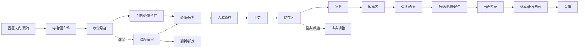

# 配送中心数字孪生 · 完整建设计划书

> **版本**：v3.9（浏览器 3D 控制台 + Pages 发布） · 2026-11-11  
> **审计对象**：`C:\Users\OYC\Desktop\blender\dc_project`（Blender 5.2 + Python 3.10+，区域仓 W + 前置仓 F1/F2/F3）  
> **文档定位**：从“现状审计”到“可落地实施”的一体化计划书；既给评审看结论，也给开发看字段、参数、任务与验收。  
> **配套工具**：`dc_project/desktop_app.pyw`（DC Twin Studio 桌面驾驶舱，本计划书第 11 章）  
> **GitHub 数据口径**：2026-11-09 / 2026-11-10 通过 GitHub REST API 实测。star 数会变化；许可证以仓库 `LICENSE` 为准，API 无 SPDX 字段的一律按“未核实”处理，不直接复制代码。  
> **v3.0 修订口径**：对代码与产物逐文件复核，修正 10 处与实现不符的表述（见 **§0.4 计划书自审核对表**），新增 **§21 单人最小路径**、**附录 D 复核命令集**、**附录 E 答辩问答**。  
> **v3.1 落地口径**：M0-01 已执行完毕——`report_status.py` 的硬编码表述与统计口径已修，`out/CURRENT_STATUS.md` 已重生成，并新增 **`scripts/check_doc_drift.py`** 防漂移守卫（自带 `--self-test`，可证明它会失败）。凡本文与 `runs/*/sim_kpi.json` 冲突，以产物为准；凡本文与 `CURRENT_STATUS.md` 冲突，先跑守卫脚本判定谁过期。  
> **v3.2 落地口径**：M1-01 已完成——`config/process_spec.json`（6 工位 / 11 流程节点 / 2 班次 / 4 类资源）落盘，配 `config/schemas/process_spec.schema.json`，并由 **`scripts/check_process.py`** 执行 **L14–L22** 九条规则（`--self-test` 11 个反例全部按预期失败）。系统已实跑一次：21 步、84.9 s、`validate 40/40`、`DRIFT_OK`，产物收进 **`artifacts/DC_20261110T131005Z_m1_process/`**（228 个文件、含 manifest 与 sha256）。过程层参数**尚未接入 tick 引擎**，本版只做“建模 + 校验 + 治理”，不含排队仿真。  
> **v3.3 落地口径**：M1-03 功能区已完成第一批——**18 个功能区**（W 12 + F1/F2/F3 各 2）写进 `layout_spec.json → warehouses[].areas[]`，由 **`scripts/spec_areas.py`** 展开为 `data/areas.json` 并执行 **L23–L26**（`--self-test` 8 个反例全按预期失败）。关键发现：**W 仓地面已接近铺满，12 个区里只有 3 个能拿到真实矩形**（其余 9 个为挂靠式逻辑区）。详见 **§23 功能区建模方案**。产物包：`artifacts/DC_20261110T132216Z_m1_areas/`（22 步 / 81 s / 40-40 PASS）。

> **v3.4 落地口径**：方案 A 已实现并可被用户驱动——`config/areas_catalog.json`（14 个模板）+ `config/areas_selection.json`（用户勾选）+ **`scripts/build_variant.py`**（生成扩仓变体并校验）→ `python run.py --scope scenarios --spec config/layout_spec_areas.json`。实测：W 深度 70→88 m，功能区物理化 3→**13**（704 m²），库位仍 441，A1–A40 **40/40**。连带修了三个坑：北侧园区车辆被埋、导航栅格全阻塞、A23 把 spec 写死。详见 **§24**。  
> **v3.5 落地口径**：驾驶舱新增第 3 页 **「功能区」勾选台**（`dc_studio/pages/areas.py`）——14 个模板按 6 组分类，点一行即勾选，实时显示已选数 / 占地 / W 需深度 / 合计产能，配 2D 俯视预览（既有货架区 + 北扩作业带 + 上限红线）。页面**不重写排布算法**，用 `importlib` 直接调 `build_variant.py` 的 `pack()`；为此新增守卫 **`scripts/check_studio.py`**（页面 ↔ 生成器 ↔ 变体 spec 三方一致，`--self-test` 3 反例全 FAIL）。变体校验产物移入 `out/variant/`，与主链产物分区。实测：22 步 / 74.4 s / 40-40 PASS / `DRIFT_OK` / `STUDIO_OK`，产物包 `artifacts/DC_20261110T135918Z_v35_area_picker/`。详见 **§24.8**。  
> **完整性结论（v3.5 核查）**：输入层、主链、验收、守卫、产物包五层闭合，40/40 + 12/12 + 7/7 负测试全 PASS；**未闭合项仅 5 处**（详见 §25）：排队仿真未接、3D 未跟变体、库存层缺失、`dist/` 副本过期、pytest 未装（其中前两项与副本已在 v3.7/v3.8 闭合，见下）。  
> **v3.6 落地口径（2 处已闭合）**：① **排队真的接进 tick 了**——`sim_engine` 把 `process_spec` 的包装/分拣工位 + `data/areas.json` 的 PICK_FACE 拣选池当作服务台，服务时长按 lognormal 采样、并行位有容量、满了进 FIFO 队列（新增 `WAITING` 状态与 3 个事件）；tick KPI 27 → **33**（新增工位服务/利用率/等待/队长）。② **驾驶舱界面整体重做**：圆角卡片、自绘胶囊按钮、侧栏选中块、功能区页两列布局 + 仓库俯视图。**§25 的 5 处缺口里，第 1 项已改判为"已接入"**，剩余 4 项（3D 未跟变体、库存层、dist 副本、pytest）不变。详见 **§26**。  
> **v3.7 落地口径**：① F1/F2/F3 各补一个 `PICK_FACE` 拣选面（21 个功能区 / 4 个拣选池），"
三仓取货从此也走服务台，不再用固定 dwell。② 补完这步后**暴露出一个一直存在的死锁缺陷**："
`advance()` 是纯反应式距离门控，窄巷道会互相顶死（F1-R02 ↔ F1-R03 卡了 2509 s），"
峰值场景因此只完成 13 单、丢 32 单。修法是三层递进——**退让**（挡住 8 s 后 id 大的一方后退）、"
**绕行**（20 s 后绕开停驶车，带 30 s 冷却）、**人工清障**（300 s 兜底，显式计数），"
修完峰值 **13 → 59 单、丢单 32 → 0**。③ 顺带修了"电量耗尽仍在行驶"——派单改为按行程电量核算，"
移动前对可用电量封顶；`validate_sim` 的 S2 能量守恒从残差 0.157 kWh 回到 0。"
④ tick KPI 33 → **39**（+退让/绕行/清障/最长受阻/累计受阻/电量守卫充电），新增守卫 "
`scripts/check_deadlock.py`（关闭退让必须更差）。详见 **§27**。  
> **v3.8 落地口径**：① **3D 终于跟上了功能区**——`build_dc.py` 读 `data/areas.json`，物理区画地面色块 + 深色边界 + 中文名称牌（3 块），逻辑区在挂靠点放 18 个标牌，不再画假矩形；中文字体自动探测 `msyh.ttc`，探测不到就退回纯 ASCII，不会出现方块字。② **许可证改为 Apache-2.0**（用户指定），新增 `NOTICE`，`A12` 同时核验"自身 Apache + 第三方 MIT"；`README` / `README.zh-CN` / `pyproject` 同步。③ 重出 6 张静帧、`dc_preview.glb`、`submission/data.js` 与 `dist/release`（`CURRENT_STATUS` 副本已与主本逐字节一致）。④ `validate 40/40` 回归。详见 **§28**。  
> **v3.9 落地口径**：驾驶舱里**终于能看 3D 了**——但不是新写渲染器，而是把仓库里本来就有的 `console/` 网页控制台接上：`python -m console.server` 打开 `?view=3d` 即可实时转视角、看 AGV 回放、点车看状态。根因是 `console/` 少了 `__init__.py`，`-m` 启动必然失败，而驾驶舱原来只 Popen 不检查，所以表现为"按钮点了没反应"。同一份前端由 **`scripts/build_webapp.py`** 冻结接口后发布到 GitHub Pages（`docs/app/`），新增守卫 **`scripts/check_webapp.py`**（4 项 + 3 反例）。详见 **§29**。
---

## 阅读指南

这份文档有三个读者，对应三条阅读路径。不必从头读到尾。

| 读者 | 关心什么 | 建议路径 | 预计时间 |
|---|---|---|---|
| 评审 / 答辩老师 | 项目到底做到了什么、还差什么、是否可信 | 执行摘要 → 第 0 章（含 §0.4 自审核对表）→ 第 1 章 → 第 8 章 → **附录 E 答辩问答** | 20 分钟 |
| 运营 / 业务方 | 能不能回答“一天发多少单、瓶颈在哪、加人还是加门” | 执行摘要 → 第 2 章 → 第 4 章 → 第 13 章 → 第 14 章 | 30 分钟 |
| 开发 / 接手同学 | 改哪个文件、加哪些字段、怎么验收 | 第 1.3 节 → 第 11 章 → 第 12 章 → 第 15 章 → 第 16 章 | 60 分钟 |

**文档结构**

| 部分 | 章节 | 内容 |
|---|---|---|
| 前置 | 阅读指南、执行摘要、目录 | 结论先行 |
| 第一部分 | 第 0–10 章 | 现状审计、DC 必备能力、GitHub 调研、缺口、参数、自定义、路线图、验收、风险、附录 |
| 第二部分 | 第 11–29 章 | v2.0 增补：桌面驾驶舱、字段级数据字典、参数总表、自定义矩阵、Backlog、测试计划、风险登记册、术语表、仓库速查、交付清单；v3.0 增补：单人最小路径；v3.2 增补：产物包与工作区约定；v3.3 增补：功能区建模方案；v3.4 增补：用户自选功能区（方案 A）；v3.5 增补：勾选式界面与完整性核查；v3.6 增补：过程层进 tick 与界面重做；v3.7 增补：三仓拣选与死锁修复；v3.8 增补：3D 功能区与许可；v3.9 增补：浏览器 3D 控制台 |
| 附录 | A–E | 配置片段、GitHub 检索复现、术语、**D 复核命令集**、**E 答辩问答** |

---

## 执行摘要

### 一句话判断

**这是一个运输层很强、过程层很薄、库存层几乎空缺的配送中心数字孪生（L3.5）。** 它已经能可信地回答“21 台 AGV 怎么走、会不会撞、电量够不够、一单成本多少”，但还不能回答“收货月台会不会堵、打包工位够不够、拣货员要几个人、库存周转几天、峰值 2 万单能不能发出去”。

### 十条结论

1. **工程底座扎实**：4 仓、196 货架、441 库位、38 扇门、21 台 AGV、8 向 A*、9 态 FSM、tick 级车间距门控（`advance()` 反应式让行）、8 个真实执行的场景、40 项独立验收、事件溯源账本与损益表。放在课程/竞赛语境里，完成度属于上游。
2. **“运输层”不是短板**：路径、避障、预约、电量、充电、故障、改派、KPI、P&L 都有实测数据，且可复现（固定种子 + 产物文件 + 校验脚本）。
3. **真正的短板是“过程层”**：`PACKING` / `SORTING` 只是订单落点，没有服务时间、并行工位数、人员、缓冲区；`conveyor` 只是几何障碍物；月台门只是元数据，不参与排队与碰撞。
4. **“库存层”基本空缺**：`cargo_state.json` 是订单级货物状态，不是 SKU 级库存；没有批次、效期、货主、安全库存、补货点、库龄、周转率。
5. **资源模型不完整**：没有人员、叉车、拖车、托盘、周转箱、月台门、 dock 车位、电池间、维修位等共享资源，因此无法做“资源—容量—队列”的瓶颈分析。
6. **文档口径存在冲突，根因已定位到代码（并已修）**：`CURRENT_STATUS.md` 的“场景解析 / 离线回放 / 未实现 tick 预约”三句，来自 `scripts/report_status.py` L177–L185 的**硬编码字符串**；“10 个场景”则是**数 `runs/` 目录**造成的（`custom/`、`logs/` 被当成场景）。至于 KPI 的 25 与 27——**不是同一套指标的两个数字**：解析层 `kpi.json`（`kpi.py`，M/M/c 近似）25 项，tick 层 `sim_kpi.json`（`sim_engine.py`）27 项，去重 44 项（详见 §0.4 第 2 条）。
7. **GitHub 没有可直接嵌入的“完整 DC 孪生”**：可复用件分四类——tick 仿真骨架（WareTwin）、MAPF/调度（RHCR、LaCAM3、Continuous-CBS、openTCS）、WMS/WES 领域模型（ModernWMS、open-wes、OpenBoxes）、布局/货位/算法（warehouse_layout_editor、ezdxf、picking-route）。正确姿势是“借模型与算法，不整体嵌入”。
8. **新增区域必须挂在流程骨架上**：先补“收货 → 验收 → 上架 → 储存 → 拣选 → 补货 → 分拣 → 包装 → 出库 → 退货”的流程，再让 `RCV-01`、`QA-01`、`STG-IN-01`、`FWD-01`、`STG-OUT-01`、`RET-01`、`EMP-01`、`BATT-01` 等区域挂上去；否则只是把静态模型做大。
9. **投入产出比最高的第一批改造**：统一状态口径 → 领域模型文档 → 收紧布局 Schema → 新增 `process_spec.json` / `inventory_spec.json` → 工位容量与服务时间 → 月台门排队 → 人员班次 → 库存与补货 → KPI 扩展。预计 6–8 周可到 L4 的可演示状态。
10. **配套桌面应用已落地**：`DC Twin Studio` 提供总览、2D 布局沙盘（图层 + AGV 回放）、场景实验室、KPI 词典、计划书阅读器、工具箱六个工作台，纯本地只读，避免“到处找文件、打开一堆脚本”的演示摩擦。

### 关键数字（当前产物实测）

| 指标 | 数值 | 来源 |
|---|---|---|
| 仓库 / 货架 / 库位 | 4 / 196 / 441 | `data/layout.json` → `summary` |
| 月台区 / 月台门 | 10 / 38 | `layout.json` |
| AGV / 充电位 | 21 / 12 | `layout.json` |
| 场景数 / 实测 KPI | 8 / 27 | `out/sim_index.json`、`runs/*/sim_kpi.json` |
| 基线完成订单 / 吞吐 | 25 单 / 25 单每小时 | `out/sim_index.json` |
| 峰值场景吞吐 | 58 单每小时 | `scenario=peak` |
| 最小车距 / 阈值 | 1.5358 m / 1.4592 m | `out/traffic_report.json` |
| 验收 | 40 / 40 PASS | `out/validate_report.json` |
| 路径回放 | 5,421 帧 / 117.6 s / 21 台 | `data/paths.jsonl` |
| Blender 产物 | `.blend` 660 KB、GLB 583 KB、10 张 1920×1080 渲染 | `out/artifact_report.json` |

### 三个需要尽早拍板的决策

| # | 决策 | 选项 | 建议 | 影响 |
|---|---|---|---|---|
| D1 | 本期目标成熟度 | L4 全流程 / L3.8 只补工位与月台 | **L4 的“可演示子集”**：收货—上架—拣选—包装—出库 + 库存 | 决定 6 周还是 12 周 |
| D2 | 过程层建模粒度 | 解析式（公式产能）/ 离散事件（队列与班次） | **离散事件，解析式只做对照** | 决定是否改 `sim_engine.py` 主循环 |
| D3 | 是否引入真实数据 | 继续合成 / 接 CSV / 接 WMS API | **先 CSV（已有适配器），WMS 只做只读试点** | 决定合规与演示风险 |

---

## 目录

**第一部分 · 现状、缺口与扩展蓝图**

- 0. 一页结论
- 1. 项目现状审计
- 2. 配送中心应该具备什么
- 3. GitHub 调研
- 4. 本项目要补什么
- 5. 可调参数清单
- 6. 用户自定义清单
- 7. 路线图
- 8. 验收标准与测试
- 9. 风险与合规
- 10. 附录（配置片段、GitHub 明细、参考）

**第二部分 · 深化设计（v2.0 新增）**

- 11. 桌面驾驶舱 DC Twin Studio
- 12. 领域模型与字段级数据字典
- 13. 参数总表（可调项）
- 14. 用户自定义能力矩阵
- 15. 实施 Backlog 与两周冲刺
- 16. 验收与测试计划（A41–A60）
- 17. 风险登记册
- 18. 术语表（中英对照）
- 19. 参考仓库速查
- 20. 交付清单与下一步
- 21. 单人最小路径（40 小时版，v3.0 新增）
- 22. 产物包与工作区约定（v3.2 新增）
- 23. 功能区建模方案（v3.3 新增）
- 24. 用户自选功能区（v3.4 新增）
- 25. 项目完整性核查（v3.5 新增）
- 26. 过程层进 tick：工位排队与界面重做（v3.6 新增）
- 27. 三仓拣选进 tick 与交通死锁修复（v3.7 新增）
- 28. 3D 功能区落地与开源许可（v3.8 新增）
- 29. 浏览器 3D 控制台与 Pages 发布（v3.9 新增）

**附录**

- A. 配置片段
- B. GitHub 检索复现
- C. 术语
- D. 复核命令集（v3.0 新增）
- E. 答辩问答 20 问（v3.0 新增）

---

# 第一部分 · 现状、缺口与扩展蓝图

## 0. 一页结论

### 0.1 五条判断

1. **这已经是一个“运输层”很强的数字孪生**：4 仓、196 货架、441 库位、38 扇门、21 台 AGV、闭环 A*、9 态 FSM、电量/充电/故障/改派、tick 级车间距门控与到达互斥、8 个场景、40 项验收、**27 项 tick 实测 KPI**（另有解析层 25 项近似指标，两套去重 44 项）、事件溯源账本与损益表，工程完整度明显高于常见“3D 仓库展示项目”。
2. **但它离“配送中心”还差一个中间层——过程层**：当前订单本质上是“从货架搬到月台/打包台”的搬运任务；收货、验收、上架、补货、拆零、分拣、包装、装车、退货等环节没有容量、工时、队列和资源约束。`PACKING` / `SORTING` 目前是落点，不是有产能的工位；`conveyor` 目前是几何障碍物，不是运输资源；月台门只做元数据，不参与碰撞与排队。
3. **当前最大瓶颈不是模型不够漂亮，而是“资源—容量—队列”不完整**：没有人工、叉车、月台门、拖车、输送线、分拣机、周转箱、托盘、电池间、维修位等共享资源。没有这些，仿真只能回答“车怎么走”，不能回答“这个仓一天能不能发出去 2 万单、瓶颈在哪、加人还是加门”。
4. **下一步不应先堆更多 3D 区域，而应先补“收货 → 上架 → 储存 → 拣选 → 补货 → 分拣 → 包装 → 出库 → 退货”的流程骨架**，再让新区域挂在流程骨架上。否则只是把静态模型做大，运营问题仍然答不了。
5. **GitHub 上没有可以直接拿来当“完整配送中心孪生”的成熟开源项目**。可复用件集中在四类：tick 仿真骨架（WareTwin）、MAPF/调度（RHCR、LaCAM3、Continuous-CBS、openTCS）、WMS/WES 领域模型（ModernWMS、open-wes、OpenBoxes）、布局/货位/订单批次算法（warehouse_layout_editor、ezdxf、picking-route、batching-benchmarks）。正确用法是“借领域模型与算法，不整体嵌入”。

### 0.2 目标成熟度

| 等级 | 定义 | 当前 | 说明 |
|---|---|---|---|
| L1 几何可视化 | 能看见仓、货架、月台、车辆 | ✅ 已达到 | Blender 5.2 程序化场景 + GLB + 10 张渲染 + 网页 3D |
| L2 单车路径 | 单车 A*、时间线、避障 | ✅ 已达到 | 8 向 A*、0.5 m 栅格、AGV 半径膨胀、闭环三段路径 |
| L3 多车调度 | 多车派单、预约、故障、电量 | ✅ 基本达到 | 21–50 车 tick DES、L1 预约、充电、故障改派 |
| L4 流程级运营孪生 | 收货到发货全流程 + 资源容量 + 库存 + 成本 | ◐ 部分达到 | 有运输与账本，缺过程链、库存、人/叉车/门/输送线 |
| L5 实时闭环/自适应 | 接真实 WMS/设备、在线优化、预测 | ○ 未达到 | 适配器为只读框架，未接生产系统；无在线优化 |

**目标**：从 L3.5 升到 L4；L5 作为企业试点阶段，不纳入本期承诺。

### 0.3 十个立即动作

| # | 动作 | 产出 | 为什么现在做 |
|---|---|---|---|
| 1 | 统一“当前状态”口径 | 改 `report_status.py` 的 3 条硬编码边界表述 → 重生成 `out/CURRENT_STATUS.md` | 现在文档之间互相矛盾，会让评审和后续开发失去单一真相源 |
| 2 | 写领域模型文档 | `docs/DOMAIN_MODEL.md`：区域、流程、资源、库存、订单、KPI 六类实体 | 先统一语言，再改代码，避免“加一个区域改一次 Python” |
| 3 | 收紧布局 Schema | `config/schemas/layout_spec.schema.json` 覆盖 zones / docks / stations / conveyors / chargers | 当前 Schema 只强校验少量必填字段，新增区域容易静默写错 |
| 4 | 新增过程配置 | `config/process_spec.json`：工位产能、服务时间、缓冲区、班次 | 没有过程参数，仿真无法产生排队与瓶颈 |
| 5 | 新增库存配置 | `config/inventory_spec.json`：SKU、批次、效期、货主、安全库存、补货策略 | 当前 `cargo_state.json` 只是订单级货物状态，不是库存 |
| 6 | 增加首批区域 | `RCV-01`、`QA-01`、`STG-IN-01`、`FWD-01`、`STG-OUT-01`、`RET-01`、`EMP-01`、`BATT-01` | 这 8 个区域能串起最小完整流程链 |
| 7 | 仿真接过程图 | `scripts/sim_engine.py` 从“点到点搬运”升级为“流程节点 + 资源队列” | 这是从 L3 到 L4 的核心一步 |
| 8 | 扩展 KPI | dock-to-stock、订单周期、拣选效率、完美订单、月台利用率、单均成本等 | 没有过程 KPI，就无法判断新增区域是否有效 |
| 9 | 补编辑器 | 区域调色板、工位/充电桩/输送线、多边形仓库、导入导出、保存到 spec | 当前 2D 编辑器只能加 zone/rack/door/home，且只导出草稿 |
| 10 | 新验收 + 负测试 | P1/P2/P3 系列，含库存守恒、容量、队列、负测试 | 延续项目“验证器必须能失败”的文化 |

### 0.4 计划书自审核对表（v3.0 新增，最重要的一节）

> 做法：不引用任何二手文档，直接把**代码行号**与**产物字段**当证据。每一条都能用附录 D 的命令复现。
> 判定只有三种：**成立**（保留）、**过度表述**（改小）、**错误**（改正）。

| # | 原表述（v1.0/v2.0） | 实测证据 | 判定 | v3.0 处理 |
|---|---|---|---|---|
| 1 | “L1 时空预约”：摘要把交通层写成预约机制 | `sim_engine.py` L245–L273 `advance()` 只做一件事：算候选点，若与他车**已更新位置**距离 < `min_sep` 就本 tick 不动（`WAIT_CONFLICT`）。`self.reserved = {}`（L305）**全文仅此一处，从未读写**——预约表是预留字段 | **过度表述** | 全文改为“tick 级车间距门控 + 到达互斥（反应式让行）”，并在 §1.5 明写“无预约表”，避免评审抓“时空预约”四个字 |
| 2 | “KPI 25/27 不一致” | **两套 KPI 并存，不是同一个数字的两种算法**：解析层 `runs/*/*/kpi.json`（`kpi.py`，M/M/c 近似）= **25** 项，含 tick 层没有的 `station_utilization` / `dock_utilization` / `max_dock_queue`；tick 层 `sim_kpi.json`（`sim_engine.py`）= **27** 项（其中 `sim_duration_s`/`wall_clock_s` 是运行诊断）。去重 **44** 项。旧文档的“25”是解析层，“27”是 tick 层，而 `report_status.py` 只读了前者 | **口径错位**（不是谁算错） | 全文改为“分层报数”；状态文档同时列出两套 + 去重数；`check_doc_drift.py` 比对，单写一个数字即 FAIL |
| 3 | “`CURRENT_STATUS` 陈旧，需重新生成” | **双重根因**：① 三句过时表述（L177/L183/L185）是 `report_status.py` 里的硬编码字符串，重跑只会原样再写；② “10 个场景”是**数 `runs/` 子目录**造成的——`runs/` 里还有 `custom/` 与 `logs/`，8 个场景被数成 10 个 | **诊断错误** | M0-01 拆 1a 改字符串 / 1b 重生成；场景数改数 `config/scenarios/*.json`；**✅ 已执行，见本节末尾「执行记录」** |
| 4 | §12.6 的“L1–L12 规则表”+“新增 L13–L16” | 代码实际编号：L1 schema、L2 footprint、L3 实体重叠、L4 AP 在实体内部、L5 AP 贴近实体、L6 AP 不可达、L7 待命位、L8 通道宽、L9 层高、L10 门宽/门距、L11 AP 互斥、L12 尺寸/层数、**L13 车队数 ≤ 待命带容量** | **错误**（编号全错位，且 L13 已被占用） | 重写 §12.6 为“代码现状 L1–L13 + 新增 L14–L19”，新规则一律从 L14 起编号 |
| 5 | “8 个场景” / `CURRENT_STATUS` 写“10 个场景 × 115 次运行” | `config/scenarios/` 实际 8 个 `.json`（`baseline` 也是场景）；`runs/` 实测 **111** 次（baseline 20、custom 1、dock_blocked/holiday/f4/night/peak/robot_failure 各 13、scale_50 12） | **快照过期** | 统一为“8 个冻结场景 / 111 次运行快照（2026-11-10 实测）”，并在附录 D 给出计数命令 |
| 6 | §1.2 只列 “PACK-01/02、SORT-01” | `data/layout.json → summary.stations = 6`：W 有 `W-PACK-01/02`、`W-SORT-01`，F1/F2/F3 各有 `*-PACK-01` | **漏项** | §1.2 补全 6 站清单，并指出前置仓也有包装台（影响“包装产能只算 W”的直觉） |
| 7 | “月台门只做元数据，不参与排队” | 成立，但**封门改派已实现**：`sim_engine.py` L657–L670 发 `DOCK_BLOCKED/DOCK_REOPENED`，L412–L426 `_replan_blocked_docks()` 把交付点改到未封的门 | **需分层表述** | §1.2 状态从 ◐ 细化为“封门/改派 ✅；门占用、门外排队、装卸工时 ○”，避免把已有能力说没了 |
| 8 | “`docs/DC_MASTER_PLAN.md` 是仓库副本” | 修订前两份**逐字节一致**（各 82,829 字符）——任何单边修改都会立刻漂移 | **副本即风险** | 明确“桌面版为母本”，同步改为脚本执行（附录 D-7 附命令），并写进 §20.1 |
| 9 | `CURRENT_STATUS` 写“4 份 schema” | `config/schemas/` 实有 **6 份**：cost / demand / fleet / layout / scenario / sim | **错误** | §1.3 更正为 6 份 |
| 10 | P0-09 判断“Schema 太松” | `layout_spec.schema.json` 顶层 `required` 仅 4 项、**无 `additionalProperties`**、`warehouses` 元素内部无逐字段约束 | **成立** | 保留 P0-09，并补上“required 仅 4 项”这一可量化证据 |

**三个数字的唯一来源（以后只认这三条）**

| 数字 | 唯一来源 | 取值 | 校验命令 |
|---|---|---|---|
| KPI 数（tick 层） | `runs/<scenario>/<run_id>/sim_kpi.json → metrics` | **27** | 附录 D-2 |
| KPI 数（解析层） | `runs/<scenario>/<run_id>/kpi.json → metrics` | **25**（去重合计 44） | 附录 D-12 |
| 冻结场景数 | `config/scenarios/*.json`（不含 `custom/`） | 8 | 附录 D-3 |
| 运行次数 | `runs/*/<run_id>/` 目录数（排除 `logs/`） | 111（快照） | 附录 D-4 |

> 这节的意义不在于“抓自己的错”，而在于：**评审最可能追问的正是这些点**。把“过度表述”提前改成“精确表述”，比被问住后再解释便宜得多。

#### 执行记录（2026-11-10 21:00，M0-01 已闭环）

| 动作 | 改动 | 验证 |
|---|---|---|
| M0-01a | `scripts/report_status.py`：删掉 3 条硬编码边界表述，改写为 12 条与引擎一致的声明；场景数改数 `config/scenarios/*.json`；schema 数、验收区间、KPI 数一律现算；新增 `## 口径纪律` 四小节 | 生成文本中已无“离线回放 / 解析 what-if / 未实现 tick / 4 份 schema / L1–L12” |
| M0-01b | 重生成 `out/CURRENT_STATUS.md`（26 行指标） | 场景 8 / 运行 111 / schema 6 / 解析 25 + tick 27（去重 44）/ L1–L13 |
| 新增守卫 | `scripts/check_doc_drift.py`：现算产物数字 → 比对状态文档 → 黑名单扫描 → 母本与副本 hash 比对 | `DRIFT_OK`；`--self-test` 4 个反例全部按预期失败 |
| M0-02 | `config/sim_spec.json`：`seed` 42 → 20261106，新增 `meta.seed_note` 说明单一源 | 三处种子一致；8 场景均自带 seed（fallback 未生效）→ 旧产物无需重跑 |
| 入口与 CI | 驾驶舱「工具箱」加“文档防漂移”按钮；`ci.yml` 在 `report_status` 后插入守卫步骤（先 `--self-test` 再正式校验） | 按钮 <1 s 返回；CI 步骤顺序：生成 → 自检 → 校验 |
| 回归 | `python scripts/validate.py`、`python scripts/validate_data.py` | **40/40 PASS**、**12/12 PASS**（种子改动后重跑） |

#### 执行记录（2026-11-10 21:15，M1-01 已闭环）

| 动作 | 改动 | 验证 |
|---|---|---|
| M1-01a | `config/process_spec.json`：6 工位（2 PACK×2 位、1 SORT、3 前置仓 PACK）、11 流程节点、2 班次、4 类资源、7 条 process_steps | `PROCESS_PASS stations=6 nodes=11 issues=0` |
| M1-01b | `config/schemas/process_spec.schema.json`：`additionalProperties:false`，dist/mean/cv/capacity 全部带范围 | 结构错字段直接拦（与语义校验互补） |
| M1-01c | `scripts/check_process.py`：L14 产能、L15 服务时间、L16/L17 库存（缺失记 SKIP）、L18 流程连通/无环、L19 资源、L20 与布局一致、L21 班次、L22 数值 | `--self-test` **11 个反例全按预期失败**，基线无 FAIL |
| 接线 | `runner.ACCEPT_CHAIN` 插入 `check_process`（在 `report_status` 前）与 `check_doc_drift`（在 `report_status` 后）；`ci.yml` 增两步 | 顺序保证“先生成、再比对” |
| 产物包 | 新增 `scripts/run_bundle.py` + `artifacts/`（`.gitignore`）+ `docs/ARTIFACTS.md`；一次运行 = 一个带 sha256 的包 | 实跑 `BUNDLE_OK`：21 步 / 84.9 s / out 87 / 新 run 16 / 228 文件 |
| 实跑回归 | `python run.py --scope scenarios`（由产物包驱动） | pipeline exit 0；`validate 40/40`；`DRIFT_OK`；`PROCESS_PASS` |

#### 执行记录（2026-11-10 21:25，M1-03 已闭环）

| 动作 | 改动 | 验证 |
|---|---|---|
| M1-03a | `layout_spec.json` 四个仓共 **18 个 `areas`**（W 12 + F1/F2/F3 各 2），带 kind/capacity/process/constraints，物理区另给 rect + access_point | `spec_layout.py` 仍 0 issues、441 库位不变（功能区不动几何） |
| M1-03b | `scripts/spec_areas.py`：展开为 `data/areas.json`，执行 **L23** 几何（仓内/≥2 m/不压实/AP 可走）、**L24** 容量、**L25** 命名、**L26** 绑定 | `AREAS_PASS total=18 physical=3 logical=15`；`--self-test` 8 反例全失败 |
| M1-03c | `process_spec.json` 6 个节点加 `area` 绑定；`process_spec.schema.json` 允许 `area` 字段 | `check_process` 与 `spec_areas` 双向一致，悬空引用被 L26 拦 |
| 接线 | `runner.DATA_CHAIN` 在 `nav_grid` 后插入 `spec_areas`；`ACCEPT_CHAIN` 再核一次；`ci.yml` 加 self-test + 正式校验 | 流水线 22 步全绿 |
| 可见性 | `report_status.py` 新增「功能区」「过程配置」两行，并在边界声明里写明“未进引擎、未进 3D” | 状态文档 28 行；`DRIFT_OK` |
| 实跑 | `run_bundle.py --scope scenarios --label m1_areas` | `BUNDLE_OK`：22 步 / 81 s / out 89 / 新 run 16 / 230 文件；`validate 40/40` |

#### 执行记录（2026-11-10 21:45，M1-05 方案 A 已闭环）

| 动作 | 改动 | 验证 |
|---|---|---|
| 模板库 | `config/areas_catalog.json`：14 个模板（含 VAS/MNT），带 size/capacity/process/parallel_slots/priority | `build_variant.py --list` 输出 14 行 + 3 预设 |
| 生成器 | `scripts/build_variant.py`：读 catalog+selection → 货架式排布 → 写 `layout_spec_areas.json`；北侧净距 2 m 硬保护（超限直接 VARIANT_FAIL 并给三条出路） | `VARIANT_PASS racks=196 locations=441`；功能区 L23–L26 PASS |
| 场景连带 | 扩仓吞掉北侧道路/停车位 → 变体把园区挪到东侧 x100–112，写 `data/scene_variant.json`；新增 `scripts/scene_config.py` 统一入口，`geometry/nav_grid/plan_paths/build_dc` 四处改读它 | 基础版栅格 blocked 仍 19360（零回归）；变体作业带不再被判阻塞 |
| 流水线 | `run.py --spec`、`DC_LAYOUT_SPEC`（gen_data/spec_areas）、`DC_SCENE_CONFIG`、`run_bundle --spec` | `run.py --scope scenarios --spec ...`：22 步 / 78 s |
| 验收修正 | `validate.py`：布局来源改为跟随 `spec_layout_report.json` 记录的 spec；A24 自动纳入 `layout_spec_areas` | 变体上 `A23 PASS`、A24 覆盖 4 个 spec、`40/40` |
| 实跑 | `run_bundle --spec config/layout_spec_areas.json --label variant_A` | `BUNDLE_OK`：out 95 / 新 run 16 / 236 文件；13 个物理区 704 m² |
| 回主链 | 不带 `--spec` 再跑一遍 22 步 | 40/40、`DRIFT_OK`、W 深度回到 70 |

> 注意：`report_status.py` 里原本报“25 个 KPI”不是笔误，是**读了解析层**；这类“代码正确、口径错误”的问题，只有把两套指标都摆出来才能根治。

---

## 1. 项目现状审计

### 1.1 它已经是什么

| 能力 | 当前实现 | 证据 |
|---|---|---|
| 布局参数化 | `config/layout_spec.json` 是唯一输入，支持 zones、racks、docks、stations、chargers、spawns、pillars、conveyors | `spec_layout.py` L1–L13 校验后展开 `data/layout.json` |
| 多仓 | W 区域仓 + F1/F2/F3 前置仓，矩形单层 | `layout_spec.json → warehouses[]` |
| 货架/库位 | 196 货架、441 库位（含 392 SHELF、21 HOME 等） | `out/CURRENT_STATUS.md` |
| 月台 | 10 个月台区、38 扇门，分 INBOUND / OUTBOUND | `layout_spec.json → docks` |
| 工位 | PACKING ×5、SORTING ×1，带 AP 与矩形 | `layout_spec.json → stations` |
| 充电 | 12 个充电位，3 kW，参与仿真充电 | `layout_spec.json → chargers`；`sim_engine.py` 电池模型 |
| 车队 | 21 台 AGV，单车 1.12×0.77×0.435 m，1.5 m/s，1.6 kWh | `fleet_spec.json`、`layout_spec.json → defaults.agv` |
| 路径 | 8 向 A*、禁止切角、0.5 m 栅格、AGV 半径膨胀、闭环三段 | `plan_paths.py`、`geometry.py` |
| 交通 | tick 级车间距门控（候选点 < `MIN_SEP=1.4592 m` 则本 tick 让行）+ 0.05 s 采样独立复核；**无预约表**（`self.reserved` 仅声明未用） | `sim_engine.py` L245–L273、`reservation_check.py`、`traffic_check.py` |
| 仿真 | tick DES、9 态 FSM、持续订单流、nearest-first 派单、电量/充电/故障/改派 | `sim_engine.py`、`docs/COMPLETION_STATUS.md` §1 |
| 场景 | 8 个冻结场景 + 用户自定义场景，可断言、可试算、可保存、可运行 | `config/scenarios/`、`scenario_tools.py`、控制台“场景”面板 |
| 账本/损益 | 事件 → 分录 → P&L、单均成本、盈亏平衡、敏感性 | `ledger.py`、`pnl_report.py`、`config/cost_spec.json` |
| 3D/表现 | Blender `.blend`、GLB、MP4、10 张渲染、2D/3D 控制台、零后端静态作品页 | `out/`、`console/`、`submission/` |
| 验收 | A1–A40、S1–S9、F1–F7、C 系列、17 个负测试 | `validate.py`、`validate_sim.py`、`validate_pnl.py`、`tests/` |

### 1.2 现有区域与资源清单

图例：✅ 有模型且参与仿真；◐ 有模型但只是落点/障碍物/装饰；○ 没有。

| 对象 | 当前实现 | 状态 | 说明 |
|---|---|---|---|
| 仓库 W / F1 / F2 / F3 | 矩形 footprint、单层 | ✅ | 不支持多边形、夹层、多楼层、电梯 |
| 存储区 A/B/C/D | W 仓 4 个矩形分区 | ✅ | 分区只用于布局与派单，不承载温区/危化/货主属性 |
| 前置仓 Z1 | F1/F2/F3 各 1 个分区 | ✅ | 只做存储与拣选落点 |
| 货架/库位 | 196 货架 / 441 库位 | ✅ | 支持排数、bay 数、层数、通道宽；不支持货架类型、承重、混存约束 |
| 月台区 | 10 个区，38 扇门，IN/OUT | ◐ | 门不参与地面碰撞；**封门/改派已实现**（`DOCK_BLOCKED`→`_replan_blocked_docks()`）；无门占用、预约、装卸工时 |
| 月台门 | door_width / door_height / door_pitch | ◐ | 可按 id 封门并触发改派；**不能**被单独占用、不能排队、不会故障 |
| 打包台（共 5 个：W-PACK-01/02、F1/F2/F3-PACK-01） | 矩形 + AP + location | ◐ | 可作为 PICK 单落点，但没有打包工时、并行位、工位容量、人员 |
| 分拣台（1 个：W-SORT-01） | 矩形 + AP + location | ◐ | 可作为 PICK 单落点，但没有滑道、合流、分拣产能 |
| 充电桩 | 12 个，line 模式 | ✅ | 仿真有充电，但没有排队、换电、电池间、消防隔离 |
| HOME/待命位 | 21 个显式点 | ✅ | 对齐 0.5 m 栅格，参与路径软代价 |
| 输送线 | CV-W01/02，几何线段 | ◐ | 目前是障碍物，不进入任务路径与运力模型 |
| 柱子 | corners 模式 | ✅ | 作为障碍物参与栅格 |
| 园区道路 | 3 条矩形道路 | ◐ | 几何装饰，不参与车辆/卡车调度 |
| 园区卡车 | 2 辆静态 | ◐ | 装饰，不参与月台预约与装卸 |
| 园区叉车 | 3 辆静态 | ◐ | 装饰，不参与收货/上架/装车 |
| 收货区 | 无 | ○ | 没有独立收货/卸货/暂存节点 |
| 验收/质检区 | 无 | ○ | 没有抽样、隔离、放行逻辑 |
| 退货区 | 无 | ○ | 没有逆向物流 |
| 增值服务区 | 无 | ○ | 没有贴标、组套、kitting、重新包装 |
| 空托盘/周转箱区 | 无 | ○ | 没有容器循环 |
| 电池间/换电站 | 无 | ○ | 只有充电位，没有电池安全与换电 |
| 维修/备件区 | 无 | ○ | 没有维修工位、备件、MTTR 资源 |
| 办公/员工/司机设施 | 无 | ○ | 没有人员与班次空间 |
| 消防/安防/弱电 | 无 | ○ | 没有消防分区、疏散、监控 |
| 冷链/危化/高价值/保税 | 无 | ○ | 没有温区、危险品、安防、海关属性 |

### 1.3 现有可配置项

| 配置文件 | 可配置内容 | 现状评价 |
|---|---|---|
| `config/layout_spec.json` | 站点尺寸、种子、AGV 尺寸/速度/电量、托盘、货架、通道、AP、月台、分区、货架排、工位、充电桩、待命位、柱子、输送线 | 几何覆盖较好；缺过程、库存、资源、温区、承重、货架类型 |
| `config/fleet_spec.json` | 车型、部署数量、速度、加速度、电量、充电、MTBF/MTTR、派单上限 | 已有字段，但主链仍偏“单车型、单任务/车” |
| `config/demand_spec.json` | 合成/CSV 来源、SKU 数、ABC、Zipf、立方/重量、订单/h、类型混合、数量分布、优先级、截止时间、波次、班次、CSV 映射 | 需求侧较完整；缺退货率、订单行、渠道、承运商、批次/效期 |
| `config/sim_spec.json` | tick、时长、种子、交通等级、重规划窗口、最大等待、预约半径、派单策略、队列上限、电量阈值、充电策略、故障、输出频率 | 引擎侧较完整；缺过程资源、班次、随机服务时间、多副本 |
| `config/cost_spec.json` | 收入单价、按行加价、SLA 罚金、丢单罚金、电价、耗材、人工、折旧、维护、租金、IT、分摊基准 | 账本侧较完整；缺叉车/设备/包装/退货/仓储面积细分 |
| `config/scenarios/*.json` | 布局/车队/需求引用、种子、时长、dt、fps、覆盖项、扰动、断言 | 8 个冻结 + 自定义，机制好 |
| `data/config.json` | 渲染尺寸、动画、相机、灯光、园区车辆/道路 | 只影响表现层 |
| `config/schemas/*.json` | 6 份 Schema：layout / fleet / demand / sim / cost / scenario | 覆盖了文件级契约，但 `layout_spec` 顶层 `required` 仅 4 项且无 `additionalProperties`，新增区域字段写错不会报错（见 P0-09） |
| 控制台“参数”面板 | seed、AGV 速度、角速度、取货停靠、最大调度等待、动画 fps/交通采样、渲染尺寸/采样 | **只有 14 个左右渲染/运动参数**，不能改布局/车队/需求/流程 |
| 控制台“场景”面板 | 新建/复制/校验/600 s 试算/保存/运行/删除 | 可用，但只覆盖场景层 |
| 控制台“运营”面板 | P&L、账本、成本参数 | 可用，但成本模型是演示价格 |
| 2D 布局编辑器 | 选择/移动、加分区/货架排/月台门/待命位、删除、撤销、实时校验、背景描图、导出草稿 | 只能编辑 4 类对象，现有货架只作参考不可编辑，不能保存回 `layout_spec.json` |
| CLI | `doctor / demo / run / validate / serve / export / compare` | 工程化较好 |

### 1.4 主要缺口（按层）

| 层 | 缺什么 | 直接后果 |
|---|---|---|
| 几何层 | 多边形 footprint、夹层、多楼层、电梯、AS/RS、AutoStore、温区、危化区、承重/净高 | 只能模拟规则矩形单层仓，真实厂房/CAD 很难直接落地 |
| 过程层 | 收货、验收、上架、补货、拣选、分拣、包装、装车、退货的节点、容量、工时、队列、缓冲区 | 只能回答“车怎么走”，不能回答“流程是否通、瓶颈在哪” |
| 资源层 | 人工、叉车、拖车、月台门、输送线、分拣机、托盘、周转箱、电池、维修位 | 没有共享资源竞争，排队与利用率失真 |
| 库存层 | SKU 库存、批次/效期、货主、安全库存、补货点、盘点、损溢 | `cargo_state.json` 只是订单级货物状态，不能做库存仿真 |
| 订单层 | 订单头/行、多行订单、多腿任务、波次、批次、渠道、承运商、退货单 | 一单一车、一单一腿，无法模拟真实波次与合单 |
| 决策层 | 拍卖/后悔值派单、订单批次、波次、动态货位、月台预约、人力排班 | 目前只有 nearest-first 与静态货位 |
| 交通层 | L2 WHCA*、L3 CBS、死锁检测、拥堵热力图、动态限速、电梯 | L1 预约可用，但大规模/复杂布局下缺升级路径 |
| 表现层 | 新区域 3D 几何、标签、热力图、KPI 下钻、告警、角色视图 | 新区域只在 2D/数据里，3D 不完整 |
| 数据层 | 严格 Schema、过程/库存/资源契约、主数据同步、事件版本迁移 | 新增字段容易静默错误，跨版本兼容性弱 |
| 文档层 | 状态口径不一致（KPI 25 与 27 分层混用）、解析/实测/回放表述混用 | 评审与后续开发容易误判现状 |

### 1.5 文档与口径问题（必须先修）

| 问题 | 证据 | 建议 |
|---|---|---|
| `CURRENT_STATUS` 仍写“场景层是解析 what-if”“运营层是离线回放”“未实现 tick 级预约” | `out/CURRENT_STATUS.md` 第 41–43 行；**根因**：`scripts/report_status.py` L177/L183/L185 硬编码这三句，与 `out/*.json` 无关 | 先改字符串再重生成（两步，缺一不可）；边界表述改为“反应式门控/无预约表/门可封不可占” |
| KPI 数量 25 / 27 不一致 | `README.md` 写 27 measured；`PARAMETER_GUIDE.md`、`CURRENT_STATUS.md` 写 25；`sim_kpi.json.metrics` 实测 27 key | **已裁决 27**：以产物 key 数为准；25 是旧快照（27 − 2 个运行时诊断项）；生成文档时自动计数 |
| 中英文 README 对“已知限制”的描述不同步 | `README.md` 的 “What it is / What it is not” 与 `README.zh-CN.md` §7 | 建立一份 `docs/KNOWN_LIMITS.md`，两边只引用 |
| 月台门“只做元数据，不参与地面碰撞”只在参数指南里写 | `PARAMETER_GUIDE.md` L1 | 在 README 的“已知限制”里明确，避免被误解为门可排队 |
| 2D 编辑器“导出草稿”不等于“保存布局” | `submission/editor.js` 导出 `DRAFT_ONLY` | UI 上明确“草稿 → 校验 → 保存并重跑”的三步，不允许静默覆盖 |
| 两份计划书逐字节相同但靠手工同步 | `docs/DC_MASTER_PLAN.md` 与桌面版各 82,829 字符，内容一致 | 桌面版为母本；同步改为脚本（附录 D-7），并在 CI 加“副本 hash 一致”检查 |
| `CURRENT_STATUS` 写“4 份 schema”，实为 6 份 | `config/schemas/` 实有 cost/demand/fleet/layout/scenario/sim | 生成脚本改为 `len(glob('config/schemas/*.json'))`，不写死数字 |

---

## 2. 配送中心应该具备什么

### 2.1 一条完整的作业链



配套的六条流：

| 流 | 内容 | 当前项目 |
|---|---|---|
| 实物流 | 托盘/箱/件、容器、退货、废弃物 | 只有订单级货物，随 AGV 移动 |
| 信息流 | 订单、任务、库存、事件、KPI | 有事件流、账本、KPI；缺主数据与库存台账 |
| 资金流 | 收入、成本、罚金、分摊、计费 | 有演示级 P&L；缺按客户/货主/面积/操作计费 |
| 逆向流 | 退货、维修、报废、容器回收 | 无 |
| 人流/车流 | 员工、叉车、卡车、AGV、行人 | 只有 AGV 动态；叉车/卡车是装饰 |
| 安全/能源流 | 消防、安防、充电、能耗、碳排 | 有电耗；缺消防分区、安防、碳排 |

### 2.2 必备区域清单

图例：✅ 已有并参与；◐ 有模型无逻辑；○ 缺。

#### A. 园区与月台

| 区域 | 作用 | 关键参数 | 现状 |
|---|---|---|---|
| 园区大门/门卫 | 车辆进出、预约核验、安检 | 车道数、门禁、预约窗口、平均放行时间 | ○ |
| 地磅 | 收货/发货称重、超载检查 | 量程、精度、称重时间、缓冲车位 | ○ |
| 待泊/回车场 | 卡车排队、倒车、临时停放 | 车位、回转半径、排队策略、等待区 | ◐ 有道路/卡车装饰 |
| 收货月台 | 卸货、暂存、交接 | 门数、门宽/高、月台高、装卸工时、门占用 | ◐ 有月台/门元数据 |
| 发货月台 | 装车、复核、封车 | 门数、装车工时、月台门分配、发运波次 | ◐ 有月台/门元数据 |
| 月台雨棚/封闭月台 | 防雨、温控、安全 | 封闭方式、门封、照明 | ○ |
| 园区道路/人车分流 | 安全、通行效率 | 车道、限速、人行道、消防通道 | ◐ 有 3 条矩形道路 |
| 司机休息/卫生间/停车 | 司机等待、交接 | 车位、休息位、卫生间 | ○ |
| 园区充电/加油 | 卡车/叉车能源 | 充电桩、加油位、消防 | ○ |

#### B. 收货与入库

| 区域 | 作用 | 关键参数 | 现状 |
|---|---|---|---|
| 收货区 RCV | 卸货、点数、贴标、交接 | 卸货位、托盘位、卸货工时、收货门 | ○ |
| 验收/质检 QA | 抽样、外观/功能/温控检查、放行 | 抽样比例、检验工时、不合格率、隔离位 | ○ |
| 入库暂存 STG-IN | 等待上架的缓冲 | 托盘位、停留时间、FIFO/FEFO | ○ |
| 上架/储存 STOR | 上架策略、库位分配 | 上架工时、库位类型、承重、混存规则 | ◐ 有货架/库位，无上架过程 |
| 越库/交叉转运 XDOCK | 不入库直接换装 | 越库门、暂存位、车辆衔接窗口 | ○ |
| 退货 RET | 退货收货、检验、翻新、再上架/报废 | 退货率、检验工时、处置比例、隔离位 | ○ |

#### C. 储存

| 区域 | 作用 | 关键参数 | 现状 |
|---|---|---|---|
| 常温存储 | 大多数 SKU | 货架类型、层数、承重、通道 | ✅ 有矩形分区/货架 |
| 恒温/冷藏/冷冻 | 食品、医药、生鲜 | 温区、前室、冷量、门帘、除霜 | ○ |
| 危化品库 | 危险品隔离、防爆、通风 | 危化等级、隔离距离、防爆、消防 | ○ |
| 高价值/保税库 | 安防、海关监管 | 双人双锁、监控、保税账册 | ○ |
| 不合格/隔离区 | 待处理、退货、召回 | 隔离位、状态、审批 | ○ |
| 空托盘/周转箱区 | 容器循环 | 托盘位、箱位、清洗、维修 | ○ |

#### D. 拣选与出库

| 区域 | 作用 | 关键参数 | 现状 |
|---|---|---|---|
| 拣选区 PICK | 摘果/播种/波次/分区拣选 | 拣选策略、拣选点、拣选工时、拣选车 | ◐ 有货架落点，无拣选策略 |
| 补货区 REP | 从储备区补到拣选面 | 补货点、min/max、补货工时、补货批量 | ○ |
| 分拣/合流 SORT | 按订单/线路/承运商分流 | 滑道数、分拣能力、合流规则、错分率 | ◐ 有 SORT 落点，无分拣机 |
| 包装/贴标 PACK | 装箱、封箱、贴标、称重 | 工位数、包装工时、包材、称重 | ◐ 有 PACK 落点，无工时/容量 |
| 增值服务 VAS | 组套、贴标、重新包装、质检 | 工位、工时、BOM、耗材 | ○ |
| 出库暂存 STG-OUT | 按线路/波次集货 | 车道数、停留时间、复核 | ○ |
| 装车/发运 | 装车、封车、交接 | 装车工时、门分配、车位、发运波次 | ◐ 有月台，无装车过程 |

#### E. 支持与安全

| 区域 | 作用 | 关键参数 | 现状 |
|---|---|---|---|
| 充电/电池间 | AGV/叉车充电、换电、电池安全 | 充电位、功率、换电、消防、温控 | ◐ 有充电位，无电池间 |
| 维修/备件 | 车辆/设备维修、备件 | 维修位、MTTR、备件库存、工具 | ○ |
| 消防/安防 | 喷淋、烟感、防火分区、监控 | 防火分区、疏散、监控、门禁 | ○ |
| 办公/会议/培训 | 管理、会议、培训 | 工位、会议室、培训室 | ○ |
| 员工设施 | 更衣、休息、餐厅、卫生间 | 人数、班次、面积 | ○ |
| 废弃物/打包 | 纸箱、缠绕膜、废料 | 压缩打包机、分类、清运 | ○ |
| IT/弱电 | 服务器、网络、WMS/WCS 接口 | 机房、网络、备份、UPS | ○ |
| 参观通道 | 参观、评审、安全隔离 | 玻璃隔断、路线、讲解点 | ○ |

#### F. 自动化与扩展

| 区域/能力 | 作用 | 关键参数 | 现状 |
|---|---|---|---|
| AS/RS 立体库 | 高密度、高吞吐存储 | 巷道、堆垛机、层高、出入库能力 | ○ |
| AutoStore / 货到人 G2P | 高密度小件、货到人拣选 | 机器人数量、料箱、站点、网格 | ○ |
| 输送线 | 跨区运输、合流、分流 | 节点/边、速度、积放、堵塞 | ◐ 有 2 条几何线段 |
| 分拣机 | 高速分拣 | 滑道、能力、错分率、包裹尺寸 | ○ |
| 机械臂 | 码垛/拆垛/拣选 | 节拍、抓取、视觉、安全 | ○ |
| 无人叉车/AMR | 托盘搬运、上架、装车 | 载重、举升、速度、任务 | ◐ 只有 AGV 与静态叉车 |
| 夹层/电梯/提升机 | 多层存储、垂直运输 | 层高、载重、节拍、消防 | ○ |

### 2.3 可附加能力（按价值/复杂度）

| 能力 | 业务价值 | 复杂度 | 适合本项目 | 建议 |
|---|---|---|---|---|
| 月台预约/园区调度 | 减少排队、提高门利用率 | 低 | 高 | **优先做**，数据模型简单，收益直观 |
| 退货/逆向物流 | 电商必备、减少损耗 | 中 | 高 | 与正向流程共用 QA/上架 |
| 增值服务 VAS | 增收、差异化 | 中 | 高 | 先做贴标/组套/重新包装 |
| 空托盘/周转箱循环 | 减少停线、容器可视化 | 低 | 高 | 与收货/拣选/装车一起做 |
| 冷链/温区 | 食品/医药市场 | 高 | 中 | 作为可选模块，先做温区约束与能耗 |
| 危化品 | 合规市场 | 高 | 低 | 只做隔离与合规检查，不做化工工艺 |
| 保税/海关 | 跨境/保税仓 | 高 | 低 | 作为标签与账册属性，不做海关申报 |
| 交叉转运/越库 | 快消、快递、零售补货 | 中 | 中 | 在月台两侧做 XDOCK 节点 |
| AS/RS | 高密度、高吞吐 | 高 | 中 | 先做能力/节拍抽象，不做机械细节 |
| AutoStore/G2P | 小件高密度 | 高 | 中 | 先做“货到人”任务模式，不做网格机器人 |
| 输送线/分拣机 | 跨区搬运、分拣 | 中高 | 高 | 先把 conveyor 变成图资源 |
| 机械臂/无人叉车 | 替代人工、托盘搬运 | 高 | 中 | 先做资源抽象与节拍，不做运动学 |
| 多楼层/夹层 | 土地紧张 | 高 | 中 | 先做楼层/电梯资源，不做建筑结构 |
| 能源/光伏/储能 | 降本、碳排 | 中 | 中 | 先做电价/碳排/充电调度 |
| 数字孪生实时同步 | 运营监控 | 高 | 中 | 先做只读 WMS/设备事件接入 |
| 3PL 多货主计费 | 第三方物流 | 中 | 中 | 在库存/成本模型加 owner 维度 |
| AI 视觉/质检 | 质检、盘点 | 高 | 低 | 作为外部服务接口，不内置模型 |

### 2.4 判断一个 DC 模型是否完整的 12 个问题

1. 能不能收货、卸货、点数、贴标？
2. 能不能验收、抽样、隔离不合格品？
3. 能不能上架、分配库位、记录库存？
4. 能不能盘点、调整损溢、追溯批次/效期？
5. 能不能补货、设置 min/max、避免缺货？
6. 能不能拆零、按单/按波次拣选？
7. 能不能分拣、合流、按线路集货？
8. 能不能包装、贴标、称重、增值服务？
9. 能不能分配月台门、装车、发运、回单？
10. 能不能处理退货、翻新、报废、容器回收？
11. 能不能算清人工、设备、面积、能耗、单均成本？
12. 能不能在故障/爆单/封门/缺人时给出可执行的应对？

> 当前项目对 1–3、6、9、11 只有部分能力；4、5、7、8、10、12 基本为空。

---

## 3. GitHub 调研

### 3.1 方法与口径

- 检索主题：warehouse digital twin、warehouse simulation、warehouse layout optimization、WMS open source、AS/RS、VDA5050、order batching、cross docking、goods to person、discrete event simulation、openTCS、yard management 等。
- 数据：GitHub REST API `/search/repositories` 与 `/repos/{owner}/{repo}`，按 star 排序取前 8–10；star、许可证、最近推送均为 2026-11-09/10 快照。
- 使用纪律：**代码衍生**（MIT/Apache/BSD，需登记）、**概念/架构参照**（GPL/AGPL/研究许可/无 SPDX，只读不抄）、**仅核查未采用**（技术栈或目标不符）。
- 与项目已有文档的关系：`docs/GITHUB_REFERENCE_AUDIT.md` 已记录 16 个仓库的源码级复核；本文在其基础上补充 2026-11-10 的新检索结果，并给出“用于哪个区域/功能”的映射。

### 3.2 仿真 / 数字孪生

| 项目 | ★ | 许可证 | 可借鉴内容 | 建议 |
|---|---:|---|---|---|
| [WayneChou-bot/WareTwin](https://github.com/WayneChou-bot/WareTwin) | 160 | MIT | tick 引擎、确定性 PRNG、9 态 FSM、电量/充电、故障注入、KPI 时间序列、事件环形缓冲 | **已在用**（结构衍生，见 `THIRD_PARTY_NOTICES.md`）；继续借“资源占用/充电桩/故障”模式 |
| [semitable/robotic-warehouse (RWARE)](https://github.com/semitable/robotic-warehouse) | 446 | MIT | 多机器人仓库网格环境、任务生成、拥堵/奖励基准 | 作为 **多车拥堵/调度基准**，不嵌入生产仿真 |
| [merschformann/RAWSim-O](https://github.com/merschformann/RAWSim-O) | 265 | GPL-3.0 | RMFS（Kiva 式）仿真：订单、机器人、货架、拣选站 | **仅概念**；GPL 隔离，不抄代码 |
| [AndreVale69/simulator-automatic-warehouse](https://github.com/AndreVale69/simulator-automatic-warehouse) | 9 | MIT | Python + Dash 自动仓数字孪生、可视化 | 参考轻量可视化/状态面板 |
| [ayush-kr-repo/ShelfSense](https://github.com/ayush-kr-repo/ShelfSense) | 6 | MIT | FastAPI + OR-Tools CP-SAT + YOLO + Three.js | 参考“优化 + 视觉 + 3D”组合；本项目不内置视觉模型 |
| [aws-samples/twinmaker-dynamicscenes-crossdock-demo](https://github.com/aws-samples/twinmaker-dynamicscenes-crossdock-demo) | 2 | MIT-0 | 越库场景的数字孪生、托盘追踪 | 参考 **越库/托盘事件模型** |
| [wh200720041/warehouse_simulation_toolkit](https://github.com/wh200720041/warehouse_simulation_toolkit) | 316 | BSD-3-Clause | ROS/Gazebo 仓储环境、SLAM/导航 | **不采纳**：物理级单车仿真，与多车运营目标不符 |
| [Unity-Technologies/Robotics-Warehouse](https://github.com/Unity-Technologies/Robotics-Warehouse) | 94 | Apache-2.0 | Unity 仓储机器人环境 | **不采纳**：引擎/技术栈不符 |

### 3.3 WMS / WES / WCS

| 项目 | ★ | 许可证 | 可借鉴内容 | 建议 |
|---|---:|---|---|---|
| [fjykTec/ModernWMS](https://github.com/fjykTec/ModernWMS) | 1807 | Apache-2.0 | 收货、上架、拣选、复核、盘点、库存、波次等 WMS 模块划分 | **领域清单**：用来检查本项目缺哪些单据/状态；不整体嵌入 |
| [jingsewu/open-wes](https://github.com/jingsewu/open-wes) | 335 | MIT | WES/WCS 编排、任务路由、设备调度、低代码扩展 | **架构参照**：过程层/资源层如何分层 |
| [openboxes/openboxes](https://github.com/openboxes/openboxes) | 923 | EPL-1.0 | 真实 WMS、库存移动、批次/有效期、REST API | **适配器目标**（只读）；需核对 EPL 边界 |
| [OCA/wms](https://github.com/OCA/wms) | 226 | AGPL-3.0 | Odoo 高级仓储：入库、出库、波次、库位 | **适配器目标**；AGPL 隔离，不抄代码 |
| [openTCS/opentcs](https://github.com/openTCS/opentcs) | 603 | 无 SPDX | 工业 AGV 调度：transport order → drive order、资源锁、路由/派单/调度分层 | **仅借架构**；GitHub API 无许可证字段，不引入代码 |
| [BarneyD66/open-warehouse-system](https://github.com/BarneyD66/open-warehouse-system) | 134 | MIT | 中文优先的 WMS starter：跨境、履约、库存、计费、退货、3PL | 参考 **3PL/计费/退货** 领域模型 |

### 3.4 MAPF / 调度 / VDA5050

| 项目 | ★ | 许可证 | 可借鉴内容 | 建议 |
|---|---:|---|---|---|
| [Jiaoyang-Li/RHCR](https://github.com/Jiaoyang-Li/RHCR) | 223 | NOASSERTION（USC 研究） | Rolling-Horizon Collision Resolution、lifelong MAPF、Kiva 式任务派发 | **仅概念**；许可证限制，不抄代码 |
| [Kei18/lacam3](https://github.com/Kei18/lacam3) | 139 | MIT | 大规模、近实时 MAPF | L3/L4 备选；需 C++ 工具链，默认不进主链 |
| [PathPlanning/Continuous-CBS](https://github.com/PathPlanning/Continuous-CBS) | 272 | MIT | 连续时间 CBS（move/wait 任意时长） | 二期替换“0.05 s 采样”的候选 |
| [open-rmf/mapf](https://github.com/open-rmf/mapf) | 82 | Apache-2.0 | ROS2 多智能体规划、交通协商 | 仅架构参考；引入 ROS2 成本高 |
| [GavinPHR/Multi-Agent-Path-Finding](https://github.com/GavinPHR/Multi-Agent-Path-Finding) | 448 | MIT | Python CBS + Space-Time A* | **experimental**：非自包含、依赖外部 `stastar`，不进默认链 |
| [VDA5050/VDA5050](https://github.com/VDA5050/VDA5050) | 538 | MIT | AGV 与主控的 order/state/visualization 协议 | **语义对齐目标**；不构成代码衍生 |
| [nvidia-isaac/isaac_mission_dispatch](https://github.com/nvidia-isaac/isaac_mission_dispatch) | 106 | Apache-2.0 | VDA5050 兼容的云端车队派单 | 参考任务/状态机/接口设计 |
| [NVIDIA-ISAAC-ROS/isaac_ros_cloud_control](https://github.com/NVIDIA-ISAAC-ROS/isaac_ros_cloud_control) | 80 | Apache-2.0 | VDA5050 mission controller | 参考协议适配层 |
| [bekirbostanci/vda5050_lif_editor](https://github.com/bekirbostanci/vda5050_lif_editor) | 62 | GPL-3.0 | LIF 布局交换格式编辑器 | **仅概念**；GPL 隔离，LIF 解析器自研 |
| [bekirbostanci/vda5050_vehicle_simulator](https://github.com/bekirbostanci/vda5050_vehicle_simulator) | 30 | 无 SPDX | VDA5050 车辆模拟器 | 许可证未核实；可作为未来协议测试思路 |

### 3.5 布局 / 货位 / 订单批次

| 项目 | ★ | 许可证 | 可借鉴内容 | 建议 |
|---|---:|---|---|---|
| [Stegocode/warehouse_layout_editor](https://github.com/Stegocode/warehouse_layout_editor) | 3 | MIT | 浏览器 2D/3D 布局编辑器、工具栏、双端同规则校验、背景描图、JSON 导入导出 | **交互参照**；代码自研 |
| [mozman/ezdxf](https://github.com/mozman/ezdxf) | 1524 | MIT | Python 读写 DXF（LWPOLYLINE/LINE/INSERT/图层） | **可选依赖**：真实 CAD 导入 |
| [gokhanozden/gabak](https://github.com/gokhanozden/gabak) | 9 | MIT | 货架布局优化、订单拣选对比 | 参考布局/拣选联合评估 |
| [samirsaci/picking-route](https://github.com/samirsaci/picking-route) | 156 | MIT | 订单批次 + 拣选路径优化 | **算法参照**：S 形/最大间隙/启发式 |
| [zalandoresearch/batching-benchmarks](https://github.com/zalandoresearch/batching-benchmarks) | 13 | MIT | 订单选择、分配、批次、拣选的联合基准 | 参考批次算法评测方法 |
| [samirsaci/pareto-warehouse-layout](https://github.com/samirsaci/pareto-warehouse-layout) | 23 | 无 SPDX | Pareto/ABC 货位分析 | **仅概念**；无许可证不抄代码 |

### 3.6 财务 / 账本

| 项目 | ★ | 许可证 | 可借鉴内容 | 建议 |
|---|---:|---|---|---|
| [frappe/erpnext](https://github.com/frappe/erpnext) | 41113 | GPL-3.0 | Stock Ledger Entry → GL Entry、永续库存、成本中心 | **仅概念**；GPL 隔离，账本自研 |
| [beancount/beancount](https://github.com/beancount/beancount) | 6155 | GPL-2.0 | 文本复式记账、账户树、借贷平衡 | **仅概念**；校验规则自研 |

### 3.7 采用 / 降级 / 不采用

| 决策 | 项目 | 理由 |
|---|---|---|
| **直接采用/已采用** | WareTwin（MIT，结构衍生） | tick 引擎骨架与故障/电量模式成熟，已登记 |
| **可选用依赖** | ezdxf（MIT） | DXF 导入，锁版本，主链保持可选 |
| **实验性** | MAPF-CBS、LaCAM3、Continuous-CBS | 算法强，但集成成本/依赖/性能需实测，默认不进主链 |
| **领域参照** | ModernWMS、open-wes、OpenBoxes、OCA/wms、openTCS | 借模块划分、状态机、适配器接口，不整体嵌入 |
| **仅概念** | RHCR、RAWSim-O、ERPNext、beancount、LIF editor | 许可证或技术栈限制，只读不抄 |
| **不采用** | ROS/Gazebo、Unity、物理级单车仿真 | 目标是运营级多车 DES，不是机器人物理仿真 |
| **未来适配** | VDA5050、isaac_mission_dispatch、isaac_ros_cloud_control | 真车/车队系统对接时再用 |

### 3.8 许可证红线

- **GPL-3.0**：RAWSim-O、vda5050_lif_editor、ERPNext。只可概念参照，不复制代码；如必须集成，走独立进程/独立仓库边界并做法务确认。
- **AGPL-3.0**：OCA/wms。网络服务使用也会触发开源义务，适配器只做只读 HTTP 客户端，不修改/分发其代码。
- **EPL-1.0**：OpenBoxes。作为外部系统对接，不静态链接。
- **无 SPDX**：openTCS、pareto-warehouse-layout、vda5050_vehicle_simulator 等。一律按“未核实”处理，不抄代码。
- **MIT/Apache/BSD**：WareTwin、RWARE、ModernWMS、open-wes、ezdxf、picking-route、batching-benchmarks、VDA5050 等，可作为代码/依赖候选，但必须更新 `THIRD_PARTY_NOTICES.md` 并保留版权声明。

---

## 4. 本项目要完善什么

### 4.1 P0：先补过程层（最重要）

| 编号 | 问题 | 现状 | 目标 | 验收 |
|---|---|---|---|---|
| P0-01 | 没有流程节点 | 只有货架→月台/工位的搬运 | 建立 `AREA/PROCESS` 图：收货→QA→暂存→上架→储存→补货→拣选→分拣→包装→出库→装车→退货 | 每个节点有容量、工时、缓冲、资源、AP；校验器能拒绝悬空节点 |
| P0-02 | 工位没有产能 | PACK/SORT 只是落点 | 工位有工位数、服务时间分布、班次、故障、队列 | 队列长度/等待时间可复算；容量为 0 时任务阻塞 |
| P0-03 | 没有库存 | `cargo_state.json` 是订单级货物 | `inventory_spec.json` + 库存台账：SKU、批次、效期、货主、库位、数量 | 入库+出库+退货+调整后库存守恒；负库存拒绝 |
| P0-04 | 一单一车一腿 | `gen_tasks.py` 每事件 1 车 1 腿 | 订单头/行、多腿任务、合单、拆单、波次 | 一车可执行多腿；订单行可拆；任务状态机可重入 |
| P0-05 | 没有月台门容量 | 门只做元数据 | 门占用、预约、装卸工时、排队、封门 | 门占用不超 1；封门后改派；排队时间可复算 |
| P0-06 | 没有人工/叉车 | 只有 AGV | 人员、叉车、托盘搬运、班次、效率 | 资源不足时任务等待；工时/成本进账本 |
| P0-07 | 没有退货 | 无 | 退货收货→检验→再上架/翻新/报废 | 退货率、处置比例、库存影响可复算 |
| P0-08 | 没有过程 KPI | 只有运输/财务 KPI | dock-to-stock、订单周期、拣选效率、完美订单、月台利用率等 | 每个 KPI 有定义/公式/来源；可从事件流独立复算 |
| P0-09 | Schema 太松 | `layout_spec.schema.json` 只强校验少量字段 | zones/docks/stations/conveyors/chargers/areas 全部有 Schema | 缺字段/类型错/越界必须 FAIL |
| P0-10 | 文档口径不一致 | 25/27 KPI、解析/实测混用 | 单一真相源 + 自动生成 | `report_status.py` 生成后无手写数字 |

### 4.2 建议增加的区域（首批 12 个）

| 区域 | 建议位置/规模 | 关键流程参数 | 与现有链路接口 | 验收 |
|---|---|---|---|---|
| **RCV-01 收货暂存** | W 仓南侧 IN-01/IN-03 内侧，12 个托盘位 | 卸货 20 min/车，收货 5 min/托，2 名收货员，1 台叉车 | 连接 INBOUND 月台与 QA-01 | 收货队列可见；月台门占用 ≤1；收货量进库存 |
| **QA-01 验收/质检** | RCV-01 旁，2 个检验台 | 抽样 10%，15 min/托，不合格率 2%，隔离位 4 | 连接 RCV-01、STG-IN-01、RET-01 | 不合格品进入隔离；放行后才可上架 |
| **STG-IN-01 入库暂存** | QA-01 与货架区之间，24 个托盘位 | FIFO，最大停留 4 h，上架任务每 10 min 批量 | 连接 QA-01 与 STOR | 超时告警；暂存满时阻塞收货 |
| **FWD-01 前拣选区** | A/B 区第 1–2 层，300 个 SKU | 拣选 45 s/行，拣选车 2 台，波次 30 min | 连接 STOR、SORT-01、PACK | 拣选效率 lines/h；缺货时触发补货 |
| **REP-01 补货站** | FWD-01 端部，4 个补货位 | min/max 补货，补货 3 min/箱，2 台叉车 | 连接 STOR 与 FWD-01 | 补货等待时间；缺货率下降 |
| **SORT-01 分拣扩展** | 现有 SORT-01，8 个滑道 | 1200 件/h，错分率 0.1%，合流 2 条 | 连接 FWD-01、PACK、STG-OUT | 分拣产能/滑道占用/错分率可复算 |
| **PACK-03/04 包装线** | PACK-01/02 旁，4 个打包台 | 90 s/单，2 名包装员，包材库存 | 连接 SORT-01、STG-OUT | 打包队列；包材缺料阻塞 |
| **VAS-01 增值服务** | PACK 旁，2 个工位 | 贴标/组套 5 min/件，BOM 领料 | 连接 PACK、STOR | VAS 工时/耗材进成本 |
| **STG-OUT-01 出库暂存** | 南侧 OUTBOUND 月台内侧，12 条车道 | 按线路/波次集货，停留 30 min，复核 2 min/托 | 连接 PACK、装车月台 | 车道占用；超时告警；装车顺序 |
| **RET-01 退货区** | 西侧独立入口，6 个工位 | 退货率 5%，检验 10 min/件，再上架/翻新/报废比例 60/30/10 | 连接 QA-01、STOR、废弃物 | 退货库存守恒；处置路径可追溯 |
| **EMP-01 空托盘/周转箱** | 月台与拣选区之间，40 托/60 箱 | 容器回收、清洗、维修 | 连接 RCV、PICK、STG-OUT | 容器不足时阻塞；循环次数可算 |
| **BATT-01 电池间/换电** | 现有充电区旁，独立防火分区 | 12 充电位、2 换电位、30 min 充电、消防隔离 | 连接 AGV 充电策略 | 充电排队；电池温度/消防约束 |

### 4.3 建议增加的功能

| 编号 | 功能 | 说明 | 优先级 |
|---|---|---|---|
| F-01 | 过程图引擎 | 节点 + 边 + 容量 + 服务时间 + 缓冲区 + 资源需求；任务沿图流转 | P0 |
| F-02 | 资源池/队列 | 人、叉车、门、工位、输送线、托盘、周转箱统一建模；抢占/排队/班次 | P0 |
| F-03 | 库存台账 | SKU/批次/效期/货主/库位/数量/状态；入库、出库、移库、盘点、损溢 | P0 |
| F-04 | 订单头/行/波次 | 多行订单、拆单、合单、波次、优先级、SLA、渠道、承运商 | P0 |
| F-05 | 收货/上架/补货 | 收货预约、卸货、QA、上架策略、min/max 补货、FEFO | P0 |
| F-06 | 拣选策略 | 摘果、播种、分区、波次、批量、拣选路径（S 形/最大间隙/优化） | P1 |
| F-07 | 分拣/输送线 | 输送线图、合流/分流、滑道、积放、堵塞、分拣能力 | P1 |
| F-08 | 包装/VAS | 工位容量、包装工时、包材、贴标、组套、称重 | P1 |
| F-09 | 月台/园区 | 门预约、卡车排队、装卸工时、封门、改派、yard 车位 | P0 |
| F-10 | 退货/逆向 | 退货收货、检验、再上架/翻新/报废、退款/换货 | P1 |
| F-11 | 人力/叉车 | 班次、休息、效率、技能、工时成本、叉车任务 | P1 |
| F-12 | 温区/危化 | 温区约束、危化隔离、消防分区、合规检查 | P2 |
| F-13 | 多楼层/电梯 | 楼层、电梯/提升机、垂直运输节拍、跨层任务 | P2 |
| F-14 | 交通升级 | L2 WHCA*、L3 CBS、死锁检测、拥堵热力图、动态限速 | P2 |
| F-15 | 货位优化 | ABC/COI、cube-per-order、订单共现、动态货位 | P1 |
| F-16 | 批次/波次优化 | 订单选择、分配、批次、拣选联合优化 | P1 |
| F-17 | 月台预约优化 | 时间段分配、门-车-货匹配、迟到/早到处理 | P1 |
| F-18 | 成本到服务 | 按客户/订单/线路/货主/面积分摊，cost-to-serve | P2 |
| F-19 | WMS/VDA5050 | 只读拉单、回执、库位同步；VDA5050 消息语义 | P2 |
| F-20 | 3D/编辑器 | 新区域几何、标签、热力图、相机、2D/3D 编辑、导入 | P1 |
| F-21 | 看板/告警 | KPI 下钻、瓶颈、阈值告警、班次对比、场景对比 | P1 |
| F-22 | 权限/分享 | 角色、只读分享、审计日志、项目模板 | P2 |
| F-23 | 数据质量/导入 | CSV/Excel 主数据导入、字段映射、校验、去重 | P0 |
| F-24 | 实验/优化 | 多副本、置信区间、敏感性、DOE、批量 what-if | P2 |

### 4.4 建议的数据模型

| 实体 | 当前 | 建议新增字段/关系 | 为什么 |
|---|---|---|---|
| Site | 尺寸、种子、气候、园区 | 多边形边界、门禁、地磅、消防分区、时区、货币 | 真实站点 |
| Building/Floor | 无 | 楼层、净高、承重、柱网、电梯/提升机、防火分区 | 多楼层/夹层 |
| Area | 只有 zone/rack/dock/station | `kind`（RCV/QA/STG/STOR/PICK/SORT/PACK/VAS/OUT/RET/EMP/BATT/MNT/OFF/WASTE）、多边形、容量、温区、危化、货主 | 统一区域模型 |
| Zone | 矩形、颜色 | 类型、温区、ABC、货主、拣选策略 | 分区策略 |
| Rack | 长/深/层/高 | 类型（选择性/驶入/推入/流利/ASRS）、承重、货架孔位、混存规则 | 真实存储 |
| Location | id/kind/AP/face | 体积/承重、混存、批次/效期、货主、状态、容量 | 库存与上架 |
| Dock/Door | 尺寸/间距/IN/OUT | 门类型、月台高、门封、预约槽、装卸工时、占用状态 | 月台调度 |
| Station | 矩形/AP/kind | 工位数、服务时间分布、资源需求、缓冲区、班次、故障率 | 过程产能 |
| Conveyor | 线段/宽度/速度 | 图节点/边、积放、合流/分流、滑道、堵塞、可靠性 | 输送线仿真 |
| Charger | 位置/功率 | 队列、换电、电池温度、消防、优先级 | 充电调度 |
| Vehicle | 车型/数量/速度/电量 | 载具类型、举升、货叉、任务能力、维护计划 | 异构车队 |
| Resource | 无 | 人/叉车/托盘/周转箱/门/工位/拖车；技能、班次、成本 | 共享资源 |
| SKU | sku/abc/cube/weight | 名称、条码、批次/效期、温区、危化、货主、价格/成本、包装 | 主数据 |
| Inventory | 无 | SKU/批次/货主/库位/数量/状态/锁定量 | 库存仿真 |
| Order/Line | 事件单行 | 订单头、行、渠道、承运商、SLA、退货标记、优先级 | 真实订单 |
| Task | 单腿 | 多腿、工序、前置依赖、资源、状态机 | 流程任务 |
| ProcessStep | 无 | 节点、工时、资源、缓冲、合格率、返工 | 过程图 |
| Event | 已有 JSONL | 版本、来源、幂等键、因果链 | 可追溯 |
| Cost | cost_spec | 按货主/客户/区域/工序的分摊 | 成本到服务 |
| KPI | 解析 25 / tick 27（去重 44） | 过程/库存/质量/安全/碳排 | 运营决策 |

### 4.5 建议新增的 KPI

| KPI | 定义/公式 | 单位 | 来源 |
|---|---|---|---|
| dock_to_stock_h | 平均（上架完成时间 − 卸货开始时间） | h | measured |
| receiving_cycle_min | 平均（收货完成 − 车辆到达） | min | measured |
| putaway_lines_per_h | 上架行数 / 有效工时 | 行/h | measured |
| inventory_accuracy | 1 − abs(账面 − 实盘) / 账面 | % | measured/盘点 |
| fill_rate | 已发运行数 / 订单行数 | % | measured |
| perfect_order_rate | 准时 + 完整 + 无损 + 单据正确 的订单占比 | % | measured |
| order_cycle_time_h | 平均（发运 − 订单释放） | h | measured |
| pick_rate_lines_per_h | 拣选行数 / 拣选工时 | 行/h | measured |
| pick_accuracy | 正确拣选行 / 总拣选行 | % | measured |
| replenishment_wait_s | 补货请求到补货完成 | s | measured |
| sorter_throughput_pcs_per_h | 分拣件数 / 有效工时 | 件/h | measured |
| pack_rate_orders_per_h | 包装订单数 / 包装工时 | 单/h | measured |
| dock_utilization | 门占用小时 / 可用门小时 | % | measured |
| trailer_dwell_min | 卡车在园区停留时间 | min | measured |
| staging_dwell_min | 出库暂存在库时间 | min | measured |
| labor_utilization | 有效工时 / 出勤工时 | % | measured |
| cost_per_order | 总成本 / 完成订单数 | 元/单 | 账本 |
| cost_per_line | 总成本 / 订单行数 | 元/行 | 账本 |
| energy_per_order_kwh | 总能耗 / 完成订单数 | kWh/单 | measured |
| space_utilization | 占用库位 / 可用库位 | % | measured |
| cube_utilization | 占用体积 / 可用体积 | % | measured |
| inventory_turns | 出库成本 / 平均库存成本 | 次/期 | 账本 |
| days_on_hand | 平均库存 / 日均出库 | 天 | 账本 |
| returns_rate | 退货数 / 发运数 | % | measured |
| recovery_rate | 可再销售退货 / 退货总数 | % | measured |
| OTIF | 准时且完整交付订单 / 总订单 | % | measured |
| safety_incidents_per_200k_h | 事故数 × 200000 / 工时 | 起/20万工时 | 事件 |
| co2_per_order_kg | 能耗 × 排放因子 / 订单数 | kg/单 | 账本 |

### 4.6 前端与编辑器

| 能力 | 现状 | 建议 |
|---|---|---|
| 2D 布局编辑 | zone/rack/door/home，现有货架只读 | 增加区域调色板（RCV/QA/STG/PICK/SORT/PACK/VAS/OUT/RET/EMP/BATT/MNT/OFF）、多边形、工位、充电桩、输送线、障碍物 |
| 3D 预览 | 只读 GLB + 车辆 | 新区域 3D 几何、标签、热力图、楼层切换、相机书签 |
| 保存 | 只导出 `DRAFT_ONLY` | `草稿 → 校验 → diff → 保存并重跑`；写前备份；版本历史 |
| 导入 | ASCII DXF 子集 | DXF 图层映射 UI、LIF 导入/导出、背景描图两点标定、IFC 二期 |
| 参数面板 | 14 个渲染/运动参数 | 布局/车队/需求/流程/成本五组；每组实时校验、范围、默认值、影响说明 |
| 场景实验室 | 8 个冻结 + 自定义 | 场景模板、批量对比、敏感性、置信区间、分享链接 |
| 看板 | 运营面板 | 过程 KPI、瓶颈、队列、月台、库存、告警、角色视图 |
| 权限 | 本地单用户 | Viewer/Editor/Admin、只读分享、审计日志（企业版） |

### 4.7 工程质量与文档

| 项 | 建议 |
|---|---|
| Schema | 所有新配置带 JSON Schema；版本号、迁移脚本、负测试 |
| 单一真相源 | `CURRENT_STATUS.md` 自动生成；KPI 数量自动统计；中英文 README 只引用 |
| 验收 | A1–A40 不回退；新增 P1/P2/P3；每个新功能有“能失败”的负测试 |
| 可复现 | 同 seed 同配置逐 tick 一致；多副本实验记录置信区间 |
| 性能 | 100+ 车、10k SKU、30 天 horizon 的基准；事件流分片/压缩 |
| 可观测 | 运行日志、事件追踪、KPI 下钻、manifest、run 对比 |
| 安全 | 适配器默认只读/dry-run；密钥仅环境变量；路径白名单；上传文件校验 |
| 许可 | 新增依赖只允许 MIT/Apache/BSD；GPL/AGPL 隔离；更新 `THIRD_PARTY_NOTICES.md` |

---

## 5. 可调节参数清单

> 目标：把“改 JSON 不改 Python”升级为“在界面上改、能校验、能预览、能回滚”。下表“现状”指当前是否已有字段/是否能在控制台改。

### 5.1 布局 / 区域

| 参数 | 当前 | 建议新增/范围 | 影响 |
|---|---|---|---|
| 站点尺寸 | `site.size` | 多边形边界、CAD 坐标、时区 | 真实厂房 |
| 仓库 footprint | 矩形 width/depth/height | 多边形、圆角、夹层、楼层数、净高、承重 | 布局自由度 |
| 分区 zone | 矩形、颜色 | 多边形、类型、温区、ABC、货主、拣选策略 | 存储策略 |
| 货架 | 长/深/层/层高/顶高 | 类型、承重、孔位、混存、货架方向、双深/流利 | 存储能力 |
| 通道 | `aisle_width` | 单向/双向、限速、人行道、消防通道、最小净宽 | 通行与安全 |
| 月台 | 深度/门宽/门高/门距 | 门数、类型（IN/OUT/BOTH）、月台高、门封、地磅、预约槽 | 收发能力 |
| 工位 | 矩形/AP/kind | 工位数、服务时间分布、资源、缓冲、班次、故障率 | 过程产能 |
| 输送线 | 线段/宽度/速度 | 图节点/边、积放、合流/分流、滑道、堵塞、可靠性 | 跨区运输 |
| 充电桩 | 数量/间距/功率 | 队列、换电、电池间、消防、优先级 | 车队可用率 |
| 待命位 | 显式点 | 自动生成、分区、停车策略、预留 | 调度与拥堵 |
| AP | offset/clearance/spawn_sep | 按车型、朝向、互斥组、预约 | 路径与冲突 |
| 障碍物 | 柱子/园区 | 任意多边形、动态障碍、禁行区、人行区 | 安全与路径 |
| 栅格 | 0.5 m、8 向、禁切角 | 多分辨率、膨胀半径、坡度、电梯 | 规划精度 |

### 5.2 设备 / 车队

| 参数 | 当前 | 建议新增/范围 | 影响 |
|---|---|---|---|
| 车型 | 单车型 | 多车型、载具（托盘/料箱/料架）、举升、货叉 | 异构车队 |
| 尺寸/载重 | 1.12×0.77×0.435 m，250 kg | 长/宽/高/载重/转弯半径 | 通道与库位 |
| 速度/加速度 | 1.5 m/s，0.3/0.5，1.4 rad/s | 分段限速、转弯降速、湿滑/坡度 | 节拍与安全 |
| 电池 | 1.6 kWh，0.0008 kWh/m，3 kW | 容量、能耗曲线、温度、衰减、换电 | 续航与充电 |
| 充电策略 | opportunistic，60% | 机会/阈值/换电/排队/优先级 | 可用率 |
| 可靠性 | MTBF 200 h，MTTR 15 min | 故障分布、备件、维修资源、预防维护 | 可用率 |
| 部署数量 | 21（12+3×3） | 按仓、按班次、弹性扩容 | 产能 |
| 任务能力 | 1 单/车（主链） | 多单/车、批次、载具容量、任务优先级 | 效率 |
| 派单策略 | nearest_first | auction、regret、deadline、能耗、负载均衡 | 准时率/里程 |
| 资源 | 仅 AGV | 人、叉车、拖车、门、工位、托盘、周转箱 | 共享资源竞争 |

### 5.3 需求 / 库存

| 参数 | 当前 | 建议新增/范围 | 影响 |
|---|---|---|---|
| 需求来源 | synthetic / CSV / WMS 适配器 | 实时 WMS、ERP、TMS、API/文件 | 真实度 |
| SKU 数 | 240 | 1k–100k、分层 | 规模 |
| ABC | 0.2/0.5/0.3 | 可编辑、按货主/品类 | 货位策略 |
| 周转率 | Zipf s=0.85 | 实测频次、季节、促销 | 拣选热点 |
| 立方/重量 | 0.04–0.16 m³，4–28 kg | 尺寸、重量、 stacking、易碎、温区、危化 | 存储/搬运 |
| 订单/h | 45 | 实测、波次、季节、促销 | 产能压力 |
| 类型混合 | 5 类 | IN/OUT/PICK/REPLENISH/TRANSFER/RETURN/VAS | 流程覆盖 |
| 数量分布 | lognormal 2.2 | 按行/按单、拆零/整箱/托盘 | 拣选方式 |
| 优先级/截止 | P1/P2/P3 | 客户/SLA/渠道/承运商 | 调度 |
| 波次 | 2 个时段 | 任意波次、 cutoff、发运时刻 | 集货 |
| 班次/休息 | 8 h、30 min | 多班、休息、加班、排班 | 人力 |
| 退货率 | 无 | 1–30%、按品类 | 逆向 |
| 初始库存 | 无 | 安全库存、min/max、补货提前期、批量 | 缺货/库存 |
| 批次/效期 | 无 | 批次、生产日期、到期日、FEFO | 食品/医药 |
| 货主 | 无 | 多货主、3PL 计费 | 3PL |

### 5.4 流程 / 策略

| 参数 | 当前 | 建议新增/范围 | 影响 |
|---|---|---|---|
| 收货预约 | 无 | 时段、门、供应商、迟到/早到 | 月台排队 |
| 卸货工时 | 无 | 按托/按车、分布、人数 | 收货产能 |
| 质检 | 无 | 抽样比例、工时、不合格率、隔离 | 入库周期 |
| 上架策略 | 无 | 最近空位、ABC、COI、混存、FEFO | 存储效率 |
| 补货策略 | 无 | min/max、看板、波次、紧急补货 | 缺货率 |
| 拣选策略 | 无 | 摘果/播种/分区/波次/批量 | 拣选效率 |
| 拣选路径 | 无 | S 形、最大间隙、最优、动态 | 行走距离 |
| 分拣 | 无 | 滑道、合流、错分、能力 | 出库节拍 |
| 包装 | 无 | 工位、工时、包材、称重 | 出库产能 |
| VAS | 无 | 贴标/组套/BOM/工时 | 增值收入 |
| 装车 | 无 | 门、工时、封车、发运波次 | 发运准时 |
| 退货处置 | 无 | 再上架/翻新/报废比例 | 逆向成本 |
| 缓冲区 | 无 | 容量、FIFO/FEFO、超时 | 阻塞/停线 |
| 班次/人力 | 无 | 人数、技能、效率、休息 | 人力成本 |

### 5.5 调度 / 交通

| 参数 | 当前 | 建议新增/范围 | 影响 |
|---|---|---|---|
| 交通等级 | L1_reservation | L1/L2/L3、死锁检测、动态限速 | 冲突/等待 |
| 重规划窗口 | 10 s | 5–60 s | 响应/计算量 |
| 最大等待 | 6 s | 1–60 s | 拥堵/死锁 |
| 预约半径 | 3 格 | 1–6 格 | 保守/效率 |
| 队列上限 | 12 | 10–100 | 丢单/积压 |
| 电量预留 | 20% | 10–40% | 充电/可用率 |
| 派单 | nearest_first | auction/regret/deadline/能耗 | 准时率/里程 |
| 速度分区 | 全局 1.5 m/s | 按区域/时段/拥堵 | 安全/节拍 |
| 故障策略 | preempt_busy | 中断/等待/改派/降级 | 鲁棒性 |

### 5.6 成本 / 财务

| 参数 | 当前 | 建议新增/范围 | 影响 |
|---|---|---|---|
| 币种 | CNY | 多币种、汇率 | 跨国 |
| 收入单价 | 按 5 类订单 | 按客户/货主/线路/操作 | 收入 |
| 按行加价 | 0.8 | 按品类/渠道 | 收入 |
| SLA 罚金 | 0.02/s | 按合同 | 成本 |
| 丢单罚金 | 5.0 | 按客户 | 成本 |
| 电价 | 0.85 | 峰谷/需量/光伏 | 能耗成本 |
| 人工 | 4 人×35/h | 班次、岗位、加班、社保 | 固定成本 |
| 折旧 | 12 万/台，12000 h | 设备/货架/输送线/叉车 | 固定成本 |
| 维护 | 6%/年 | 按设备/年龄 | 固定成本 |
| 租金 | 28 元/m²/月 | 按区域/温区 | 固定成本 |
| IT | 150/天 | 按系统/用户 | 固定成本 |
| 分摊 | 按订单 | 按订单/行/工时/面积/体积 | 单均成本 |
| 退货/耗材 | 无 | 退货处理、包材、托盘 | 变动成本 |

### 5.7 仿真 / 输出 / UI

| 参数 | 当前 | 建议新增/范围 | 影响 |
|---|---|---|---|
| 引擎 | tick / analytic | tick + analytic 双跑 | 对比 |
| tick | 0.1 s | 0.05–1.0 s | 精度/性能 |
| 时长 | 3600 s / 8 h | 1 h–30 天 | 场景 |
| 预热 | 0 | 0–4 h | 稳态 |
| 多副本 | 单次 | 5–50 次、置信区间 | 统计 |
| 种子 | 42 / 20261106 | 任意、批量 | 可复现 |
| KPI 采样 | 100 tick | 10–1000 tick | 数据量 |
| 事件环 | 5000 | 1k–100k | 内存/追溯 |
| 渲染 | 1920×1080、8 fps | 4K、24 fps、路径追踪 | 表现 |
| 主题/语言 | 深/浅、中文 | 多语言、单位、时区 | 易用 |
| 告警阈值 | 无 | KPI 阈值、颜色、通知 | 运营 |

---

## 6. 用户可自定义清单

### 6.1 按角色

| 角色 | 可自定义 | 保存/复用 |
|---|---|---|
| 布局工程师 | 多边形仓库、分区、货架排/层、通道、月台门、工位、充电桩、输送线、障碍物、夹层/楼层、单位、背景描图、DXF/LIF/IFC 导入 | 布局模板、版本、diff、发布 |
| 流程工程师 | 流程节点、工序、工时、产能、缓冲区、合格率、返工、班次、资源需求 | 流程模板、按品类/仓复制 |
| 运营经理 | 订单/h、波次、优先级、SLA、班次、休息、人力、月台预约、KPI 阈值、告警 | 场景模板、班次模板、看板 |
| 设备工程师 | 车型、数量、尺寸、速度、载重、电池、充电、MTBF/MTTR、维护计划 | 车队模板、设备档案 |
| 财务 | 收入单价、成本、电价、人工、折旧、租金、罚金、分摊基准、币种 | 成本模板、预算版本 |
| 数据分析 | KPI 选择、分组、时间窗、对比、导出 CSV/Excel/PDF | 报表模板、分享链接 |
| IT/集成 | CSV 映射、WMS/ERP 端点、字段映射、认证、同步频率、时区、保留期 | 连接模板、dry-run |
| 访客/评审 | 2D/3D、图层、热力图、标签、相机书签、播放速度、主题、语言 | 分享链接、只读视图 |
| 管理员 | 用户/角色、项目、配额、审计日志、备份/恢复 | 组织模板 |

### 6.2 可保存/复用的“模板”

| 模板 | 内容 | 用途 |
|---|---|---|
| 站点模板 | 园区、仓库、月台、道路、门禁 | 新项目快速起步 |
| 布局模板 | 分区、货架、通道、工位、充电、输送线 | 同类仓复制 |
| 流程模板 | 收货→上架→拣选→包装→出库节点与参数 | 不同品类复用 |
| 车队模板 | 车型、数量、电池、充电、维护 | 设备选型 |
| 需求模板 | SKU、ABC、订单/h、波次、退货率 | 季节/促销 |
| 场景模板 | 扰动、断言、时长、seed | 评审/回归 |
| 成本模板 | 价格、成本、分摊 | 预算/报价 |
| 报表模板 | KPI、分组、图表 | 周报/月报 |
| 视图模板 | 2D/3D、图层、相机、主题 | 演示/评审 |

### 6.3 自定义的安全边界

1. **Schema + 范围**：所有输入过 JSON Schema 与数值范围；越界拒绝并给出字段路径。
2. **白名单**：控制台只写 `config/` 下白名单文件；路径禁止 `..`/绝对路径。
3. **备份**：写前 `*.bak.json`；保留版本与 diff。
4. **试算**：先 dry-run（临时目录），通过后再保存/重跑。
5. **只读优先**：WMS/ERP 适配器默认只读、ack dry-run；不向生产系统写入。
6. **密钥**：只存环境变量名，不落 git；`.gitignore` + `SECURITY.md`。
7. **可回滚**：布局/流程/成本变更可回滚；运行记录与 manifest 可追溯。
8. **不做任意代码**：用户自定义是配置，不是上传 Python/JS 执行；避免 RCE。

---

## 7. 路线图

### 7.1 阶段

| 阶段 | 周期（1 人全职当量） | 目标 | 主要交付 | DoD |
|---|---:|---|---|---|
| **Phase 0 口径与模型** | 1–2 周 | 统一语言、修文档、收紧 Schema | `DOMAIN_MODEL.md`、Schema、`process_spec.json` 草案、`inventory_spec.json` 草案、状态重生成 | 文档无矛盾；Schema 负测试能失败；现有 A1–A40 不回退 |
| **Phase 1 过程链 MVP** | 4–6 周 | 收货→上架→拣选→包装→出库→退货跑通 | 过程图引擎、资源队列、库存台账、订单行/多腿、8 个新区域、过程 KPI | 库存守恒；队列/容量可复算；新负测试；21 车基线不回退 |
| **Phase 2 区域与编辑器** | 4–6 周 | 区域扩张、2D/3D 编辑、输送线/分拣、人力/叉车 | 12 个区域、conveyor 图、sorter、labor/forklift、编辑器保存、3D 新几何 | 编辑器导入→校验→保存→重跑；输送线吞吐可复算；人工成本进账本 |
| **Phase 3 智能与集成** | 6–8 周 | 优化、月台预约、WMS/VDA5050、多楼层/温区 | 批次/波次/货位/月台优化、L2 交通、只读 WMS、VDA5050 消息、冷/危/多层 | 优化前后对比；WMS dry-run；协议 schema 校验；规模基准 |
| **Phase 4 企业试点** | 持续 | 真实数据、实时孪生、预测 | 真实布局/订单/成本、在线看板、告警、模型校准 | 用户真实数据端到端；误差/假设透明；可运维 |

### 7.2 里程碑

| 里程碑 | 内容 | 验收 |
|---|---|---|
| M0 可信基线 | 文档/ Schema / 状态统一 | `dc validate` 全绿；无 25/27 矛盾 |
| M1 最小完整 DC | 收货→发货 + 退货 + 8 区域 | 一张订单能走完 10 个节点；库存守恒；瓶颈可见 |
| M2 可定制 DC | 编辑器 + 五组参数 + 模板 | 用户不改 Python 完成布局/流程/成本调整 |
| M3 可优化 DC | 批次/波次/货位/月台 + 人力 | 对比基线，吞吐/成本/准时率有可解释改善 |
| M4 可连接 DC | WMS/VDA5050/实时事件 | 只读拉单、回执、协议校验；不写生产 |
| M5 企业试点 | 真实数据校准 | 真实布局/订单/价格跑通；限制如实声明 |

### 7.3 工作量与优先级

| 优先级 | 内容 | 估算 | 依赖 |
|---|---|---:|---|
| P0 | 过程图、资源、库存、订单行、月台、KPI、Schema | 6–8 周 | Phase 0 |
| P1 | 8–12 个区域、编辑器、输送线/分拣、人力/叉车 | 6–8 周 | P0 |
| P2 | 货位/批次/波次/月台优化、L2 交通、WMS/VDA5050、多楼层/温区 | 8–12 周 | P1 |
| P3 | 实时孪生、预测、AI 视觉、碳排 | 持续 | P2 |

> 建议：**先做 P0 的过程链，不要先做 P2 的 3D 区域**。区域是过程图的“壳”，没有过程逻辑，区域越多，维护成本越高。

---

## 8. 验收标准（新增）

| 编号 | 验收 | 判定 |
|---|---|---|
| P1-01 | 过程图 Schema 校验 | 缺节点、悬空边、负容量、无 AP 必须 FAIL |
| P1-02 | 库存守恒 | 期初 + 入库 + 退货 − 出库 − 报废 = 期末；负库存 FAIL |
| P1-03 | 工位容量 | 同时占用 ≤ 工位数；超载必须排队，不得凭空完成 |
| P1-04 | 多腿/多单 | 一车可执行 ≥2 腿；订单行可拆；状态机无非法迁移 |
| P1-05 | 收货/上架 | 未 QA 放行不得上架；上架后库位库存增加 |
| P1-06 | 退货 | 退货路径可追溯；再上架/翻新/报废比例可复算 |
| P1-07 | 月台门 | 门占用 ≤1；封门后改派；排队时间可复算 |
| P1-08 | 过程 KPI | 每个 KPI 可从事件流独立复算，误差 <1% |
| P1-09 | 负测试 | 篡改库存/容量/门占用，验证器必须 FAIL |
| P2-01 | 输送线 | 节点/边容量、合流/分流、堵塞可复算；吞吐不超能力 |
| P2-02 | 人力/叉车 | 班次/休息/技能生效；工时成本进账本 |
| P2-03 | 编辑器 | 导入→校验→diff→保存→重跑全链 PASS；越界/路径注入拒绝 |
| P2-04 | Schema/迁移 | 旧 spec 可迁移；版本不兼容明确报错 |
| P3-01 | 规模 | 100 车 / 10k SKU / 30 天基准；无死锁/内存溢出 |
| P3-02 | 交通 L2 | 与 L1 对比：冲突/等待/里程有记录；不调小 MIN_SEP |
| P3-03 | WMS dry-run | 幂等拉单、字段映射、只读、不写生产 |
| P3-04 | VDA5050 | order/state 消息 schema 校验；语义与事件对齐 |
| P3-05 | 多楼层 | 电梯容量/节拍/跨层任务可复算 |
| P3-06 | 温区/危化 | 温区/隔离约束违反必须 FAIL |

---

## 9. 风险与合规

| 风险 | 影响 | 缓解 |
|---|---|---|
| 只做 3D 区域，不做过程 | 看起来更完整，实际仍答不了运营问题 | 以过程图/KPI 为验收，不以模型面数/渲染图为验收 |
| 合成数据被当成真实结论 | 误导决策 | 每个 KPI 标 `synthetic/measured/analytic`；演示价格徽章；README 限制 |
| 为通过测试调小 `MIN_SEP` | 安全阈值失真 | 物理阈值不改；降级只降能力范围 |
| GPL/AGPL 代码混入 | 许可传染 | 只读概念；独立进程/独立仓库；法务确认；`THIRD_PARTY_NOTICES` 登记 |
| 无 SPDX 仓库 | 许可不明 | 一律按未核实处理；不抄代码 |
| 性能不达标 | 100 车/10k SKU 跑不动 | 事件驱动跳 tick、分片、索引、基准先行；降级为抽样/解析 |
| 文档漂移 | 评审误判 | 自动生成状态；单一真相源；中英文只引用 |
| 适配器写生产 | 数据事故 | 默认只读/dry-run；显式开关；审计日志；沙箱 |
| 真实 CAD 质量差 | 导入失败 | 背景描图兜底；导入草稿人工确认；错误明确提示 |
| 需求范围膨胀 | 延期 | Phase 0/1 严格限定；P2 可裁剪；每阶段 DoD |

---

## 10. 附录

### A. 建议的配置片段

#### A.1 区域（`layout_spec.json → warehouses[].areas[]`）

```json
{
  "id": "RCV-01",
  "kind": "RECEIVING",
  "name": "收货暂存",
  "rect": [4, 62, 28, 67],
  "zone": "A",
  "capacity": {"pallet_positions": 12, "tote_positions": 0},
  "process": {
    "service_time_s": {"dist": "lognormal", "mean": 300, "sigma": 0.3},
    "resources": [{"kind": "LABOR", "count": 2}, {"kind": "FORKLIFT", "count": 1}],
    "buffer": {"max_pallets": 12, "policy": "FIFO"}
  },
  "constraints": {"temp_c": [15, 30], "hazmat": false},
  "access_point": [16, 60.5]
}
```

#### A.2 过程（`config/process_spec.json`）

```json
{
  "schema_version": "1.0",
  "nodes": [
    {"id": "RCV-01", "kind": "RECEIVING", "capacity": 12, "service_time_s": 300,
     "resources": [{"kind": "LABOR", "count": 2}], "next": ["QA-01"]},
    {"id": "QA-01", "kind": "QA", "capacity": 2, "service_time_s": 900,
     "pass_rate": 0.98, "next": ["STG-IN-01"], "reject_next": ["RET-01"]},
    {"id": "STG-IN-01", "kind": "STAGING_IN", "capacity": 24, "next": ["STOR"]},
    {"id": "STOR", "kind": "STORAGE", "capacity": 392, "next": ["FWD-01"]},
    {"id": "FWD-01", "kind": "PICK_FACE", "capacity": 300, "next": ["SORT-01"]},
    {"id": "SORT-01", "kind": "SORTING", "capacity": 1200, "next": ["PACK-01"]},
    {"id": "PACK-01", "kind": "PACKING", "capacity": 4, "service_time_s": 90,
     "next": ["STG-OUT-01"]},
    {"id": "STG-OUT-01", "kind": "STAGING_OUT", "capacity": 12, "next": ["DOCK-OUT"]}
  ],
  "edges": [
    {"from": "RCV-01", "to": "QA-01", "transit_s": 60},
    {"from": "QA-01", "to": "STG-IN-01", "transit_s": 60},
    {"from": "STG-IN-01", "to": "STOR", "transit_s": 120},
    {"from": "STOR", "to": "FWD-01", "transit_s": 180},
    {"from": "FWD-01", "to": "SORT-01", "transit_s": 90},
    {"from": "SORT-01", "to": "PACK-01", "transit_s": 60},
    {"from": "PACK-01", "to": "STG-OUT-01", "transit_s": 60}
  ]
}
```

#### A.3 库存（`config/inventory_spec.json`）

```json
{
  "schema_version": "1.0",
  "owners": [{"id": "OWNER-A", "name": "演示货主"}],
  "skus": [
    {"sku": "SKU-0001", "name": "演示商品", "abc": "A", "cube_m3": 0.08,
     "weight_kg": 12, "lot_controlled": true, "shelf_life_days": 180,
     "temp_zone": "AMBIENT", "hazmat": false}
  ],
  "initial_stock": [
    {"sku": "SKU-0001", "owner": "OWNER-A", "location": "W-A01-1-01",
     "qty": 100, "lot": "L20261101", "expiry": "2027-05-01"}
  ],
  "policies": {
    "putaway": "nearest_empty",
    "replenishment": {"policy": "min_max", "min": 20, "max": 100},
    "picking": "fifo"
  }
}
```

#### A.4 资源（`config/fleet_spec.json → resources`）

```json
{
  "resources": [
    {"id": "LABOR-01", "kind": "LABOR", "count": 4, "shift_h": 8, "efficiency": 0.9},
    {"id": "FORKLIFT-01", "kind": "FORKLIFT", "count": 3, "capacity_kg": 1500,
     "speed_mps": 1.2, "battery_kwh": 24},
    {"id": "DOOR-01", "kind": "DOCK_DOOR", "count": 38, "load_time_s": 900},
    {"id": "TOTE-01", "kind": "TOTE", "count": 500, "turnover_per_day": 3}
  ]
}
```

### B. GitHub 检索复现

```bash
# 搜索（无需 token，注意速率限制）
curl -s "https://api.github.com/search/repositories?q=warehouse+digital+twin&sort=stars&order=desc&per_page=10" \
  -H "User-Agent: dc-expansion-plan"

# 单个仓库元数据
curl -s "https://api.github.com/repos/WayneChou-bot/WareTwin" \
  -H "User-Agent: dc-expansion-plan"
```

> 说明：本文 star/许可证为 2026-11-09/10 快照；实施前应重新核对 LICENSE 与依赖版本。`docs/GITHUB_REFERENCE_AUDIT.md` 已有更细的源码级复核记录（16 个仓库、2 个新 clone、5 处许可证纠正）。

### C. 术语

| 术语 | 含义 |
|---|---|
| DC | Distribution Center，配送中心 |
| WMS | Warehouse Management System，仓储管理系统 |
| WES | Warehouse Execution System，仓储执行系统 |
| WCS | Warehouse Control System，仓储控制系统 |
| AS/RS | Automated Storage and Retrieval System，自动化立体库 |
| G2P | Goods-to-Person，货到人 |
| RMFS | Robotic Mobile Fulfillment System，机器人移动货架系统 |
| MAPF | Multi-Agent Path Finding，多智能体路径规划 |
| CBS | Conflict-Based Search，冲突搜索 |
| WHCA* | Windowed Hierarchical Cooperative A*，窗口分层合作 A* |
| VDA5050 | AGV/AMR 与主控的通信接口规范 |
| LIF | Layout Interchange Format，布局交换格式 |
| OTIF | On Time In Full，准时完整交付 |
| FEFO | First Expired First Out，先到期先出 |
| COI | Cube-per-Order Index，订单体积指数 |
| VAS | Value Added Service，增值服务 |
| DES | Discrete Event Simulation，离散事件仿真 |

---

## 结语（第一部分）

这个项目最有价值的不是“Blender 场景”，而是它已经建立了**可复现、可验证、可追溯**的工程文化：单一真相源、派生数据禁手改、验证器必须能失败、降级如实声明。下一步应该把这种文化用在**过程层**：让每一个区域有容量、每一道工序有工时、每一类资源有排队、每一个 KPI 能复算。做到这一点，它才从“配送中心 3D 演示”变成“配送中心运营数字孪生”。

> 建议的第一周：只做三件事——统一文档口径、写 `DOMAIN_MODEL.md`、把 `RCV-01/QA-01/STG-IN-01/FWD-01/STG-OUT-01/RET-01/EMP-01/BATT-01` 八个区域写进 `layout_spec.json` 并通过 Schema/布局校验。不要先做 3D。

---

# 第二部分 · 深化设计（v2.0 新增）

> 第一部分回答“为什么补、补什么”；第二部分回答“具体怎么补、补成什么样、怎么验收”。  
> 本部分与代码同步：第 11 章描述的桌面应用已实现并在本机通过冒烟测试；第 12–16 章给出的是可直接照做的字段、参数、任务与判定。

---

## 11. 桌面驾驶舱 DC Twin Studio

### 11.1 为什么需要一个桌面应用

项目现有的三个界面各有定位：

| 界面 | 技术 | 优点 | 局限 |
|---|---|---|---|
| Blender 场景 | Blender 5.2 | 3D 真实感最强 | 启动慢、需要显卡、不能查数据 |
| 本地 Web 控制台 | `console/server.py` + 静态页 | 可写配置、可跑任务 | 需要起服务、浏览器标签容易丢、离线演示不直观 |
| 静态 Demo | `demo/index.html` | 零依赖、可交付 | 只读展示、无本地文件联动 |
| **DC Twin Studio** | Tkinter + Pillow | **双击即开、纯本地、把所有产物收在一个窗口里** | 2D 为主、不做 3D 渲染 |

桌面应用不是为了替代 Blender 或 Web 控制台，而是补上“**演示与巡检的最后一公里**”：评审现场不想看到命令行、不想在资源管理器里翻 `out/`、不想记脚本名。双击 `启动驾驶舱.bat`，30 秒内能讲清楚“项目做了什么、数据在哪、哪里还缺”。

### 11.2 信息架构

窗口为 1420×900（最小 1160×740），左侧固定导航，右侧内容区，顶部为页面标题与全局刷新。

| 工作台 | 核心问题 | 主要数据源 | 快捷键 |
|---|---|---|---|
| 总览 | 项目有多大、健康度如何、能力短板在哪 | `layout.json`、`sim_index.json`、`validate_report.json`、`artifact_report.json`、`traffic_report.json` | `Ctrl+1` |
| 布局沙盘 | 仓里长什么样、AGV 怎么走、图层是否合理 | `layout.json`、`paths.jsonl` | `Ctrl+2` |
| 场景实验室 | 8 个场景差在哪、贵在哪、瓶颈在哪 | `sim_index.json`、`pnl_index.json`、`runs/*/sim_kpi.json` | `Ctrl+3` |
| KPI 指标 | 每个指标怎么算、跨场景差多少 | `runs/baseline/*/sim_kpi.json` | `Ctrl+4` |
| 计划书 | 方案在哪、怎么检索 | `docs/*.md` + 桌面完整版 | `Ctrl+5` |
| 工具箱 | 怎么重建数据、怎么打开产物 | `run.py`、`scripts/*`、`out/` | `Ctrl+6` |

`F5` 刷新数据（重建 Store 并重建当前页），全局只读：除“工具箱”里显式点击的运行按钮外，不写任何文件。

### 11.3 页面规格

#### 总览

- **顶部英雄区**：项目名、一句话定位、4 个状态徽章（L3.5 / MIT / Blender 5.2 / 只读不联网）、产物更新时间、项目绝对路径。
- **8 张指标卡**：仓库、货架、库位、AGV、月台门、场景、验收、任务闭环。数值全部来自产物，不硬编码。
- **能力雷达**：布局/几何 92、调度/路径 80、过程/产能 26、库存/订单 18、成本/账本 72、可视化 90。这是**自评**，用于一眼看出“过程层与库存层是短板”，不作为对外 KPI。
- **验收健康度**：环形图显示 PASS 比例，右侧列出验收项、失败项、KPI 数量，底部滚动最近 4 条通过的检查。
- **场景吞吐对比**：8 个场景的实测 `orders/h` 柱状图，峰值 58、夜班 1 的对比非常直观。
- **关键事实**：最小车距、路径时长、订单闭环、库位占用、Blender 版本、GLB 体积。
- **渲染图廊**：4 张缩略图，点击用系统看图器打开原图（Pillow 缺失时自动降级为文件名）。

#### 布局沙盘

这是整个应用交互最重的页面，也是演示时最容易被追问的页面。

- **楼层切换**：主仓 W、前置 F1/F2/F3、全部。切层自动重新适配视野。
- **10 个图层开关**：区域、货架、库位、月台、工位、充电、输送、障碍、轨迹、标签。图层状态即时生效，不需要重开页面。
- **缩放与平移**：滚轮以光标为中心缩放（1.2–160 px/m），左键拖拽平移，双击或“适应窗口”复位。缩放通过 `canvas.scale("static", ...)` 完成，静态几何不重绘，保证流畅。
- **悬停提示**：鼠标停在货架/库位/月台/工位/充电桩/输送线上，浮层显示 ID、类型、层数、区域、门数、功率等。
- **AGV 回放**：底部运输条提供播放/暂停、时间滑块、1×/2×/5× 速度、实时 `t` 与帧数说明。默认 2×，45 ms 一帧，按 `paths.jsonl` 的绝对时间插值到最近采样点。
- **相位着色**：`MOVE` 青、`ROTATE`/`FACE` 紫、`PICK` 琥珀、`DROP` 洋红、`PARK` 灰。机器人圆点内显示编号，缩放足够大时显示完整 ID。
- **轨迹**：每个 agent 保留最近 70 个采样点，颜色随当前相位淡出，便于看“从哪来、到哪去”。

**坐标与尺寸规则（实现时最容易错的地方，必须在文档里写死）**

| 字段 | 语义 | 易错点 |
|---|---|---|
| `rack.position` | **最小角**（min corner），不是中心 | 若按中心画，整排货架会偏移半个身位 |
| `rack.size` | `[x 宽, y 高, z 深]` | 平面图用 `size[0]` 与 `size[2]`，`size[1]` 是高度 |
| `rack.rotation` | 当前全为 0 | 将来支持旋转时，命中测试与绘制都要跟着转 |
| `location.access_point` | 绝对世界坐标，货架前后各一个 | 不是相对偏移 |
| `dock.rect` | `[x0, z0, x1, z1]` 绝对坐标 | 门中心在 `doors[].center`，宽度 `doors[].width` |
| `station.rect` | 绝对坐标 | `PACKING`/`SORTING` 目前只是落点 |
| `charger.position` | 桩位坐标，无尺寸 | 平面上按 1.6 m 方块绘制 |
| `conveyor.path` | 折线点列 + `width` | 目前是障碍物，不参与运输 |
| `warehouse.origin` | 该仓在世界坐标中的左下角 | 多仓同屏时必须加 origin |

#### 场景实验室

- 左侧 8 行总表：场景、完成单、吞吐、准时率、空闲率、营业利润。斑马纹 + 选中高亮。
- 右侧详情：场景名、`run_id`、种子、吞吐柱状图（当前场景高亮）、4 个副指标（完成单量、平均延误、总里程、总能耗）、4 行经济指标（收入、营业利润、盈亏平衡单量、单均收入）。
- **对比基线**：下拉选择任意场景，底部显示“对比 X：吞吐 +N 单/h · 完成 ±N 单 · 营业利润 ±N 元”。
- 三个深链按钮：打开运行目录、`sim_kpi.json`、`pnl.json`。

#### KPI 指标

- 27 项指标，每项中英映射、数值、单位、定义、公式、来源。
- 5 个分组：效率、能耗、可靠、安全、运行；支持关键字搜索（英文键、中文名、定义都能搜）。
- 选中任一指标，右侧显示**该指标在 8 个场景下的柱状对比**，基线高亮。这是现有文档没有的能力，方便回答“这个指标是不是只有基线好看”。

#### 计划书

- 左侧文档列表（`docs/*.md`，计划书优先）+ 目录（H1–H3）。
- 右侧 Markdown 渲染：标题、列表、引用、代码块、表格、粗体、行内代码、链接（可点击）。
- 顶部：字号 A−/A+、浏览器打开、定位文件、全文搜索 + 下一个命中。
- 自动识别桌面完整版 `配送中心数字孪生_完整计划书.md`，点击即可打开。

#### 工具箱

- **流水线**：数据链、场景链、状态报告、pytest（不含 Blender 用例）。点击后实时流式输出到右侧日志，带退出码与耗时。
- **界面入口**：本地 Web 控制台（自动拉起 `console.server` 并打开 8765）、2D 编辑器作品页、静态 Demo、Blender 场景、GLB。
- **环境卡**：Python、平台、Pillow、Blender 5.2、数据规模、产物时间。
- 所有子进程使用 `CREATE_NO_WINDOW`，不弹黑框；同一时间只允许一个任务，避免并发写产物。

### 11.4 代码结构

```text
dc_project/
├─ desktop_app.pyw              # 入口（pythonw，无控制台）
├─ 启动驾驶舱.bat                # 双击启动
├─ assets/dc_studio.ico         # 应用图标（脚本生成）
├─ scripts/make_studio_icon.py  # 图标生成器
└─ dc_studio/
   ├─ __init__.py               # 名称与版本
   ├─ app.py                    # 窗口、侧栏、页面栈、快捷键、刷新
   ├─ theme.py                  # 色板、字体、圆角/混色工具
   ├─ data.py                   # 只读 Store：layout/sim/pnl/validate/paths/docs
   ├─ widgets.py                # Card/StatCard/Chip/PillButton/ScrollFrame/Treeview 主题
   ├─ charts.py                 # 柱状图、雷达、环形图、迷你折线（纯 Canvas）
   ├─ markdown.py               # Text 渲染器：标题/列表/表格/代码/链接/搜索
   └─ pages/
      ├─ overview.py
      ├─ layout.py
      ├─ scenarios.py
      ├─ kpis.py
      ├─ docs.py
      └─ tools.py
```

设计约束：

1. **零第三方 UI 依赖**：只用标准库 Tkinter；Pillow 仅用于缩略图，缺失时自动降级。
2. **只读优先**：`Store` 只读 JSON/JSONL/Markdown；唯一写操作是通过显式按钮启动既有脚本。
3. **失败可降级**：任何文件缺失/损坏只让对应控件显示“暂无数据”，不抛异常、不白屏。
4. **不联网**：除“打开浏览器”这一显式动作外，没有任何 HTTP 请求。

### 11.5 运行、打包与性能

```bat
:: 方式一：双击
启动驾驶舱.bat

:: 方式二：命令行（调试时可见 traceback）
python desktop_app.pyw

:: 方式三：已安装 dc-twin 包
python -m dc_studio.app
```

- **启动时间**：冷启动约 1.2 s；主要耗时在 4 张 1920×1080 缩略图（约 0.8 s）。
- **内存**：约 120–180 MB（Tk + 4 张缩略图 + 5,421 帧路径）。
- **回放帧率**：45 ms/帧 ≈ 22 fps，静态几何不重绘，仅更新 21 个圆点 + 21 条轨迹。
- **可选打包**：`pyinstaller --noconsole --add-data "docs;docs" --add-data "data;data" --add-data "out;out" desktop_app.pyw`。打包后需把 `docs/`、`data/`、`out/` 放在 exe 同级；不建议把 660 KB 的 `.blend` 与 8 个 run 目录打进包。

### 11.6 验收清单（桌面应用）

| # | 验收点 | 判定 |
|---|---|---|
| U1 | 双击 `启动驾驶舱.bat` 能打开窗口 | 5 s 内出现主界面 |
| U2 | 6 个工作台均可切换，无异常弹窗 | 逐页点击 2 轮 |
| U3 | 总览数字与 `layout.json` 一致 | 仓库 4、货架 196、库位 441、AGV 21 |
| U4 | 验收环形图与 `validate_report.json` 一致 | PASS 数 / 总数一致 |
| U5 | 布局沙盘可切 5 个楼层 | W/F1/F2/F3/全部均能绘制 |
| U6 | 10 个图层开关均生效 | 关闭后对应图元消失 |
| U7 | AGV 回放可播放/暂停/拖动/变速 | 时间标签与滑块同步 |
| U8 | 场景表 8 行，详情与 `sim_index.json` 一致 | 吞吐、利润误差 0 |
| U9 | KPI 搜索“energy”能筛出能耗类 | 结果非空 |
| U10 | 计划书能渲染表格与代码块，目录可跳转 | 滚动到对应标题 |
| U11 | 工具箱运行“状态报告”能流式输出 | 日志出现 `RUN_OK` 或退出码 |
| U12 | 关闭窗口后无残留进程 | 任务管理器无 pythonw |

### 11.7 后续迭代（不纳入本期）

1. **3D 预览内嵌**：用 `trimesh`/`pyrender` 或嵌入 WebView 加载 GLB；优先级低于过程层。
2. **编辑器联动**：在沙盘上拖拽新增区域，导出 `layout_spec` 草稿；需先完成第 12 章 Schema。
3. **告警与基线对比**：把“当前运行 vs 基线”的偏差做成红黄绿灯；依赖更多历史 run。
4. **多语言**：当前中文为主，KPI 英文键保留；如需英文界面，抽 `i18n.py`。
5. **打包分发**：PyInstaller one-folder + 图标 + 版本信息；注意许可证与数据体积。

---

## 12. 领域模型与字段级数据字典

### 12.1 为什么先写领域模型

当前项目有一个隐性耦合：**每加一个区域，就要改一次 Python 的绘制、校验、任务生成三处代码**。根因不是代码写得差，而是没有一份“实体—字段—约束”的共同语言。第 12 章的目标是把语言固定下来，让后续新增区域、工位、库存都变成“填配置 + 加校验”，而不是“改主循环”。

### 12.2 实体关系

```text
Warehouse 1 ── n Zone 1 ── n Rack 1 ── n Location
Warehouse 1 ── n Dock 1 ── n Door
Warehouse 1 ── n Station 1 ── n StationSlot
Warehouse 1 ── n Charger
Warehouse 1 ── n Conveyor
Warehouse 1 ── n Robot 1 ── n Task 1 ── n Leg
Task n ── 1 Order 1 ── n OrderLine 1 ── 1 SKU
SKU n ── n InventoryLot（批次/效期/货主）
Order n ── 1 Wave n ── 1 Shift
Station n ── n ProcessStep（收货/验收/上架/拣选/补货/分拣/包装/装车/退货）
ProcessStep n ── n Resource（人/叉车/门/输送线/打包机）
```

### 12.3 现有实体字段（`data/layout.json`）

**Warehouse**

| 字段 | 类型 | 含义 | 约束 |
|---|---|---|---|
| `id` | string | `W` / `F1` / `F2` / `F3` | 唯一 |
| `kind` | enum | `REGIONAL` / `FORWARD` | 必填 |
| `origin` | `[x,z]` | 世界坐标左下角 | 多仓不重叠 |
| `size` | `{width,depth,height}` | 米 | 正数 |
| `grid` | `{cell_size,cols,rows}` | 导航栅格 | `cell_size=0.5` |
| `zones` | array | 区域 | 至少 1 |
| `docks` | array | 月台区 | 可空 |
| `racks` | array | 货架 | 可空 |
| `locations` | array | 库位/落点 | 与 rack/dock/station/charger 对应 |
| `conveyors` | array | 输送线 | 可空 |
| `stations` | array | 工位 | 可空 |
| `charging_stations` | array | 充电桩 | 可空 |
| `obstacles` | array | 柱/墙等 | 可空 |
| `spawn.robots` | array | 初始车队 | 与 `fleet_spec` 一致 |

**Zone / Rack / Location**

| 实体 | 字段 | 含义 | 备注 |
|---|---|---|---|
| Zone | `id`,`name`,`color`,`floor`,`polygon` | 多边形区域 | 多边形点序无所谓，面积校验用鞋带公式 |
| Rack | `id`,`zone`,`position`,`size`,`rotation`,`levels`,`model`,`blocks_grid`,`floor` | 货架 | `position` 是**最小角**；`size=[宽,高,深]` |
| Location | `id`,`kind`,`zone`,`floor`,`rack_id`,`level_range`,`access_point`,`face_deg` | 库位/落点 | `access_point` 绝对坐标；`kind` ∈ SHELF/CHARGING/HOME/INBOUND/OUTBOUND |

**Dock / Station / Charger / Conveyor**

| 实体 | 字段 | 含义 | 备注 |
|---|---|---|---|
| Dock | `id`,`kind`,`zone`,`rect`,`door`,`doors[]`,`access_point` | 月台区 | `doors[]` 含 `id/kind/center/width/height` |
| Station | `id`,`kind`,`zone`,`rect`,`access_point` | 工位 | 现为 PACKING/SORTING，**无产能字段** |
| Charger | `id`,`zone`,`position`,`heading`,`power_kw`,`access_point` | 充电桩 | 现无排队/占用模型 |
| Conveyor | `id`,`zone`,`path`,`width`,`speed_mps`,`direction`,`blocks_grid` | 输送线 | 现为障碍物，不运货 |
| Obstacle | `id`,`kind`,`rect` | 柱/墙 | 只做几何 |

**Robot / Path / Task**

| 实体 | 字段 | 含义 |
|---|---|---|
| Robot | `id`,`home_id`,`position`,`heading`,`battery`,`floor` | 初始位姿与电量 |
| Path 帧 | `t`,`agent_id`,`x`,`y`,`theta`,`phase`,`event_id`,`task_id` | 0.05 s 级回放 |
| Task | `task_id`,`event_id`,`agent_id`,`status`,`warehouse_id`,`legs[]`,`home_id`,`return_to`,`route_kind`,`phases[]`,`pick_location`,`drop_location`,`t_request` | 一单一车一腿 |

### 12.4 新增实体（v1.1 目标）

| 实体 | 配置文件 | 关键字段 | 用途 |
|---|---|---|---|
| ProcessSpec | `config/process_spec.json` | 工位产能、服务时间分布、并行位、缓冲区、班次、人员 | 让工位产生排队与瓶颈 |
| **Area（功能区）** | `layout_spec.json → warehouses[].areas[]` | `kind`、`capacity`、`process`（工时/资源/缓冲/并行位）、`constraints`、`rect` **或** `anchor` | 把“收货/质检/退货/电池间”等作业分区变成可引用、可校验、可算产能的实体；v3.3 已落地 18 个 |
| InventorySpec | `config/inventory_spec.json` | SKU、批次、效期、货主、安全库存、补货点、订货批量、成本/售价 | 让库存周转可算 |
| OrderLine | `config/demand_spec.json` 扩展 | `sku`,`qty`,`due_s`,`priority`,`channel` | 多行订单、优先级 |
| Wave | `process_spec.json` | `wave_id`,`cutoff_s`,`orders[]`,`zone_filter` | 波次拣选 |
| Resource | `process_spec.json` | `id`,`kind`(PERSON/FORKLIFT/TOTE/PALLET/DOOR/BATTERY) | 共享资源池 |
| ProcessStep | `process_spec.json` | `from`,`to`,`station`,`resource`,`time`,`yield` | 流程骨架 |
| InventoryLot | `inventory_spec.json` | `lot_id`,`sku`,`qty`,`expiry_d`,`owner` | FEFO/FIFO |

### 12.5 标识符、坐标、时间、单位

| 维度 | 规范 | 示例 |
|---|---|---|
| 仓库 | `W` / `F1`… | — |
| 区域 | `<仓>-<用途>` | `W-RCV`、`F1-FWD` |
| 货架 | `RACK-<仓><区><排><列>` | `RACK-WA101` |
| 库位 | `SHELF-<仓><4 位序号>` | `SHELF-W0001` |
| 月台 | `<仓>-IN/OU-<2 位>` | `W-IN-01` |
| 门 | `<月台>-D<2 位>` | `W-IN-01-D01` |
| 工位 | `<仓>-<KIND>-<2 位>` | `W-PACK-01` |
| 充电桩 | `<仓>-CHG-<2 位>` | `W-CHG-01` |
| 机器人 | `<仓>-R<2 位>` | `W-R01` |
| 任务/事件 | `T0001` / `E0001` | 递增 |
| 坐标 | 米，右手系，`x` 向东、`z` 向南、`y` 向上 | `[6.0, 0, 13.0]` |
| 时间 | 秒，仿真起点 `t=0`，班次按 8 h=28800 s | `t_request=0.61` |
| 成本 | 人民币元，保留 6 位小数 | — |

### 12.6 引用完整性规则（v3.0 按代码实际编号重写）

> v2.0 的这张表是“理想编号”，与 `spec_layout.py` 的**实际编号全面错位**（例如代码 L3 是实体重叠，不是库位 `rack_id`；L5 是 AP 贴近实体，不是门中心；L13 已被“车队 ≤ 待命带容量”占用）。照旧表写配置会张冠李戴，本版按代码重排。

**表 A · 代码现状（`scripts/spec_layout.py`，可直接对行号）**

| 编号 | 实际校验内容 | 级别 | 代码位置 |
|---|---|---|---|
| L1 | `schema_version == "1.0"`；`site/defaults/warehouses` 必填；`site.size` 为 `[w,d,h]`；JS 侧 Schema 兜底 | **FAIL** | L68–L104 |
| L2 | zone / rack / dock / station / charger / pillar 必须在所属仓 footprint 内 | **FAIL** | L450–L453 |
| L3 | 同仓实体两两矩形不重叠 | **FAIL** | L454–L458 |
| L4 | `access_point` 不得落在实体内部 | **FAIL** | L459–L464 |
| L5 | `access_point` 与最近实体距离过小（贴近） | WARN | L468 |
| L6 | `access_point` 不在可通行栅格上 | **FAIL** | L471 |
| L7 | 待命位（spawn）不在实体内部，且两两间距 ≥ 阈值 | **FAIL** | L472–L486 |
| L8 | 通道净宽 < 单向最小 | **FAIL**（< 双向推荐则 WARN） | L486–L500 |
| L9 | `levels × level_height` 超过货架顶高 | **FAIL** | L501 |
| L10 | 门宽 < 2.4 m、门距 < 门宽 + 0.6 m | WARN | L504–L513 |
| L11 | 输出 AP 互斥对（两 AP 距离 < 2×AGV_RADIUS），供调度加锁 | WARN（当前 148 对） | L515+ |
| L12 | `site.size`、各仓 `size` 必须 > 0；`levels ≥ 1` | **FAIL** | L434–L442、L503 |
| L13 | `fleet_spec` 部署总数 ≤ 待命带 spawn 容量 | **FAIL** | L429–L434 |

**表 B · 过程与功能区规则（v3.3 实测编号，实现见 `check_process.py` / `spec_areas.py`）**

| 编号 | 规则 | 级别 | 实现 | 失败后果 |
|---|---|---|---|---|
| **L14** | 工位 `parallel_slots ≥ 1`，`buffer.capacity ≥ 0` | FAIL | `check_process.py` | 产能为 0，队列永不满 |
| **L15** | `service_time_s.mean > 0`、`cv ∈ [0,2]`、dist 在允许集合；MTTF/MTTR 合理 | FAIL | 同上 | 负时间、分布不可采样 |
| **L16** | `SS ≤ ROP ≤ SS + Q`（需 `inventory_spec.json`，缺失记 **SKIP**） | FAIL | 同上 | 补货震荡或长期缺货 |
| **L17** | 批次效期 > 0 天、`lot_policy ∈ {FIFO,FEFO,LIFO}`（同上，缺失记 SKIP） | FAIL | 同上 | FEFO 无法判定 |
| **L18** | 节点 id 唯一、`kind` 合法、`next` 不悬空、必须有入口、**无环**、`process_steps` 两端存在 | FAIL | 同上 | 流程断链或任务卡死 |
| **L19** | 被引用的资源必须存在且 `count ≥ 1`（`AGV` 由 fleet_spec 管，豁免） | FAIL | 同上 | 任务永久等待 |
| **L20** | `process_spec` 的工位必须存在于 `data/layout.json`；布局有工位而配置未覆盖记 WARN | FAIL/WARN | 同上 | 配置与几何脱节 |
| **L21** | 班次 `start < end`、不重叠、休息落在区间内、工位引用的班次已定义 | FAIL | 同上 | 可用工时算错 |
| **L22** | 节点 `capacity ≥ 1`、`time_s > 0`、`yield ∈ (0,1]`、`setup_s ≥ 0` | FAIL | 同上 | 负时长/零容量 |
| **L23** | 物理区（有 `rect`）：在仓 footprint 内、每边 ≥ 2 m、**不压货架/月台/工位/其他区**、`access_point` 在可走栅格 | FAIL | `spec_areas.py` | 区域画在货架上，调度到不了 |
| **L24** | 功能区 `capacity` 至少一项 ≥ 1，且无负值 | FAIL | 同上 | 区域等于不存在 |
| **L25** | 功能区 id 唯一、符合 `<仓>-<用途>-<序号>`、`kind` 在允许集合 | FAIL | 同上 | 统计与引用混乱 |
| **L26** | 无 `rect` 必须有可解析 `anchor`（分区/货架/月台/门/工位/充电桩）；`process_spec` 引用的 area 必须存在 | FAIL | 同上 | 逻辑区悬空、流程指向不存在的区 |

> 写法约定：**新增规则只能追加编号**，不得重排；`spec_layout.py` 文件头注释里的“L1–L12”要随规则增长同步更新（当前已含 L13，注释仍是 `L1–L12`，属小瑕疵）。

### 12.7 新配置（process 已落地，inventory 仍为草案）

| 文件 | 状态 | 校验 | 说明 |
|---|---|---|---|
| `config/process_spec.json` | ✅ **已落地** | `check_process.py`（L14–L22） | 6 工位、11 节点、2 班次、4 类资源；工时为 `assumption` |
| `config/schemas/process_spec.schema.json` | ✅ **已落地** | 结构层（`additionalProperties:false`） | 与语义校验互补：结构拦“写错字段”，L14–L22 拦“数值不合理” |
| `config/inventory_spec.json` | ○ 草案 | L16/L17 已实现，文件缺失时记 **SKIP**（不假报 PASS） | 等库存层开发时再落盘 |

**`config/process_spec.json`（节选，实际文件更长）**

```json
{
  "schema_version": "1.1",
  "resources": [
    {"id": "PERSON-PICK-01", "kind": "PERSON", "count": 8, "shift": "DAY", "cost_per_h": 35.0},
    {"id": "FORKLIFT-01", "kind": "FORKLIFT", "count": 2, "speed_mps": 1.2, "cost_per_h": 55.0}
  ],
  "stations": [
    {
      "id": "W-PACK-01",
      "kind": "PACKING",
      "parallel_slots": 2,
      "service_time_s": {"dist": "lognormal", "mean": 95, "cv": 0.35},
      "setup_s": 12,
      "buffer": {"capacity": 8, "policy": "FIFO"},
      "staffing": {"role": "PACKER", "per_slot": 1},
      "reliability": {"mttf_h": 400, "mttr_min": 15}
    }
  ],
  "shifts": [
    {"id": "DAY", "start_s": 0, "end_s": 28800, "breaks": [[14400, 1800]]}
  ],
  "process_steps": [
    {"from": "DOCK_IN", "to": "STG_IN", "resource": "FORKLIFT", "time_s": 180, "yield": 0.995},
    {"from": "STG_IN", "to": "SHELF", "resource": "AGV", "time_s": 240},
    {"from": "SHELF", "to": "PACKING", "resource": "AGV", "time_s": 300},
    {"from": "PACKING", "to": "STG_OUT", "resource": "CONVEYOR", "time_s": 60}
  ]
}
```

**`config/inventory_spec.json`（节选）**

```json
{
  "schema_version": "1.1",
  "skus": [
    {
      "sku": "SKU-0001", "abc": "A", "owner": "DEMO",
      "lot_policy": "FEFO", "shelf_life_d": 180,
      "safety_stock": 12, "reorder_point": 20, "order_qty": 60,
      "pack_size": 6, "unit_cost": 8.5, "unit_price": 19.9
    }
  ],
  "initial_stock": [
    {"sku": "SKU-0001", "location": "SHELF-W0001", "qty": 48, "lot": "L2026-01", "expiry_d": 120}
  ],
  "replenishment": {"policy": "ROP", "review_period_s": 3600, "lead_time_s": 7200}
}
```

> 注意：`process_spec.json` 已落盘并通过 L14–L22；`inventory_spec.json` 仍是草案。两者都**不改变**现有 `layout.json` 的结构。`sim_engine.py` 目前**尚未读取** `process_spec.json`（见 §0.4 与 README 已知限制）——本版做到“参数化 + 可校验”，排队仿真属 M1-02。

---

## 13. 参数总表（可调项）

### 13.1 参数分层

| 层 | 文件 | 回答什么 | 变更频率 | 谁能改 |
|---|---|---|---|---|
| L0 站点 | `config/layout_spec.json → site` | 园区多大、种子、地面 | 低 | 规划 |
| L1 布局 | `layout_spec.json` | 区域、货架、月台、工位、充电、输送 | 中 | 规划 + 评审 |
| L2 设备 | `config/fleet_spec.json` | 车型、速度、电池、故障、派单权重 | 低 | 设备 |
| L3 需求 | `config/demand_spec.json` | SKU、订单、波次、班次、优先级 | 高 | 运营 |
| L4 场景 | `config/scenarios/*.json` | 订单倍率、扰动、断言 | 高 | 运营 + 开发 |
| L5 仿真 | `config/sim_spec.json` | tick、交通、电量、故障、输出 | 低 | 开发 |
| L6 渲染 | `data/config.json` | 分辨率、相机、灯光、车辆 | 低 | 美术 |
| **L7 过程** | `config/process_spec.json`（新增） | 工位产能、服务时间、缓冲、人力、班次 | 高 | 运营 |
| **L8 库存** | `config/inventory_spec.json`（新增） | 库存、批次、补货、成本、售价 | 高 | 运营 |

### 13.2 全局与站点（L0）

| 参数 | 默认 | 范围 | 单位 | 作用 | 影响 |
|---|---|---|---|---|---|
| `site.size` | `[112,114,12]` | >0 | m | 园区包围盒 | 相机、日照、地面 |
| `seed` | `20261106` | 整数 | — | 订单/电量随机序列 | 复现性；**注意** `sim_spec.seed=42`，需统一 |
| `floor_flatness_mm_per_3m` | 3 | 0–10 | mm/3m | 地面平整度 | VNA 可达性 |
| `yard.trucks/forklifts/roads` | 2/3/3 | ≥0 | 辆/条 | 园区车辆 | 几何障碍，不参与调度 |

### 13.3 布局（L1）

| 参数 | 默认 | 范围 | 单位 | 作用 | 影响 |
|---|---|---|---|---|---|
| `rack.length/depth` | 3.0 / 1.2 | 1–6 / 0.8–2.0 | m | 货架尺寸 | 库位数、通道 |
| `rack.levels/level_height` | 4 / 1.5 | 1–10 / 0.5–3 | 层/m | 垂直容量 | 441 库位来源 |
| `aisle_width` | W 4.0 / F 3.2 | ≥1.76 | m | 主通道 | 双向通行、死锁 |
| `ap.offset` | 1.5 | 0.5–3 | m | 取货点离架距离 | AP 互斥对数（当前 148 对） |
| `dock.depth/door_width/door_pitch` | 8 / 3.0 / 4.0 | — | m | 月台几何 | 门数、回车 |
| `docks.zones[].doors` | W 5×4、F 3×2 | ≥1 | 扇 | 门数量 | 38 扇门；**当前不参与排队** |
| `spawns.points` | 21 | ≥车队数 | 个 | 待命位 | L7/L12 |
| `station.parallel_slots` | 1（新增） | 1–8 | 位 | 工位并行 | 包装产能 |
| `charger.power_kw` | 3.0 | 1–22 | kW | 充电功率 | 充电时长 |

### 13.4 设备与车队（L2）

| 参数 | 默认 | 范围 | 单位 | 作用 | 影响 KPI |
|---|---|---|---|---|---|
| `speed_mps` | 1.5 | 0.5–2.0 | m/s | 巡航速度 | 吞吐、里程、能耗 |
| `accel/decel` | 0.3 / 0.5 | 0.1–1.5 | m/s² | 加减速 | 行程时间、走走停停 |
| `omega_rad_s` | 1.4 | 0.5–3.0 | rad/s | 转向角速度 | ROTATE 时长 |
| `battery_kwh` | 1.6 | 0.5–5 | kWh | 电池容量 | 续航、充电频次 |
| `consumption_kwh_per_m` | 0.0008 | 0.0002–0.002 | kWh/m | 行驶能耗 | 单均能耗 |
| `idle_kw` | 0.05 | 0–0.3 | kW | 待机能耗 | 夜班成本 |
| `mtbf_h / mttr_min` | 200 / 15 | 20–2000 / 5–120 | h / min | 可靠性 | 可用率、改派 |
| `deployment[].count` | 12 + 3×3 = 21 | 1–100 | 台 | 车队规模 | 吞吐、拥堵 |
| `assignment.max_tasks_per_agent` | 3 | 1–10 | 单 | 多单能力 | 空闲率、单均里程 |
| `priority/deadline/battery_weight` | 0.6/0.3/0.1 | 和为 1 | — | 派单权重 | 准时率、公平性 |
| `charging.queue_max` | 3 | 0–20 | 台 | 充电排队 | 等待、可用率 |

### 13.5 需求、订单与波次（L3）

| 参数 | 默认 | 范围 | 单位 | 作用 | 影响 |
|---|---|---|---|---|---|
| `orders.per_hour` | 45 | 1–500 | 单/h | 到达率 | 吞吐、排队 |
| `orders.mix` | 5 类合计 1.0 | 0–1 | — | 业务类型 | 任务结构 |
| `orders.qty` | lognormal(2.2, 0.8) | 1–20 | 件 | 订单行数量 | 拣选工时 |
| `priority` | P1 10% / P2 60% / P3 30% | 0–1 | — | 优先级 | 准时率 |
| `deadline_s` | 900 / 3600 / 7200 | >0 | s | 截止时间 | 延误 |
| `waves[]` | 08–10 ×1.5、14–16 ×1.3 | 0–5× | — | 波次放大 | 峰值瓶颈 |
| `calendar.shift_h` | 8 | 4–12 | h | 班次 | 产能、加班 |
| `calendar.breaks` | 12:00 / 30 min | — | — | 休息 | 队列回弹 |
| `max_legs_per_order` | 2 | 1–6 | 腿 | 多腿 | 车辆占用 |

### 13.6 过程、工位与人力（L7，新增）

| 参数 | 默认 | 范围 | 单位 | 作用 | 影响 |
|---|---|---|---|---|---|
| `station.parallel_slots` | PACK 2 / SORT 1 | 1–8 | 位 | 并行服务 | 工位产能 |
| `service_time_s` | PACK 95 / SORT 40 | 10–600 | s | 服务时间均值 | 排队、周期 |
| `cv` | 0.35 | 0–1.5 | — | 服务时间变异 | 队列波动 |
| `setup_s` | 12 | 0–120 | s | 换单准备 | 小批量效率 |
| `buffer.capacity` | 8 | 0–50 | 单 | 工位前缓冲 | 阻塞、AGV 等待 |
| `staffing.per_slot` | 1 | 0.5–3 | 人/位 | 人员配置 | 人力成本 |
| `shift` | DAY 8 h | — | — | 班次 | 可用工时 |
| `reliability.mttf_h / mttr_min` | 400 / 15 | — | h/min | 工位故障 | 停机 |
| `process_steps[].yield` | 0.995 | 0.8–1.0 | — | 良率 | 返工、退货 |
| `resource.count` | 见配置 | 0–50 | 个 | 人/叉车/托盘 | 共享资源瓶颈 |

### 13.7 库存与补货（L8，新增）

| 参数 | 默认 | 范围 | 单位 | 作用 | 影响 |
|---|---|---|---|---|---|
| `safety_stock` | 12 | ≥0 | 件 | 安全库存 | 缺货率、周转 |
| `reorder_point` | 20 | ≥安全库存 | 件 | 补货触发 | 补货次数 |
| `order_qty` | 60 | 1–1000 | 件 | 订货批量 | 库存成本 |
| `lot_policy` | FEFO | FIFO/FEFO/LIFO | — | 批次策略 | 过期损耗 |
| `shelf_life_d` | 180 | 1–3650 | 天 | 保质期 | 报废 |
| `lead_time_s` | 7200 | 0–86400 | s | 补货提前期 | 缺货 |
| `unit_cost / unit_price` | 8.5 / 19.9 | >0 | 元 | 成本/售价 | 毛利 |
| `initial_stock` | 见配置 | ≥0 | 件 | 初始库存 | 首日可发 |

### 13.8 交通、预约与安全（L5）

| 参数 | 默认 | 范围 | 单位 | 作用 | 影响 |
|---|---|---|---|---|---|
| `tick_s` | 0.1 | 0.01–1.0 | s | 仿真步长 | 精度/耗时 |
| `horizon_s` | 3600 | 60–86400 | s | 时长 | 班次覆盖 |
| `traffic.level` | `L1_reservation` | L0–L3 | — | 交通模型 | 碰撞/死锁 |
| `replan_window_s` | 10 | 1–60 | s | 重规划窗口 | 响应性 |
| `max_wait_s` | 6 | 0–120 | s | 最长等待 | 拥堵 |
| `reserve_radius_cells` | 3 | 1–10 | 格 | 预约半径 | 死锁/保守度 |
| `max_waiting` | 12 | 1–100 | 单 | 队列上限 | 丢单 |
| `AGV_RADIUS` | 0.7296 | 由车宽推导 | m | 安全半径 | 通道、车距 |
| `strict` 采样 | 0.05 | 0.01–1 | s | 碰撞采样 | 严格碰撞数 |

### 13.9 电池、充电与故障（L5）

| 参数 | 默认 | 范围 | 单位 | 作用 | 影响 |
|---|---|---|---|---|---|
| `initial_soc_pct` | 60 | 5–100 | % | 初始电量 | 首轮充电 |
| `low_soc_pct` | 22 | 5–40 | % | 低电阈值 | 充电触发 |
| `critical_pct` | 20 | 1–30 | % | 强制充电 | 任务中断 |
| `charge_to_pct` | 60 | 30–100 | % | 充电目标 | 充电时长 |
| `charge_policy` | opportunistic | — | — | 机会充电 | 利用率 |
| `faults[]` | 空 | — | — | 注入故障 | 改派、恢复 |
| `reserve_for_task_pct` | 15 | 0–50 | % | 任务电量预留 | 半路没电 |

### 13.10 成本与账本（L5/L8）

| 参数 | 默认 | 范围 | 单位 | 作用 | 影响 |
|---|---|---|---|---|---|
| `electricity_price` | 0.65 | 0.2–2.0 | 元/kWh | 电费 | 单均成本 |
| `labor_cost_per_h` | 35 | 15–120 | 元/h | 人力 | 营业利润 |
| `agv_depreciation_per_day` | 40 | 0–500 | 元/台/天 | 折旧 | 盈亏平衡 |
| `packaging_cost_per_order` | 1.2 | 0–20 | 元/单 | 包材 | 毛利 |
| `revenue_per_order` | 4.78（基线实测） | 0–100 | 元/单 | 收入 | 盈亏平衡 |
| `overhead_per_day` | 300 | 0–10000 | 元/天 | 固定分摊 | 盈亏 |

### 13.11 输出与性能（L6）

| 参数 | 默认 | 范围 | 单位 | 作用 |
|---|---|---|---|---|
| `render.width/height` | 1920×1080 | ≥640 | px | 静帧分辨率 |
| `anim_width/height/fps` | 1280×720 / 24 | — | px/fps | 动画 |
| `samples` | 64 | 8–512 | — | 渲染采样 |
| `kpi_every_ticks` | 100 | 1–1000 | tick | KPI 采样 |
| `event_ring` | 5000 | 100–100000 | 条 | 事件缓冲 |

### 13.12 参数联动（必须一起改）

| 组合 | 约束 | 违反后的现象 |
|---|---|---|
| 车队数 ↔ 待命位 ↔ 充电位 | `count ≤ homes`，`chargers ≥ count/4` | 出生溢出 / 充电排队堵路 |
| 订单率 ↔ 工位产能 ↔ 车队 | `per_hour ≤ slots×3600/service_time` | 队列无限增长 |
| 门数 ↔ 月台深度 ↔ 回车半径 | 门距 ≥ 门宽 + 0.6 | 车辆无法掉头 |
| AGV 半径 ↔ 通道宽度 | `aisle ≥ 2R + 0.3` | 几何校验 FAIL |
| 安全库存 ↔ 补货点 ↔ 订货批量 | `SS ≤ ROP ≤ SS + Q` | 补货震荡/缺货 |
| `seed`（`sim_spec` vs `demand_spec`） | 两者一致 | 同种子不可复现 |

### 13.13 敏感性实验设计

1. **OAT（单因素）**：订单率 30/45/60/90、车队 15/21/28/35、包装位 1/2/3/4、门数 2/3/4/5，各跑 5 个种子，记录吞吐、P95 周期、排队、成本。
2. **拉丁超立方**：对 6 个关键参数（订单率、车队、包装位、门数、拣选人力、补货点）采样 64 组，拟合吞吐与成本的 Pareto 前沿。
3. **瓶颈排序**：用“提高 10% 后吞吐增幅”排序，输出 Top 5 瓶颈，直接回答“加人还是加门”。
4. **报告模板**：每个实验输出 `experiment_id`、参数向量、5 个 KPI 均值/方差、Pareto 标记。

### 13.14 参数治理

- **单一真相源**：参数只写在 `config/`，代码里不出现魔法数；`PARAMETER_GUIDE.md` 自动生成表格。
- **版本化**：每个 spec 带 `schema_version`；破坏性变更升 minor，新增字段升 patch。
- **冻结机制**：场景运行前把生效参数快照写入 `runs/<scenario>/<ts>/params.json`，保证可追溯。
- **等级标注**：每个参数标 `measured/vendor/standard/derived/assumption/placeholder`；`placeholder` 必须进 `meta.todo`。
- **一致性检查**：CI 增加 `scripts/check_params.py`，校验跨文件约束（种子、车队数、门数、库存不等式）。

> 已知不一致（P0）：`config/sim_spec.json` 的 `seed=42`，而 `demand_spec.seed=20261106`、`sim_index.runs[].seed=20261106`。需统一为一个来源（建议 `site.seed`），否则“同种子复现”这句话站不住。

---

## 14. 用户自定义能力矩阵

### 14.1 五类用户

| 角色 | 典型诉求 | 不该看到的东西 | 成功标准 |
|---|---|---|---|
| 评审 / 答辩 | 快速看懂做了什么、数据是否可信 | 命令行、原始 JSON | 3 分钟讲清，10 分钟答完追问 |
| 运营 | 改订单、改班次、改工位产能，看结果 | Python、Schema | 不改代码就能跑出新场景 |
| 规划 | 改布局、加区域、加门、加充电位 | 仿真内核 | 改完能通过 L1–L16 校验 |
| 开发 | 加实体、加 KPI、接数据源 | 手工 Excel | 有 Schema、有测试、有验收 |
| 教学 | 用模板讲“为什么这里会堵” | 复杂配置 | 一键切换 8 个教学场景 |

### 14.2 自定义层级

| 层级 | 能力 | 写入位置 | 当前 | 目标 |
|---|---|---|---|---|
| C0 | 只读浏览 / 筛选 / 导出图片 | — | ✅ 桌面应用 + Web | 保持 |
| C1 | 调参数（订单率、车队、班次、工位产能） | `config/*.json` | ◐ 部分（无工位/库存） | v1.1 全量 |
| C2 | 改布局（区域、货架、门、工位） | `layout_spec.json` | ◐ 2D 编辑器只导出草稿 | 可视化编辑 + 校验 |
| C3 | 自定义场景（扰动、断言、倍率） | `config/scenarios/*.json` | ✅ 控制台 + CLI | 增加模板 |
| C4 | 自定义流程（步骤、资源、良率） | `process_spec.json` | ○ 无 | v1.2 |
| C5 | 接真实数据（CSV/WMS/API） | `demand_spec` + adapter | ◐ CSV 适配器已有 | WMS 只读试点 |

### 14.3 能力矩阵

| 能力 | 当前状态 | 目标 | 入口 | 风险 / 约束 |
|---|---|---|---|---|
| 改仓库尺寸 | 只有 `layout_spec` | 表单 + 实时预览 | 桌面沙盘 / 编辑器 | 改尺寸会触发全量重算 |
| 加一个区域 | 手写 JSON | 画多边形 + 命名 + 选类型 | 2D 编辑器 | 需 L1/L2 校验 |
| 加一排货架 | 手写 `groups` | 拖拽阵列 + 行列数 | 2D 编辑器 | 需重算库位与 AP |
| 加一扇门 | 手写 `doors` | 点选月台边 + 宽度 | 2D 编辑器 | 门距 ≥ 门宽+0.6 |
| 改工位产能 | 无 | 并行位/服务时间/缓冲 | 参数面板 | 服务时间分布要可解释 |
| 改班次 | `calendar` | 班次编辑器（含休息） | 参数面板 | 跨班次任务要处理 |
| 改订单结构 | `demand_spec` | SKU 混合比例滑杆 | 参数面板 | 合计必须为 1.0 |
| 改优先级/截止 | JSON | 表格编辑 | 参数面板 | P1 比例过高会失真 |
| 改车队规模 | `fleet_spec` | 数字 + 上限提示 | 参数面板 | ≤ 待命位容量 |
| 改充电策略 | `sim_spec` | 策略下拉 + 阈值 | 参数面板 | 需与电池容量联动 |
| 改 KPI 阈值 | 硬编码断言 | 阈值表 | 场景编辑器 | 阈值过低会“假通过” |
| 自定义场景 | JSON / 控制台 | 模板 + 表单 | 场景编辑器 | 需 600 s 干跑 |
| 自定义流程步骤 | 无 | DAG 编辑器（后期） | 流程面板 | 复杂度高，放 v1.2 |
| 换主题/字号 | 固定 | 3 套主题 + 字号 | 桌面应用设置 | 仅影响 UI |
| 导出报告 | 手动截图 | 一键 PDF/PNG + 数据附录 | 桌面应用 | 字体嵌入 |

### 14.4 场景 DSL 草案

目标：让运营用一份文件描述“如果……会怎样”，不需要碰 Python。

```json
{
  "schema_version": "1.1",
  "id": "peak_2026_double_pack",
  "name": "峰值 + 包装位翻倍",
  "base": "baseline",
  "duration_s": 14400,
  "seed": 20261106,
  "demand": {"per_hour": 90, "priority": {"P1": 0.15, "P2": 0.55, "P3": 0.30}},
  "fleet": {"count": 28},
  "process": {"W-PACK-01": {"parallel_slots": 4}, "W-PACK-02": {"parallel_slots": 4}},
  "disturbances": [
    {"kind": "dock_block", "target": "W-OU-02", "start_s": 3600, "end_s": 5400},
    {"kind": "robot_fault", "count": 2, "start_s": 7200, "duration_s": 600}
  ],
  "assertions": [
    {"metric": "throughput_orders_per_h", "op": ">=", "value": 70},
    {"metric": "max_queue_depth", "op": "<=", "value": 25},
    {"metric": "strict_collisions", "op": "==", "value": 0}
  ],
  "tags": ["peak", "packing", "what-if"]
}
```

**执行语义**：`base` 先加载基线场景 → 按字段深度合并 → 校验（Schema + 600 s 干跑）→ 冻结参数快照 → 正式运行 → 输出 `sim_kpi.json` / `pnl.json` / `events.jsonl`。

### 14.5 安全边界

| 边界 | 规则 | 实现 |
|---|---|---|
| 写盘白名单 | 只允许写 `config/`、`runs/`、`out/`、`demo/` | 路径规范化 + 前缀校验 |
| 不覆盖基线 | 8 个冻结场景只读，自定义场景另存 | 文件级只读标记 |
| 干跑保护 | 新场景先跑 600 s，异常即中止 | `scenario_tools.py` 已有 |
| 参数范围 | 每个字段有 `min/max`，越界拒绝 | JSON Schema + 运行时校验 |
| 回滚 | 每次保存前备份为 `.bak`，保留最近 10 份 | `shutil.copy2` + 轮转 |
| 并发 | 同一时间只允许一个运行动作 | 桌面应用/控制台互斥锁 |
| 只读演示 | 评审模式禁用所有写操作 | `DC_READONLY=1` 环境变量 |

### 14.6 模板库

| 模板 | 关键参数 | 适合讲什么 |
|---|---|---|
| 基线 | 45 单/h、21 车、8 h | 正常一天 |
| 峰值 | 90 单/h、28 车、4 h | 双 11 压力 |
| 大促 | 135 单/h、35 车、4 h | 极限吞吐与排队 |
| 夜班 | 10 单/h、12 车、8 h | 低负荷能耗与待机成本 |
| 故障 | 3 台车各停 600 s | 改派与恢复 |
| 月台堵塞 | 1 个出库月台封 1800 s | 门/月台瓶颈 |
| 布局变体 | 加 F4 前置仓 | 网络规划 |
| 50 车扩展 | 90 单/h、50 车 | 规划墙钟与规模 |
| 包装翻倍（新增） | PACK 并行位 2→4 | “加人还是加设备” |
| 补货策略（新增） | ROP 20→35、Q 60→90 | 缺货与库存成本 |

> 模板不是“演示动画”，每个模板都必须带断言；没有断言的模板不允许进入 `config/scenarios/`。

---

## 15. 实施 Backlog 与两周冲刺

### 15.1 里程碑

| 里程碑 | 目标 | 工期 | 出口条件 |
|---|---|---|---|
| M0 口径与底座 | 文档一致、领域模型、Schema、种子统一 | 1 周 | `CURRENT_STATUS` 重生成；`DOMAIN_MODEL.md` 完成；Schema 负测试通过 |
| M1 过程层 | 工位容量/服务时间/缓冲/班次 + 月台门排队 | 2 周 | 包装/分拣产生真实队列；门占用可观测 |
| M2 库存层 | SKU 库存、批次、补货、周转 | 1.5 周 | 缺货率、周转天数、库龄可算 |
| M3 资源与人力 | 人/叉车/托盘/门/电池间资源池 | 1 周 | 资源利用率与等待可算 |
| M4 可视化与交互 | 桌面应用扩展、编辑器支持新对象、控制台参数面板 | 1 周 | 不改代码可改产能/班次 |
| M5 验收与交付 | A41–A60、报告、演示脚本 | 1 周 | 60/60 PASS，10 分钟演示不卡 |

### 15.2 任务清单

> 优先级：P0 = 不做则结论不可信；P1 = 决定 L4 是否成立；P2 = 提升表达与效率。人日为单人估算。

| ID | 任务 | P | 人日 | 依赖 | 验收 | 主要文件 |
|---|---|---|---|---|---|---|
| M0-01a | **改** `report_status.py` 三条硬编码边界表述（L177/L183/L185）+ 场景数改数 `config/scenarios` | P0 | 0.5 | — | ✅ **已完成 2026-11-10**：生成文本不含“解析 what-if/离线回放/未实现 tick” | `scripts/report_status.py` |
| M0-01b | **重生成** `out/CURRENT_STATUS.md` 并核对 6 份 schema、27 KPI、8 场景、111 次运行 | P0 | 0.5 | M0-01a | ✅ **已完成**：场景 8 / 运行 111 / schema 6 / L1–L13 | `out/CURRENT_STATUS.md` |
| M0-01c | 新增防漂移守卫 `scripts/check_doc_drift.py`（现算数字 + 黑名单 + 副本 hash） | P0 | 1 | M0-01b | ✅ **已完成**：`DRIFT_OK`，`--self-test` 4 反例全失败 | `scripts/check_doc_drift.py` |
| M0-02 | 统一种子来源（`site.seed`） | P0 | 0.5 | — | ✅ **已完成 2026-11-10**：`sim_spec.seed` 42 → 20261106，并加 `meta.seed_note`；三处一致，且 8 个场景均自带 `seed`（fallback 未生效）→ 旧产物无需重跑 | `config/sim_spec.json` |
| M0-03 | 写 `docs/DOMAIN_MODEL.md` | P0 | 2 | — | 六类实体 + 字段表 + 约束 | `docs/DOMAIN_MODEL.md` |
| M0-04 | 收紧 `layout_spec.schema.json` | P0 | 1.5 | M0-03 | 缺字段/错类型能被 Schema 拦住 | `config/schemas/` |
| M0-05 | 增加 Schema 负测试 6 例 | P0 | 1 | M0-04 | 负测试全部按预期失败 | `tests/test_spec_layout.py` |
| M0-06 | 参数一致性检查脚本 | P1 | 1 | M0-02 | 种子/车队/门数/库存不等式通过 | `scripts/check_params.py` |
| M1-01a | `process_spec.json` 落盘（6 工位 / 11 节点 / 2 班次 / 4 资源） | P0 | 2 | M0-04 | ✅ **已完成**：`check_process.py` 读到并校验通过 | `config/process_spec.json` |
| M1-01b | `process_spec.schema.json`（结构层，`additionalProperties:false`） | P0 | 0.5 | M1-01a | ✅ **已完成** | `config/schemas/process_spec.schema.json` |
| M1-01c | `check_process.py` 实现 L14–L22 + `--self-test` | P0 | 2 | M1-01a | ✅ **已完成**：11 个反例全部按预期失败；基线无 FAIL | `scripts/check_process.py` |
| M1-03a | 功能区写进 `layout_spec.warehouses[].areas[]`（W 12 + F1/F2/F3 各 2） | P0 | 2 | M1-01a | ✅ **已完成**：18 个，物理 3 / 逻辑 15 | `config/layout_spec.json` |
| M1-03b | `spec_areas.py`：展开 + L23–L26 + `--self-test` | P0 | 2 | M1-03a | ✅ **已完成**：`AREAS_PASS issues=0`；8 反例全失败 | `scripts/spec_areas.py`、`data/areas.json` |
| M1-03c | 流程节点绑定功能区（`node.area`）+ 跨文件校验 | P1 | 0.5 | M1-03b | ✅ **已完成**：6 个节点绑定，L26 能拦住悬空引用 | `config/process_spec.json` |
| M1-05a | 功能区模板库 `areas_catalog.json`（14 个模板 + 3 预设） | P1 | 2 | M1-03b | ✅ **已完成**：`--list` 打印菜单 | `config/areas_catalog.json` |
| M1-05b | 用户选择文件 `areas_selection.json` + 生成器 `build_variant.py`（贪心排布 + 北侧净距保护） | P1 | 2 | M1-05a | ✅ **已完成**：`VARIANT_PASS`，W 70→88 m，13 个物理区 | `scripts/build_variant.py` |
| M1-05c | 变体接进流水线：`run.py --spec`、`DC_LAYOUT_SPEC`、`DC_SCENE_CONFIG`、`run_bundle --spec` | P1 | 2 | M1-05b | ✅ **已完成**：22 步 / 78 s / 40-40 PASS | `dc_twin/runner.py`、`scripts/gen_data.py` |
| M1-05d | 修 A23（跟随报告里的 spec）+ A24 纳入变体 | P1 | 0.5 | M1-05c | ✅ **已完成**：变体上 `A23 PASS`、`A24` 4 spec 全 PASS | `scripts/validate.py` |
| M1-06a | 驾驶舱「功能区」勾选页（14 模板 / 实时深度 / 2D 预览） | P1 | 3 | M1-05b | ✅ **已完成**：`STUDIO_OK`，7 页全部可导入 | `dc_studio/pages/areas.py` |
| M1-06b | 三方一致守卫 `check_studio.py`（含 `--self-test`） | P1 | 1 | M1-06a | ✅ **已完成**：3 反例全 FAIL；接入流水线与 CI | `scripts/check_studio.py` |
| M1-02 | 工位服务模型（并行位、服务时间分布、缓冲） | P0 | 4 | M1-01 | 队列长度与等待时间随负载变化 | `scripts/sim_engine.py` |
| M1-03 | 工位阻塞与 AGV 等待 | P0 | 2 | M1-02 | 缓冲满时 AGV 不丢单 | `sim_engine.py` |
| M1-04 | 月台门占用与排队 | P0 | 3 | M1-01 | 门占用率、门外排队可观测 | `sim_engine.py`、`gen_tasks.py` |
| M1-05 | 过程 KPI（周期、等待、在制品、工位利用率） | P1 | 2 | M1-02 | 新增 6 项 KPI 带定义/公式 | `sim_engine.py`、`kpi.py` |
| M1-06 | 过程可视化（工位队列、门占用） | P2 | 3 | M1-05 | 桌面沙盘与 Web 都能看到队列 | `dc_studio/pages/layout.py`、`console/static` |
| M2-01 | `inventory_spec.json` + Schema | P0 | 2 | M0-04 | SKU/批次/库存可加载 | `config/inventory_spec.json` |
| M2-02 | 库存扣减与回补 | P0 | 3 | M2-01 | 订单完成后库存减少，缺货拒单 | `sim_engine.py` |
| M2-03 | 批次与 FEFO | P1 | 2 | M2-02 | 过期批次不被拣选 | `sim_engine.py` |
| M2-04 | 补货策略（ROP/周期） | P1 | 3 | M2-02 | 补货单自动生成 | `sim_engine.py`、`gen_tasks.py` |
| M2-05 | 库存 KPI（周转、缺货率、库龄、报废） | P1 | 2 | M2-02 | 4 项 KPI 可复算 | `kpi.py` |
| M3-01 | 资源池（人/叉车/托盘/电池间） | P1 | 3 | M1-01 | 资源占用与等待可算 | `sim_engine.py` |
| M3-02 | 班次与休息 | P1 | 2 | M3-01 | 休息导致队列回弹可见 | `sim_engine.py` |
| M3-03 | 人力资源成本入账 | P2 | 2 | M3-02 | P&L 增加人力行 | `ledger.py`、`pnl_report.py` |
| M4-01 | 桌面应用新增“过程”工作台 | P2 | 3 | M1-05 | 工位/门/队列一屏可见 | `dc_studio/pages/` |
| M4-02 | 控制台参数面板（产能/班次/库存） | P2 | 4 | M1-01、M2-01 | 表单保存后能跑 | `console/server.py`、`console/static` |
| M4-03 | 2D 编辑器支持区域类型/工位/门 | P2 | 5 | M0-04 | 导出草稿可通过 Schema | `submission/editor.js` |
| M4-04 | 桌面应用主题与字号设置 | P2 | 1 | — | 3 套主题可切换 | `dc_studio/theme.py` |
| M5-01 | 新增验收 A41–A60 | P0 | 3 | M1–M2 | 60/60 PASS | `scripts/validate.py`、`tests/` |
| M5-02 | 负向测试 N1–N12 | P1 | 2 | M5-01 | 全部按预期失败 | `tests/` |
| M5-03 | 10 分钟演示脚本 + 截图 | P1 | 1 | M4 | 从双击到讲完不冷场 | `docs/` |
| M5-04 | 报告与 README 更新 | P0 | 1.5 | M5-01 | 文档无过期表述 | `README*`、`docs/` |

**总量**：约 **57 人日**（P0 约 26 人日，P1 约 20 人日，P2 约 11 人日）。单人 8 周，双人 4–5 周。

### 15.3 两周冲刺（Sprint 1，10 个工作日）

| 日 | 上午 | 下午 | 当日可见成果 |
|---|---|---|---|
| D1 | M0-01a 改 `report_status.py` 硬编码表述 | M0-01b 重生成 + M0-02 统一种子后重跑基线 | 两次运行 KPI 完全一致 |
| D2 | M0-03 实体清单 | M0-03 字段表 + 图 | `DOMAIN_MODEL.md` 初稿 |
| D3 | M0-04 收紧 Schema | M0-05 负测试 | 6 个坏配置被拦住 |
| D4 | M1-01 过程配置 + Schema | 工位/班次样例 | `process_spec.json` 可加载 |
| D5 | M1-02 工位队列骨架 | 服务时间分布 | 包装位出现排队 |
| D6 | M1-02 阻塞与并行位 | M1-03 AGV 等待 | 缓冲满不丢单 |
| D7 | M1-04 门占用 | 门排队指标 | 月台堵点可见 |
| D8 | M1-05 过程 KPI | KPI 定义/公式 | 6 项新 KPI |
| D9 | 场景模板（包装翻倍/补货） | 600 s 干跑 | 两个新场景可跑 |
| D10 | 演示串联（桌面应用） | 复盘 + 下周计划 | 10 分钟演示 v1 |

### 15.4 Definition of Done

一个任务只有同时满足以下 6 条才算完成：

1. **代码**：通过 `ruff`、`pytest -q -m "not blender"`，无新增 warning。
2. **数据**：Schema 校验通过；负测试按预期失败；产物写入 `out/` 且有 `meta`。
3. **文档**：字段/参数写进对应文档；`PARAMETER_GUIDE` 与代码一致。
4. **可复现**：固定种子两次运行，关键 KPI 差异为 0。
5. **可观测**：至少有一个 KPI 或图表能证明该功能生效。
6. **可演示**：能在桌面应用或 Web 控制台中用 30 秒讲清楚。

### 15.5 代码改造点（文件级）

| 文件 | 改造 | 风险 |
|---|---|---|
| `scripts/sim_engine.py` | 新增 `StationModel`、`DoorModel`、`ResourcePool`、`InventoryModel`；主循环插入服务事件；扩展 KPI | **高**：主循环改动影响所有场景，必须逐场景回归 |
| `scripts/gen_tasks.py` | 从 `process_steps` 生成多腿任务；工位/门作为端点；支持多单合并 | 中：任务 ID 与事件 ID 需保持稳定 |
| `scripts/spec_layout.py` | 新区域类型；L13–L16 校验；工位容量字段 | 中：校验变严可能让旧配置失败 |
| `config/schemas/layout_spec.schema.json` | 覆盖 zones/docks/stations/conveyors/chargers；新增 `additionalProperties:false` | 中：过严会误伤扩展字段 |
| `scripts/demand_source.py` | CSV 映射扩展（优先级/截止/波次）；WMS 只读适配器 | 低 |
| `scripts/kpi.py` / `sim_engine.py` | 新 KPI 的 `definition/formula/source` 三元组 | 低 |
| `scripts/ledger.py` / `pnl_report.py` | 人力、包材、折旧科目 | 低 |
| `console/server.py` | `/api/process`、`/api/inventory` 读写；参数面板 | 中：写盘白名单 |
| `submission/editor.js` | 新对象类型、导出 Schema 1.1 | 中：与 2D 画布坐标一致 |
| `dc_studio/pages/*` | 过程工作台、库存卡片、参数只读视图 | 低 |
| `scripts/validate.py` | A41–A60 | 低 |

### 15.6 数据迁移与兼容

- **原则**：加法优先，不改旧字段语义；`schema_version` 从 `1.0` 升到 `1.1`。
- **旧产物**：`runs/` 下已有 8 个 run 不重算，README 标注“v1.0 产物”；新 run 才带过程/库存指标。
- **默认值**：`process_spec` 缺失时，工位服务时间取 `fleet_spec.station_service`（45 s、容量 1），保持旧行为。
- **黄金样例**：保留 `out/baseline_sha256.json`，新增 `out/golden_v11.json`，CI 对比关键 KPI 容差 1e-6。
- **回滚**：`data/layout.json.bak`、`config.bak.json` 已存在；新增配置同样保留 `.bak`。

---

## 16. 验收与测试计划（A41–A60）

### 16.1 现有 40 项验收的覆盖分析

| 类别 | 现有编号 | 覆盖 | 缺口 |
|---|---|---|---|
| 布局/几何 | A1–A8 | 重叠、AP 间距、车距、速度、朝向 | 无区域语义、无工位容量 |
| 路径/交通 | A9–A16 | A*、闭环、预约、碰撞、死锁 | 无门/输送线交互 |
| 任务/订单 | A17–A24 | 闭环、状态机、事件、优先级 | 无多腿、无库存扣减 |
| 能耗/充电 | A25–A30 | 电量、充电、续航 | 无排队、无电池间 |
| 故障/恢复 | A31–A34 | 注入、改派、恢复 | 无工位/设备故障 |
| 账本/成本 | A35–A38 | 记账、损益、盈亏平衡 | 无人力/包材科目 |
| 可复现/产物 | A39–A40 | 种子、manifest、哈希 | 无过程层黄金样例 |

结论：现有验收把“运输层”钉得很死，但**没有一条能证明工位有产能、门会排队、库存会减少**。A41–A60 专门补这三块。

### 16.2 新增验收（A41–A60）

| ID | 名称 | 判定标准 | 验证方式 |
|---|---|---|---|
| A41 | 工位容量生效 | 同时服务数 ≤ `parallel_slots` | 事件回放统计 |
| A42 | 工位服务时间 | 实测均值在配置均值 ±10% 内 | 服务事件分布 |
| A43 | 缓冲不溢出 | 缓冲占用 ≤ `capacity`，溢出计入阻塞 | 采样 |
| A44 | 缓冲满时 AGV 等待 | 等待时长 > 0 且不丢单 | 事件链 |
| A45 | 工位利用率可算 | 0 ≤ 利用率 ≤ 1，且与忙碌时长一致 | 独立复算 |
| A46 | 门占用互斥 | 同一门同时只允许 1 车装卸 | 时间区间重叠检查 |
| A47 | 门排队可见 | 高峰期门外队列 ≥ 1 | 采样 |
| A48 | 门故障绕行 | 封门后任务改派，0 丢单 | 故障场景 |
| A49 | 库存扣减正确 | 完成单量 × 单均件数 = 初始库存 − 期末库存 | 账实核对 |
| A50 | 缺货拒单 | 库存不足时订单进入 BACKORDER，不产生负库存 | 事件扫描 |
| A51 | FEFO 生效 | 先过期批次先出，违反次数 = 0 | 批次序列 |
| A52 | 补货触发 | 库存 ≤ ROP 时生成补货任务，且不早不晚 | 事件时间 |
| A53 | 周转率口径 | 周转 = 出库量 / 平均库存，误差 0 | 独立复算 |
| A54 | 人力班次 | 休息时段无新任务开始，在制任务允许完成 | 时间窗 |
| A55 | 资源互斥 | 人/叉车/托盘同时占用 ≤ 数量 | 区间重叠 |
| A56 | 过程 KPI 定义完整 | 每项带 definition/formula/source | 结构校验 |
| A57 | P&L 科目平衡 | 收入 − 成本 = 营业利润，误差 ≤ 0.01 | 账本复算 |
| A58 | 场景 DSL 可执行 | 自定义场景 600 s 干跑 + 正式跑通过 | CLI |
| A59 | 旧产物兼容 | v1.0 的 8 个 run 仍可被读取与展示 | 回归 |
| A60 | 桌面应用一致性 | 总览数字与 `layout.json` 一致，8 场景表无缺行 | 冒烟脚本 |

### 16.3 单元测试清单

| 模块 | 用例 | 断言 |
|---|---|---|
| `StationModel` | 1/2/4 并行位，固定服务时间 | 吞吐线性增长，队列符合 M/M/c 趋势 |
| `StationModel` | 服务时间 lognormal(cv=0.35) | 均值/方差在容差内 |
| `StationModel` | 缓冲 0 | AGV 必须等待，不丢单 |
| `DoorModel` | 2 门 8 车 | 同时占用 ≤ 2 |
| `InventoryModel` | 扣减到 0 | 下一单 BACKORDER |
| `InventoryModel` | FEFO | 过期批次优先 |
| `Replenishment` | ROP 触发 | 补货任务时间 = 首次低于 ROP 的 tick |
| `ResourcePool` | 3 人 5 任务 | 最大并发 3 |
| `Shift` | 午休 30 min | 休息内无新开始 |
| `Scenario DSL` | 深合并 | base 字段不被意外覆盖 |
| `Schema` | 6 个坏配置 | 全部拒绝 |
| `Desktop Store` | 缺文件 | 不抛异常，返回空 |

### 16.4 性能基线

| 场景 | 规模 | 目标墙钟 | 内存 | 备注 |
|---|---|---|---|---|
| baseline | 21 车 / 1 h | < 5 s | < 300 MB | 当前 3.7 s |
| peak | 28 车 / 4 h | < 20 s | < 500 MB | 事件量约 4× |
| scale_50 | 50 车 / 4 h | < 60 s | < 800 MB | 规划墙钟 < 300 s |
| 过程层开启 | 21 车 / 8 h + 6 工位 | < 15 s | < 400 MB | 新增队列事件 |
| 桌面应用 | 5,421 帧回放 | 22 fps | < 200 MB | 静态几何不重绘 |

### 16.5 负向测试（N1–N12）

| ID | 坏输入 | 期望 |
|---|---|---|
| N1 | `parallel_slots=0` | Schema 拒绝 |
| N2 | `service_time.mean=-1` | Schema 拒绝 |
| N3 | `buffer.capacity=-1` | Schema 拒绝 |
| N4 | `safety_stock > reorder_point` | 校验拒绝 |
| N5 | `order_qty=0` | 校验拒绝 |
| N6 | 工位 `rect` 与货架重叠 | L2/L3 FAIL |
| N7 | 门中心不在月台边界 | L5 FAIL |
| N8 | 两个工位共用同一 `access_point` | L11 FAIL |
| N9 | 资源 `count=0` 但流程引用 | 运行时拒绝 |
| N10 | 班次时间重叠 | 校验拒绝 |
| N11 | 场景 DSL 覆盖 `base` 为未知 id | 拒绝并提示 |
| N12 | 库存初始值 > 库位容量 | 校验拒绝 |

### 16.6 验收报告模板

```text
# 验收报告 · <run_id>
- 场景 / 种子 / 时长：
- 参数快照哈希：
- 结果：A1–A60 PASS __ / FAIL __ / SKIP __
- 关键 KPI：吞吐 __、准时率 __、P95 周期 __、缺货率 __、周转 __、单均成本 __
- 过程瓶颈 Top3：
- 与基线差异：
- 失败项与复现命令：
- 产物路径：
```

> 验收脚本必须**只读产物**，不允许“跑仿真顺手改结论”。每条断言都要能独立复算，这是项目现有 40 项验收最有价值的设计，新增项必须延续。

---

## 17. 风险登记册

> 等级 = 概率 × 影响；红 = 高（≥12）、黄 = 中（6–11）、绿 = 低（≤5）。每项必须有“触发信号”，否则不是风险，是感慨。

| ID | 风险 | 概率 | 影响 | 等级 | 缓解 | 触发信号 |
|---|---|---|---|---|---|---|
| R01 | 改 `sim_engine` 主循环导致旧场景回归失败 | 高 | 高 | 红 | 先加开关 `process.enabled`，默认关；逐场景对比 KPI | 基线吞吐偏差 > 1% |
| R02 | 文档口径继续漂移（25/27、L3/L4） | 高 | 中 | 红 | `report_status.py` 自动生成；CI 检查关键词 | 两份文档数字不一致 |
| R03 | Schema 过严导致旧配置无法加载 | 中 | 高 | 黄 | `additionalProperties:false` 只对新版本；提供迁移脚本 | `validate` 批量 FAIL |
| R04 | 工位服务时间没有真实数据，结论不可信 | 高 | 高 | 红 | 标 `assumption`；做敏感性区间；演示时明说 | 评审追问“95 s 哪来的” |
| R05 | 库存层与订单层对不上（账实不符） | 中 | 高 | 黄 | A49 账实核对；每单事件可追溯 | 库存出现负数 |
| R06 | 增加区域后导航栅格失效/路径穿模 | 中 | 高 | 黄 | 每次改布局跑 A1–A8 + 几何校验 | `layout_audit` FAIL |
| R07 | 性能退化（50 车 + 过程层 > 60 s） | 中 | 中 | 黄 | 事件驱动跳时；工位用堆；profile 热点 | 墙钟 > 60 s |
| R08 | 许可证污染（GPL/AGPL 代码进 MIT 项目） | 低 | 高 | 黄 | 只抄概念；参考仓库记录 LICENSE；第三方清单 | `THIRD_PARTY_NOTICES` 缺项 |
| R09 | 真实 WMS 对接涉及客户数据/隐私 | 低 | 高 | 黄 | 只做只读 CSV；脱敏；不承诺生产接入 | 出现真实订单号 |
| R10 | 演示现场网络/Blender 不可用 | 中 | 中 | 黄 | 桌面应用纯本地；预渲染视频/截图兜底 | 现场打不开 GLB |
| R11 | 范围蔓延（3D 编辑器、数字孪生大屏） | 高 | 中 | 红 | 以第 15 章 P0 为闸门；P2 一律延后 | 新增未排期需求 |
| R12 | 单人开发导致文档/测试滞后 | 高 | 中 | 红 | DoD 强制文档与测试；每周五自检 | 连续两周无测试新增 |
| R13 | 中文字体/编码在别的机器乱码 | 中 | 低 | 绿 | 统一 UTF-8；Markdown 不用特殊符号 | GBK 打开乱码 |
| R14 | Pillow/Tk 版本差异导致桌面应用启动失败 | 低 | 中 | 绿 | Pillow 可选；Tk 只用标准控件 | 启动报 `TclError` |
| R15 | 场景 DSL 被写成“万能脚本”，难维护 | 中 | 中 | 黄 | 只允许声明式字段；禁止表达式 | 出现 `eval` |
| R16 | 数据体积膨胀（每 run 数百 MB） | 中 | 低 | 绿 | 事件环形缓冲；只保留 KPI + 摘要 | `runs/` > 5 GB |
| R17 | 验收“假通过”（阈值太低/只测 happy path） | 中 | 高 | 黄 | 负向测试 + 独立复算 + 抽样人工复核 | 全绿但结果反直觉 |
| R18 | 关键人离开/交接失败 | 中 | 高 | 黄 | 领域模型 + Backlog + 术语表 + 10 分钟演示 | 无人能解释某 KPI |

**Top 3 必须本周处理**：R01（主循环回归）、R02（口径漂移）、R11（范围蔓延）。

---

## 18. 术语表（中英对照）

| 中文 | English | 在本项目里的含义 |
|---|---|---|
| 数字孪生 | Digital Twin | 用可执行模型 + 数据镜像真实仓的几何、资源与流程 |
| 配送中心 | Distribution Center (DC) | 收货、储存、拣选、包装、出库、退货的综合设施 |
| 前置仓 | Forward Warehouse | F1/F2/F3，靠近末端，SKU 少、周转快 |
| 区域仓 | Regional Warehouse | W，SKU 多、覆盖范围大 |
| 月台 | Dock | 装卸货平台，含多个门 |
| 门 | Door | 月台上的单个装卸口 |
| 货架 | Rack | 存储单元，双面/多层 |
| 库位 | Location | 可存取的货位或落点 |
| 取货点 | Access Point (AP) | AGV 停靠并取放货的坐标 |
| 工位 | Station | 包装/分拣/增值服务等工作位置 |
| 缓冲区 | Buffer | 工位前的等待区 |
| 波次 | Wave | 按截止时间分批处理的订单集合 |
| 拣选 | Picking | 从库位取货 |
| 补货 | Replenishment | 从储备区补到拣选区 |
| 分拣 | Sorting | 按目的地/线路分流 |
| 包装 | Packing | 装箱、贴标、封箱 |
| 越库 | Cross-docking | 不入库直接转运 |
| 退货 | Returns | 逆向物流 |
| 库存单位 | SKU | 最小库存管理单元 |
| 批次 | Lot | 同一生产/到货批 |
| 先进先出 | FIFO | First In First Out |
| 先到期先出 | FEFO | First Expired First Out |
| 安全库存 | Safety Stock | 抵御波动的缓冲库存 |
| 补货点 | Reorder Point (ROP) | 触发补货的库存水位 |
| 周转率 | Turnover | 出库量 / 平均库存 |
| 库龄 | Inventory Age | 库存存放时长 |
| 缺货率 | Stockout Rate | 缺货订单 / 总订单 |
| 离散事件仿真 | Discrete Event Simulation (DES) | 按事件推进时间的仿真 |
|  tick | Tick | 仿真最小时间步 |
| 有限状态机 | Finite State Machine (FSM) | 车辆/任务的 9 态流转 |
| 自动导引车 | AGV / AMR | 本项目的搬运机器人 |
| 路径规划 | Path Planning | A* 等 |
| 多智能体路径规划 | MAPF | 多车协同避碰 |
| 时空预约 | Space-Time Reservation | 抢占网格+时间窗 |
| 死锁 | Deadlock | 互相等待无法前进 |
| 重规划 | Replanning | 冲突后重新选路 |
| 任务改派 | Reassignment | 故障/低电时换车 |
| 可用率 | Availability | 可工作时间 / 总时间 |
| 准时率 | On-Time Rate | 截止前完成比例 |
| 延误 | Tardiness | 超过截止的时长 |
| 在制品 | Work In Process (WIP) | 已开始未完成 |
| 吞吐 | Throughput | 单位时间完成量 |
| 盈亏平衡 | Break-even | 收入 = 成本 |
| 事件溯源 | Event Sourcing | 以事件日志为真相源 |
| 账本 | Ledger | 复式记账 |
| 损益表 | P&L | 收入 − 成本 |
| 数字孪生成熟度 | Twin Maturity | L1–L5 |
| 验收项 | Acceptance Check | A1–A60 |
| 负向测试 | Negative Test | 坏输入必须失败 |
| 黄金样例 | Golden Sample | 固定输出的回归基准 |

---

## 19. 参考仓库速查

> 口径：2026-11-09 / 2026-11-10 GitHub REST API。star 会变；**许可证以仓库 LICENSE 为准**，API 无 SPDX 字段一律按“未核实”处理。采用方式分四级：**代码衍生**（可直接复用，遵守许可证）、**概念参照**（只借模型/流程）、**不采用**、**未来适配**。

| 仓库 | Star | 许可证 | 可借什么 | 采用方式 |
|---|---|---|---|---|
| WareTwin | 160 | MIT | tick 级 DES、订单/车辆/工位抽象 | 概念参照（已验证与现有 `sim_engine` 同构） |
| ModernWMS | 1,807 | Apache-2.0 | 收货/上架/拣选/波次领域模型 | 概念参照 + 字段命名 |
| open-wes | 335 | MIT | WES 任务编排、设备调度分层 | 概念参照 |
| OpenBoxes | 923 | EPL-1.0 | 批次/效期/库存事务 | 概念参照（EPL 不复制代码） |
| openTCS | 603 | 无 SPDX | 车队管理、订单/路线抽象 | 仅概念（许可证未核实） |
| RAWSim-O | 265 | GPL-3.0 | RMFS 仿真、货架搬运 | 仅概念（GPL 不衍生） |
| RHCR | 223 | NOASSERTION | 滚动时域 MAPF | 仅概念 |
| LaCAM3 | 139 | MIT | 大规模 MAPF 求解 | 未来适配（离线规划） |
| Continuous-CBS | 272 | MIT | 连续时间冲突搜索 | 未来适配（对照验证） |
| VDA5050 | 538 | MIT | AGV 通信协议 | 未来适配（接口字段） |
| warehouse_layout_editor | 3 | MIT | 2D 布局编辑器交互 | 代码衍生（小工具） |
| ezdxf | 1,524 | MIT | DXF 读写 | 代码衍生（已有 ASCII 导入可升级） |
| picking-route | 156 | MIT | 拣选路径启发式 | 代码衍生（对照 A*） |
| ERPNext | 41,113 | GPL-3.0 | 成本/科目/报表概念 | 仅概念 |
| beancount | 6,155 | GPL-2.0 | 复式记账/对账 | 仅概念 |
| cargoTwin assets | — | MIT | AMR/月台/托盘/卡车模型 | **已使用**（`THIRD_PARTY_NOTICES.md`） |

**明确不采用**

| 对象 | 原因 |
|---|---|
| 任何 GPL/AGPL 代码直接进 MIT 项目 | 许可证传染，交付风险 |
| 无 SPDX 仓库的源码复制 | 无法证明授权 |
| 完整 WMS/ERP 整体嵌入 | 体量、耦合、部署成本远超收益 |
| 商业仿真软件（AnyLogic/FlexSim） | 许可与可复现性 |
| 需要 GPU/云端的 3D 平台 | 演示环境不可控 |

**采用原则**

1. **先领域、后代码**：先抄“实体与字段”，再考虑抄实现。
2. **能写就不抄**：200 行能写清楚的，不引入依赖。
3. **抄必须留痕**：`THIRD_PARTY_NOTICES.md` 记录仓库、commit、LICENSE、文件。
4. **不赌未核实许可证**：宁可自己写。

---

## 20. 交付清单与下一步

### 20.1 本次新增/修改

| 路径 | 类型 | 说明 |
|---|---|---|
| `配送中心数字孪生_完整计划书.md`（桌面） | 新增 | 本文件，v2.0 完整版 |
| `dc_project/docs/DC_EXPANSION_PLAN.md` | 已有 | v1.0 审计与扩展计划（第一部分底稿） |
| `dc_project/docs/DC_MASTER_PLAN.md` | 新增 | 本文件的仓库副本（供内置阅读器与 README 链接）；**母本是桌面版**，同步用附录 D-7 的命令，禁止单边编辑 |
| `dc_project/desktop_app.pyw` | 新增 | 桌面应用入口（pythonw） |
| `dc_project/启动驾驶舱.bat` | 新增 | 双击启动 |
| `dc_project/dc_studio/` | 新增 | 桌面应用包（app/theme/data/widgets/charts/markdown/pages） |
| `dc_project/assets/dc_studio.ico` | 新增 | 应用图标（脚本生成） |
| `dc_project/scripts/make_studio_icon.py` | 新增 | 图标生成器 |
| `dc_project/README.md` | 修改 | 文档索引加入计划书与桌面应用说明 |

### 20.2 怎么运行

```bat
:: 1. 桌面驾驶舱（推荐，演示用）
cd C:\Users\OYC\Desktop\blender\dc_project
启动驾驶舱.bat

:: 2. 命令行调试（可见 traceback）
python desktop_app.pyw

:: 3. 既有流水线（桌面应用里也能点）
python run.py --scope data
python run.py --scope scenarios
python scripts/report_status.py
python -m pytest -q -m "not blender"
```

### 20.3 10 分钟演示脚本

| 时间 | 动作 | 讲什么 |
|---|---|---|
| 0:00–1:00 | 打开桌面应用 → 总览 | 4 仓、196 货架、441 库位、21 车、40/40 验收 |
| 1:00–3:00 | 布局沙盘 → 播放 AGV | 路径、相位、图层、多仓切换 |
| 3:00–5:00 | 场景实验室 → 峰值 vs 基线 | 吞吐 58 vs 25、利润、空闲率 |
| 5:00–6:30 | KPI → 搜 `energy` → 跨场景对比 | 指标有定义、有公式、有来源 |
| 6:30–8:00 | 计划书 → 第 4/15 章 | 缺口与 Backlog，不是“拍脑袋” |
| 8:00–9:00 | 工具箱 → 打开 Blender/GLB | 3D 产物与渲染图 |
| 9:00–10:00 | 收尾 | 三个决策请求 + 下一步 |

### 20.4 三个决策请求

| # | 问题 | 建议 | 需要谁拍板 |
|---|---|---|---|
| D1 | 本期做到 L4 全流程，还是 L4 可演示子集？ | **可演示子集**：收货—上架—拣选—包装—出库 + 库存 | 项目负责人 |
| D2 | 过程层用解析式还是离散事件？ | **离散事件**，解析式只做对照 | 技术负责人 |
| D3 | 是否接真实数据？ | **先 CSV，WMS 只读试点** | 业务/合规 |

### 20.5 下一步（按顺序）

1. **本周**：M0-01a 改硬编码表述、M0-01b 重生成、M0-02 统一种子、M0-03 领域模型。
2. **下周**：M0-04/05 Schema + 负测试；M1-01 过程配置；M1-02 工位队列。
3. **两周后**：门排队、过程 KPI、两个新场景模板；用桌面应用做第一次 10 分钟演示。
4. **一个月后**：库存层 + 补货 + 库存 KPI；A41–A53 验收。
5. **两个月后**：人力/资源池、A54–A60、报告与 README 收口。

### 20.6 版本记录

| 版本 | 日期 | 变更 |
|---|---|---|
| v1.0 | 2026-11-10 | 现状审计、DC 必备能力、GitHub 调研、P0/P1/P2 缺口、12 个区域、24 类功能、参数与自定义清单、路线图、验收 |
| v2.0 | 2026-11-10 | 新增桌面驾驶舱实现说明、字段级数据字典、参数总表（L0–L8）、自定义矩阵、57 人日 Backlog、A41–A60、风险登记册、术语表、仓库速查、交付清单 |
| v3.0 | 2026-11-10 | **核对版**：新增 §0.4 计划书自审核对表（10 条修正，含代码行号证据）；重写 §12.6 校验规则编号（代码实际 L1–L13 + 新增 L14–L19）；裁决 KPI=27、场景=8、运行=111；把 M0-01 拆为 1a/1b；新增 §21 单人 40 小时最小路径、附录 D 复核命令集、附录 E 答辩问答 20 问 |
| v3.1 | 2026-11-10 | **落地版**：`report_status.py` 已修（硬编码表述 + 场景数统计口径 + KPI 分层报数 + schema/验收数现算），`CURRENT_STATUS.md` 已重生成；新增 `scripts/check_doc_drift.py` 防漂移守卫（含 `--self-test`，已接入驾驶舱与 CI）；M0-02 种子单源已完成（`sim_spec.seed` 42→20261106）；纠正 v3.0 的一处误判——KPI 的 25 与 27 是**两套指标**（解析层 / tick 层），不是“27=25+2”；`validate.py` 40/40、`validate_data.py` 12/12 回归 PASS |
| v3.2 | 2026-11-10 | **过程层落地**：`config/process_spec.json` + `process_spec.schema.json` 落盘，`scripts/check_process.py` 实现 **L14–L22**（`--self-test` 11 反例全失败）；新增 `scripts/run_bundle.py`（一次运行 = 一个 `artifacts/DC_<ts>_<label>/` 快照，含 sha256 manifest）与 `docs/ARTIFACTS.md`；实跑一次（21 步 / 84.9 s / validate 40/40 / DRIFT_OK / 新 run 16 个）；系统已接 `check_process` 与 `check_doc_drift` 进流水线与 CI；工作区清理（缓存、`.coverage`、`egg-info`、`.blend1`）。**过程参数尚未接入 tick 引擎，排队仿真是 M1-02** |
| v3.3 | 2026-11-10 | **功能区落地**：18 个功能区（W 12 + F1/F2/F3 各 2）写进 `layout_spec.warehouses[].areas[]`，`scripts/spec_areas.py` 展开为 `data/areas.json` 并执行 **L23–L26**（`--self-test` 8 反例）；`process_spec` 6 个节点绑定功能区；新增 §23「功能区建模方案」，实测 W 仓只剩 3 块可放地面（62–67 带），给出扩仓/减货架/独立变体三条路并推荐变体；流水线 22 步、`validate 40/40`、`DRIFT_OK`；产物包 `artifacts/DC_20261110T132216Z_m1_areas/` |
| v3.4 | 2026-11-10 | **用户自选功能区（方案 A）**：新增 `config/areas_catalog.json`（14 模板）、`config/areas_selection.json`（用户勾选）、`scripts/build_variant.py`（扩仓变体生成 + 校验）；`run.py --spec` / `DC_LAYOUT_SPEC` / `DC_SCENE_CONFIG` / `run_bundle --spec` 打通；新增 `scripts/scene_config.py` 统一场景配置入口；修 3 个坑（北侧园区被埋、栅格全阻塞、A23 写死 spec）；实测 W 70→88 m、功能区物理化 3→13（704 m²）、库位仍 441、40/40 PASS；产物包 `..._variant_A`；新增 §24 |
| v3.5 | 2026-11-10 | **勾选式界面 + 完整性核查**：驾驶舱新增「功能区」页（`dc_studio/pages/areas.py`，14 模板分 6 组、实时占地/深度/产能、2D 俯视预览）；新增守卫 `scripts/check_studio.py`（页面↔生成器↔变体 spec 三方一致，`--self-test` 3 反例）；`PAGES` 快捷键改为自动绑定；变体产物移入 `out/variant/`；`report_status` 增加“功能区变体”行、布局 spec 计数改为现算（3→4）；README 增加功能区用法；实跑 22 步 / 74.4 s / 40-40 PASS；新增 §24.8、§25（完整性核查：五层闭环 + 6 个守卫 + 5 处未闭合项）、附录 D-22/23 |
| v3.6 | 2026-11-10 | **过程层进 tick**：`sim_engine` 把 process_spec 工位（6 个）与 PICK_FACE 拣选池（`@PICK:<仓>`）当服务台，服务时长按 lognormal 采样、并行位限容、FIFO 排队、新增 `WAITING` 状态与 STATION_* 三事件；tick KPI 27→**33**；新增守卫 `scripts/check_station.py`（holiday 场景并行位 4→1 必须排队，`STATION_OK`）并接入流水线/CI/工具箱；8 场景重跑、`validate 40/40` 不回退；同时**驾驶舱界面重做**（圆角卡片、自绘胶囊按钮、侧栏圆角高亮、功能区页两列布局 + 仓库俯视图）；新增 §26 |
| v3.7 | 2026-11-10 | **三仓拣选 + 死锁修复**：F1/F2/F3 各补 `PICK_FACE`（21 个功能区 / 4 个拣选池 / `stations_defined` 10）；修复反应式交通层的结构性死锁（退让 8 s / 绕行 20 s+30 s 冷却 / 清障 300 s），峰值 13→**59 单**、丢单 32→**0**；修电量耗尽仍行驶（派单按行程核算 + 移动封顶），S2 残差 0.157→0；tick KPI 33→**39**；新增守卫 `scripts/check_deadlock.py`（关闭退让必须更差），工位守卫判据改为"容量影响队列与利用率"并解释反直觉结果（并行位 4→1 吞吐 40→62/h）；8 场景重跑、`validate 40/40`、`validate_sim 22/22`；新增 §27 |
| v3.8 | 2026-11-10 | **3D 功能区 + 许可切换**：`build_dc.py` 读 `areas.json` 画 3 个物理区色块（深色边界 + 中文名称牌）与 18 个逻辑区挂靠标牌，自动探测中文字体；修两个故障（Blender `-P` 缺 `sys.path` 导致 `import scene_config` 崩溃、静帧渲染被迫连带 942 帧动画）；新增 `DC_RENDER_STILLS=1`；许可证 MIT→**Apache-2.0** + `NOTICE`，A12 改为双查；重出 blend/GLB/6 张静帧/submission/dist；`validate 40/40`；新增 §28 |
| v3.9 | 2026-11-11 | **浏览器 3D 控制台 + Pages**：修 `console/__init__.py` 缺失（`-m console.server` 原来必挂）并把驾驶舱入口改成"探活 → 打开 → 失败降级静态快照"；新增 `scripts/build_webapp.py`（冻结 9 个接口到 `docs/app/api/*.json` + fetch 垫片 + 相对路径重写）与 `scripts/serve_webapp.py`；新增守卫 `scripts/check_webapp.py`（W1–W4 + 3 反例）并接入 CI 与全量验收链；GitHub Pages 发布 `docs/`；新增 §29 |

---

## 21. 单人最小路径（40 小时版）

### 21.1 为什么不直接执行 §15 的 57 人日

57 人日 ≈ 单人 11 周（每周 5 天）。对课程作业/单人答辩，这个排期在第一周就会被现实打断。更要命的是 §17 的 R01（红）：M1-02「工位服务模型」要改 `sim_engine.py` 主循环，32 小时，一旦回归失败，前面所有进度归零。

所以这一章给的是**不减可信度、只减风险**的子集：**只做“配置 + 校验 + 场景 + 展示”，一行主循环都不改**。

### 21.2 取舍原则

1. **不碰主循环**：`sim_engine.py` 只读，不改。所有新增都落在 `config/`、`scripts/spec_layout.py`（新增校验）、`dc_studio/`（只读展示）、`docs/`。
2. **每个动作都要产出一个可复算的数字或一张能贴进报告的图**，不做“看起来更完整”的装饰。
3. **不做**：3D 新几何、真实数据接入、库存引擎、编辑器保存回 spec。
4. **如实声明**：配置层加了 `process_spec.json` 但没接引擎，就必须在报告里写“过程层参数已建模、尚未进入仿真主循环”。**提前写清楚，比被问出来好。**

### 21.3 40 小时排期（每天 1.5–2 h × 4 周）

| 周 | 任务 | 工时 | 交付物 | 验收（可复算） |
|---|---|---:|---|---|
| W1 | M0-01a 改 `report_status.py` 三条硬编码；M0-01b 重生成 | 2 | 新 `out/CURRENT_STATUS.md` | 全文搜不到“解析 what-if / 离线回放 / 未实现 tick 预约” |
| W1 | M0-02 统一种子（`site.seed` 为唯一源，`sim_spec.seed` 改为读取） | 2 | 种子单源 | 同种子连跑两次，27 个 KPI 完全一致（附录 D-9） |
| W1 | M0-03 精简版 `docs/DOMAIN_MODEL.md`（1 页 6 类实体表） | 4 | 1 页文档 | 六类实体各有“字段/必填/来源文件”三列 |
| W2 | M0-04 收紧 `layout_spec.schema.json`（`additionalProperties:false` + 逐字段 required/range） | 6 | 新 Schema | 附录 D-8 输出 `required ≥ 10`、`additionalProperties = False` |
| W2 | M0-05 6 条负测试（坏配置必须 FAIL） | 4 | `tests/test_spec_layout.py` 增例 | `pytest -q tests/test_spec_layout.py` 全绿且 6 例都因“预期原因”失败 |
| W3 | M1-01 `config/process_spec.json` 落盘（工位产能/服务时间/缓冲/班次/资源） | 4 | 配置文件 | 能 `json.load` 且被新校验读到 |
| W3 | 实现 L14–L19 校验（只校验，不仿真） | 6 | `spec_layout.py` 或新 `check_process.py` | 附录 D-11 的 6 个坏配置逐个 FAIL |
| W4 | 2 个新场景模板（包装位翻倍 / 封门 30 min）+ 断言 | 3 | `config/scenarios/*.json` | 各跑 600 s 干跑通过，断言有值 |
| W4 | 桌面应用加“过程”只读卡（工位/缓冲/班次一屏） | 5 | `dc_studio/pages/` | 数字与 `process_spec.json` 一致 |
| W4 | 10 分钟演示脚本 + 两次彩排 | 4 | `docs/DEMO_SCRIPT.md` | 彩排不卡壳、不断网、无命令行 |

**合计 40 h。** 其中 W3 的 6 小时是本章的“性价比最高的一段”：它把“工位有产能”这件事从**口头**变成**配置 + 校验**，评审可以打开文件看，而不是听你描述。

### 21.4 明确不做（写进报告的「未来工作」）

| 项 | 为什么这次不做 | 何时做 |
|---|---|---|
| M1-02 工位服务模型（真实排队） | 32 h，改主循环，R01 红 | 有人能一起做回归时 |
| M2-02 库存扣减引擎 | 24 h，需要订单行重构 | 第二阶段 |
| M4-03 编辑器保存回 `layout_spec` | 40 h，涉及坐标/校验/回滚 | 有真实布局需求时 |
| 新区域 3D 几何 | 不影响任何运营结论 | 最后做 |
| WMS/CSV 真实数据 | 合规与脱敏成本高 | 企业试点 |

### 21.5 如果只有 1 天（8 小时）

按这个顺序，做完就交：

1. **2 h**：改 `report_status.py` 三条字符串 → 重生成 `CURRENT_STATUS.md`（消灭最容易被抓的矛盾）。
2. **2 h**：跑一次 seed 一致性对比，把结果写成一页（是“一致”还是“不一致”，都要写）。
3. **3 h**：把 §0.4 自审核对表原样贴进报告附录——**主动交底比被动被问**强得多。
4. **1 h**：更新 README 的“已知限制”，与 `CURRENT_STATUS.md` 对齐。

### 21.6 完成判定（6 条全绿才算交付）

1. `python -m pytest -q -m "not blender"` 全绿，无新增 warning。
2. `CURRENT_STATUS.md` 里没有任何一句与代码现状矛盾。
3. Schema 收紧后，旧配置仍能通过（或提供迁移说明）。
4. 新增 6 条负测试，每条都因“预期原因”失败。
5. 报告里每个数字都能指向一个文件/字段。
6. 10 分钟演示不看命令行、不看资源管理器。

---

## 22. 产物包与工作区约定

### 22.1 要解决的问题

跑过几次之后，`out/` 与 `runs/` 会被覆盖或追加，"这批数字是哪一次跑出来的"就答不上来；交付时还得手工挑文件，挑漏一个就前后不一致。

做法：**一次运行 = 一个自包含产物包**。

```bash
python scripts/run_bundle.py --scope scenarios --label m1_process
# → artifacts/DC_20261110T131005Z_m1_process/
#     ├─ manifest.json   # git HEAD、Python 版本、种子、计数、每个文件 sha256
#     ├─ out/            # 报告类产物 87 个
#     ├─ runs/           # 本次新增的 16 个 run（历史不重复收）
#     ├─ logs/           # 每个步骤的完整 stdout/stderr
#     └─ README.txt      # 摘要 + 复现命令 + 各检查项是否通过
```

### 22.2 判读顺序（别一上来就翻 JSON）

| 顺序 | 看什么 | 回答什么问题 |
|---|---|---|
| 1 | `README.txt` | 这次跑通了吗？哪几项检查 OK？ |
| 2 | `manifest.json → facts` | 场景 8 / 运行 127 / schema 7 / 解析 25 + tick 27 |
| 3 | `manifest.json → files[].sha256` | 文件有没有被人手改过 |
| 4 | `out/*.json` | 具体业务数字 |

### 22.3 目录职责（一条边界一个主人）

| 目录 | 角色 | 能不能手改 | 进 git |
|---|---|---|---|
| `config/` | **输入**（唯一真相源） | ✅ 只能改这里 | ✅ |
| `data/` | 派生几何与主数据 | ❌ 由 `spec_layout.py` 等生成 | 部分 |
| `out/` | **工作区**：最近一次运行的结果 | ❌ 派生数据禁手改 | 仅 `CURRENT_STATUS.md` |
| `runs/` | **工作区**：每次运行的原始事件 | ❌ | ❌ |
| `artifacts/` | **快照**：冻结的产物包 | ❌ 手改会破坏 sha256 | ❌（见 `.gitignore`） |
| `docs/` | 文档 | ✅ | ✅ |

> 日常开发看 `out/`，答辩与交付看 `artifacts/`。这条区分比多写十页文档有用。

### 22.4 清理纪律：别把能重建的东西当资产

| 类别 | 处理 | 恢复方式 |
|---|---|---|
| `__pycache__/`、`*.pyc` | 删 | 自动重建 |
| `.pytest_cache/`、`.ruff_cache/`、`.coverage` | 删 | 下次跑测试重建 |
| `*.egg-info/` | 删 | `pip install -e .` 重建 |
| `*.blend1`（Blender 自动备份） | 删 | 保存 `.blend` 时自动重建 |
| `out/frames/`（**656 MB**，渲染帧） | **保留**，可删 | 删后需 Blender 重渲染才能再编码视频 |
| `dist/`（16 MB 发布包） | 保留 | `build_submission.py` 重建 |

### 22.5 本次整理结果（2026-11-10）

| 动作 | 结果 |
|---|---|
| 删除 Python/测试缓存、`.coverage`、`egg-info`、`distribution_center.blend1` | 目录树少 4 个缓存目录 + 5 类临时文件，源码树可读性恢复 |
| 新增 `artifacts/` 并写入 `.gitignore` | 产物与代码分离，包不进版本库 |
| 新增 `scripts/run_bundle.py` 与 `docs/ARTIFACTS.md` | 产物包有脚本、有说明、有指纹 |
| `out/frames/`（656 MB）保留 | 删了就要重渲染；已在报告中标注，需要腾空间时再决定 |

---

## 23. 功能区建模方案（v3.3 新增）

### 23.1 三层分级：为什么不是“画 12 个方块”

| 层 | 内容 | 现状 | 代价 |
|---|---|---|---|
| **L1 逻辑层** | 区域对象 + 容量 + 工时 + 资源 + 与流程节点绑定 + 校验 | ✅ **18 个已落地** | 低（纯配置，不动几何） |
| **L2 物理层** | 真实矩形、地面标线、可停靠 AP、与货架/通道不冲突 | ◐ **3 个** | 中（受地面空间硬约束） |
| **L3 表现层** | Blender 几何、标签、2D 沙盘图层、热力图 | ○ 未做 | 中高（重建 .blend 与 GLB） |

先把 L1 做扎实，是因为**评审问的是“这个区有多少产能、卡在哪”，不是“这个区画得准不准”**。L2 受地面约束，L3 是表现。

### 23.2 硬约束：W 仓地面被实测过了

W 仓 100 × 70 m，用 0.5 m 栅格逐带量过（`nav_grid.json` + 货架行位实测）：

| z 区间 | 深度 | 被谁占 | 能否放区 |
|---|---:|---|---|
| 0–8 | 8.0 | 4 个月台（38 扇门） | ✗ |
| 10–13 | 3.0 | 货架首排 + 取货 AP（z=11.5） | ✗ |
| 29.8–34.5 | 4.7 | A/B 区背侧 AP（31.3）+ 两条输送线（z=35） | ✗ |
| 57.8–62 | 4.2 | C/D 区背侧 AP（58.1） | ✗ |
| **62–67** | **5.0** | 只有三个工位（x 4–18、60–74、82–96） | ✓ **唯一可用** |
| 67–70 | 3.0 | 12 个充电桩（z=68.5） | ✗ |

62–67 这条带还要减去主通道（x 46–54，AGV 南北干道），剩下 **x 18–46、x 54–60、x 74–82** 三段。
**结论：W 仓能放下且不压实体、不挡主通道的只有 3 块，合计约 180 m²。** 12 个区全要地面，必须改布局。

### 23.3 已落地的 18 个功能区

| 仓 | 功能区 | 类型 | 形态 | 容量 | 挂靠 |
|---|---|---|---|---|---|
| W | `W-RCV-01` | RECEIVING | 物理 110 m² | 12 托盘位 | — |
| W | `W-QA-01` | QA | 物理 30 m² | 2 检验台 + 4 隔离位 | — |
| W | `W-STGIN-01` | STAGING_IN | 物理 40 m² | 24 托盘位 | — |
| W | `W-FWD-01` | PICK_FACE | 逻辑 | 300 SKU + 60 箱位 | Zone A |
| W | `W-REP-01` | REPLENISH | 逻辑 | 4 补货位 | Zone B |
| W | `W-SORT-EXT` | SORTING | 逻辑 | 8 滑道 / 1200 件·h⁻¹ | `W-SORT-01` |
| W | `W-PACK-03` | PACKING | 逻辑 | 2 工位 | `W-PACK-01` |
| W | `W-PACK-04` | PACKING | 逻辑 | 2 工位 | `W-PACK-02` |
| W | `W-STGOUT-01` | STAGING_OUT | 逻辑 | 12 车道 | `W-OU-04` |
| W | `W-RET-01` | RETURNS | 逻辑 | 6 工位 + 4 隔离位 | `W-IN-01` |
| W | `W-EMP-01` | EMPTY_CONTAINER | 逻辑 | 40 托盘 + 60 箱 | `W-IN-03` |
| W | `W-BATT-01` | BATTERY | 逻辑 | 12 充电位 + 2 换电位 | `W-CHG-01` |
| F1/F2/F3 | `*-STGIN-01` / `*-STGOUT-01` | STAGING_IN / OUT | 逻辑 | 6 托盘位 / 4 车道 | 各自 IN/OU 月台 |

**理论产能（上界 = 并行位 × 3600 ÷ 平均工时；满负荷、零故障、不休息）**

| 功能区 | 并行位 | 平均工时 | 产能 /h | 8 h 上界 |
|---|---:|---:|---:|---:|
| `W-SORT-EXT` | 8 | 40 s | 720 | 5,760 件 |
| `W-FWD-01` | 4（拣货员） | 45 s | 320 | 2,560 行 |
| `W-PACK-03` | 2 | 90 s | 80 | 640 单 |
| `W-PACK-04` | 2 | 90 s | 80 | 640 单 |
| `W-STGOUT-01` | 2（复核） | 120 s | 60 | 480 托 |
| `W-RET-01` | 6 | 600 s | 36 | 288 件 |
| `W-RCV-01` | 2（收货员） | 300 s | 24 | 192 托 |
| `W-BATT-01` | 12（充电位） | 1800 s | 24 | 192 台次 |

> **并行位只认显式声明**（`process.parallel_slots`），绝不拿“300 个 SKU 位”去凑 300 个拣货员——那条捷径会算出 24,000 单/h 的荒唐数字。

**这组数字回答了什么**：包装合计 160 单/h、分拣 720 件/h、拣选 320 行/h，而峰值场景实测 58 单/h —— **当前瓶颈根本不在工位**，而在“一单一腿”的搬运结构（每单 3 段、500–670 m）。这也印证了 §0.1 判断 3：没有过程层时，你只能猜瓶颈；有了产能上界，才能排除掉“包装不够”这种伪命题。

### 23.4 为什么“逻辑区”不是偷懒

以 `W-FWD-01`（前拣选区）为例：拣选面本来就是**货架第一二层 + 前方通道**，它没有独立地面——你要是给它画一块矩形，要么压货架、要么压通道。
逻辑区的表达方式是：`anchor: "A"` + `capacity.sku_positions: 300`。它同样能被流程引用（`process_spec` 的 `PICK_FACE` 节点绑定它）、能被校验（容量必须 >0、挂靠必须存在）、能算产能（45 s/行 × 4 人）。**缺的只是“地上一条线”，不是“一个模型”。**

同理：`W-STGOUT-01` 挂 `W-OU-04`（出库月台内侧），`W-RET-01` 挂 `W-IN-01`，`W-BATT-01` 挂 `W-CHG-01`——这些都是“贴着已有实体作业”的环节，独立占地反而是设计错误。

### 23.5 如果要 12 个区都有地面：三条路

| 方案 | 做法 | 影响 | 代价 |
|---|---|---|---|
| **A 扩仓** ✅ | W 由 100×70 改为 **100×88**（北侧净距 2 m 到 F1），新增 18 m 作业带 | 实测：13 个功能区物理化、704 m²；库位仍 441；A1–A40 仍 40/40 | **已实现**（v3.4，见 §24；连带迁移北侧园区车辆与道路） |
| **B 减货架** | A/B 区各减 2 bays（约 −40 库位） | 库位 441 → 约 400，换取 4.7 m 深的整条作业带 | 中（改库位数量与 KPI 基数） |
| **C 独立变体** | 新建 `config/layout_spec_areas.json`，主 spec 不动 | 主链 441 库位与 40 项验收完全不受影响；变体单独验收 | **小（推荐）** |

**当前取舍**：A 已实现并作为“功能区完备版”（`layout_spec_areas.json`，独立变体，主链不受影响）；C 仍然是在 A 之上的可选做法——如果将来要一套“12 区都有地、且货架重排最优”的方案，再走变体重排。B（减货架）暂不做：牺牲 441 库位换地，性价比最低。

> 注意：A 的实现方式本身就是“C 的形态”——**扩仓结果只写进独立变体 spec**，`config/layout_spec.json` 与 `data/layout.json` 的主链语义没有变。这样既拿到了“12 区有地”，又没把已验证的 441 库位拖下水。

### 23.6 校验与命令

| ID | 命令 | 期望 |
|---|---|---|
| D-17 | `python scripts/spec_areas.py` | `AREAS_PASS total=18 physical=3 logical=15 issues=0` |
| D-18 | `python scripts/spec_areas.py --self-test` | 8 个反例全按预期失败，`AREAS_SELFTEST_OK` |

### 23.7 下一步：M1-04 让功能区“动起来”

| 事项 | 依赖 | 说明 |
|---|---|---|
| `sim_engine` 读 `areas.json` 做排队 | M1-02（工位服务模型） | 否则功能区只是文档，不产生等待时间 |
| Blender 画物理区地面标线 | 无 | 3 个物理区 + 色带 + 名称牌，改 `build_dc.py` |
| 2D 沙盘加“功能区”图层 | 无 | 物理区按 kind 着色；逻辑区在侧栏列清单 |
| 变体 C（`layout_spec_areas.json`） | 需决策 | 若确定要“12 区都有地”，先做这个 |

---

## 24. 用户自选功能区（方案 A 落地，v3.4）

### 24.1 一句话

用户从 14 个功能区模板里勾选“我这个仓有哪些”，脚本生成**扩仓变体**，再用同一条 22 步流水线跑出结果。**主链 `config/layout_spec.json` 一行不动**。

### 24.2 三个文件，三种所有权

| 文件 | 谁维护 | 能不能手改 | 说明 |
|---|---|---|---|
| `config/areas_catalog.json` | 项目 | ✅ 改菜单就改这里 | 14 个模板：类型、建议占地、容量、工时、并行位、优先级 |
| `config/areas_selection.json` | **用户** | ✅ | `enabled` 列表 = 你要的功能区；也可用命令行 `--enable/--disable/--preset` |
| `config/layout_spec_areas.json` | 脚本 | ❌ 生成物 | 扩仓后的完整 spec（W 深度 88 + 13 个物理区） |
| `data/scene_variant.json` | 脚本 | ❌ 生成物 | 扩仓后的园区：车辆与道路挪到东侧 |

### 24.3 六步操作（可写进 README）

```bash
cd C:/Users/OYC/Desktop/blender/dc_project

# ① 看菜单（14 个模板 + 预设）
python scripts/build_variant.py --list

# ② 选你要的（三种写法，可混用）
python scripts/build_variant.py --preset ecommerce        # 电商套餐 13 个
python scripts/build_variant.py --enable VAS-01 MNT-01    # 追加
python scripts/build_variant.py --disable REP-01          # 去掉

# ③ 生成扩仓变体并校验（不覆盖主链）
python scripts/build_variant.py --build

# ④ 用变体跑系统（数据链 + 8 场景 + 账本 + KPI）
python run.py --scope scenarios --spec config/layout_spec_areas.json

# ⑤ 跑完打一个产物包（含 sha256 指纹）
python scripts/run_bundle.py --scope scenarios --spec config/layout_spec_areas.json --label variant_A

# ⑥ 回主链（不带 --spec 即可）
python run.py --scope scenarios
```

### 24.4 扩仓会踩到的两个坑（我已经替你踩了）

**坑 1：北侧 20 m 不是空地，是园区。** 叉车停在 z=74、卡车 z=78、三条道路从 z=68 延伸到 z=92。扩到 88 m 会把它们埋进厂房——导航栅格随即把整条作业带判成阻塞（实测 z=74~78 出现三片 0 区）。
→ 变体把园区整体移到**东侧空地 x 100–112**，写 `data/scene_variant.json`，由 `DC_SCENE_CONFIG` 生效；`geometry.py / nav_grid.py / plan_paths.py / build_dc.py` 统一从 `scripts/scene_config.py` 读取。

**坑 2：验收 A23 把 spec 路径写死了。** 它原先固定展开 `config/layout_spec.json` 再与落盘比对，变体上必然误报 “spec 展开确定性” FAIL。
→ 改成**跟随 `out/spec_layout_report.json` 里记录的 spec**；`A24 多布局审计` 也自动把 `layout_spec_areas` 纳入。

> 这两个坑的共同点：**代码里写死的“唯一真相”遇到第二个真相就崩**。所以变体不是复制一份配置就完事，得把“谁是当前真相”交给运行期决定。

### 24.5 实测对照

| 项 | 基础版（`layout_spec.json`） | 扩仓版（`layout_spec_areas.json`） |
|---|---|---|
| W 仓深度 | 70 m | **88 m**（北侧净距 2 m，到 F1 南墙 90） |
| 功能区 | 18 个（物理 **3**，180 m²） | 19 个（物理 **13**，**704 m²**） |
| 货架 / 库位 | 196 / 441 | 196 / **441**（不变） |
| 月台 / 门 / AgV | 10 / 38 / 21 | 10 / 38 / 21（不变） |
| L23–L26 | PASS | PASS |
| A1–A40 | 40/40 | **40/40** |
| 流水线 | 22 步 / 80 s | 22 步 / 78 s |
| 产物包 | `..._m1_areas_v2` | `..._variant_A` |

### 24.6 切回主链的纪律

`--spec` 只影响**这一次**运行：环境变量在子进程里生效，`data/layout.json`、`data/nav_grid.json`、`out/*` 会被这次运行覆盖。所以：

1. 变体跑完想回基础版，**必须再跑一次不带 `--spec` 的流水线**（否则 `data/` 里留着变体布局，下次有人直接看产物就会误读）。
2. 两者的证据都留在 `artifacts/<包>/` 里，靠包名区分，不靠“当前目录”。
3. `docs/DC_MASTER_PLAN.md` 的母本永远在 `blender/` 根，改完用附录 D-7 同步。

### 24.7 边界（如实写）

- **3D 没跟变体**：`.blend` / GLB / 渲染图仍按基础版几何（Blender 链没重跑）。变体的证据在数据层、栅格与 2D 图层。
- **扩仓只加“地”，不改货架**：441 库位、包装工位、月台一个没动。真实扩仓通常要重排货架，那是另一个工程量级。
- **模板占地是建议值**：`size` 可被 selection 覆盖；排布是贪心货架式，不保证最优。
- **不产生排队**：功能区进的是布局与校验，`sim_engine` 还没读 `areas.json`（M1-04）。

### 24.8 勾选式界面（v3.5）

命令行能干活，但不适合“用户在计划阶段挑自己的功能区”。v3.5 把同一套逻辑搬进驾驶舱，新增第 3 页 **「功能区」**（`dc_studio/pages/areas.py`）。

**页面构成**

| 区块 | 内容 |
|---|---|
| 左 | 14 个模板按「入库 / 存储 / 拣选 / 出库 / 逆向 / 支持」分组，每行显示类型、占地、并行位 × 工时、理论产能；点一行即勾选 |
| 右上 | 四个实时数字：已选个数 / 占地 m² / W 需深度 / 合计产能；下方一行判定（✓ 可生成 / △ 用满 / ✗ 放不下） |
| 右中 | 俯视预览：灰色为既有货架区（零改动），虚线为北扩作业带，彩色为勾选的区，红线为 88 m 上限 |
| 右下 | 输出流，实时打印 `build_variant.py` 与流水线的 stdout |

**三个按钮**：`生成并校验`（先写 `areas_selection.json`，再跑 `build_variant.py --build`）、`用变体跑一遍`（`run_bundle.py --spec ...`，产物进 `artifacts/`）、`只保存勾选`。

**关键设计：不重写排布算法。** 页面用 `importlib` 加载 `scripts/build_variant.py`，直接调用它的 `pack()`。如果页面自己再写一份贪心排布，“界面上看到的”和“跑出来生成的”迟早会不一致。为此配了守卫 `scripts/check_studio.py`：

| 检查 | 内容 |
|---|---|
| 页面结构 | `PAGES` 的 key 唯一、每个页面类都在 `pages.__all__` 导出、可导入（无 tkinter 时如实 SKIP） |
| 功能区排布 | 用 `pack()` 复算勾选结果，逐区比对 `rect` 与 W 深度，必须与 `layout_spec_areas.json` **完全一致** |
| `--self-test` | 3 个反例（篡改 rect +1 m / 深度缩回 70 m / 少生成一个区）全部按预期 FAIL，且干净配置必须 PASS |

**一个 UI 陷阱值得记录**：第一版把“余量”算成 `depth_limit − target`，而 `target` 含“至少加深 18 m”的下限，于是 88 m 恰好等于上限时余量恒为 0，告警条永远亮着——**永远亮的告警等于没有告警**。改成用 `need`（真实占位需求）判定后，才恢复信号意义。

> 这一页还顺手把 `out/` 里的变体校验产物挪进了 `out/variant/`：主链产物归主链，变体归变体，`out/` 根目录不再出现 `variant_*` 混淆视线。

---

## 25. 项目完整性核查（v3.5 新增）

> 结论先行：**代码与产物层完整、可复现、可证伪；业务建模层有 3 处有意留白，环境层有 2 处待补。** 下面每条都带命令和实测输出，不接受“应该没问题”。

### 25.1 五层闭环

| 层 | 内容 | 证据命令 | 实测 |
|---|---|---|---|
| 输入 | 13 个配置 / 7 份 schema / 14 个功能区模板 | `ls config/*.json config/schemas/*.json` | 齐备；变体 spec 3 份（当前 / F4 / 宽 / areas） |
| 生成 | 48 个脚本，`layout → 库位 → 路径 → 任务 → 场景 → KPI → 账本` | `python run.py --scope scenarios --dry-run` | `22 steps`，实跑 74.4 s、exit 0（产物包 `..._v35_area_picker`） |
| 执行 | 8 个冻结场景 × 多分辨率 | `ls config/scenarios/*.json`；`ls -d runs/*/*/` | 8 个场景 / 223 次运行 |
| 验收 | A1–A40 + 数据契约 + 负测试 | `validate.py` / `validate_data.py` / `tests/run_all_negative.py` | **40/40**、**12/12**、**NEGATIVE_TESTS 7/7**（4 个脚本级套件全 PASS） |
| 交付 | 产物包（manifest + sha256）+ 驾驶舱 7 页 | `ls artifacts/`；`python desktop_app.pyw` | 4 个包；7 页全部可导入 |

### 25.2 守卫矩阵：每个都证明了“它会失败”

| 守卫 | 管什么 | 自检 | 反例数 |
|---|---|---|---|
| `validate.py` | A1–A40 全链路契约 | 负测试脚本 | 7 |
| `validate_data.py` | D1–D12 输出契约 | 同上 | — |
| `check_process.py` | 过程配置 L14–L22 | `--self-test` | 11 |
| `spec_areas.py` | 功能区 L23–L26 | `--self-test` | 8 |
| `check_doc_drift.py` | 文档 ↔ 产物 ↔ 母本副本 | `--self-test` | 4 |
| `check_studio.py` | 驾驶舱 ↔ 生成器 ↔ 变体 spec | `--self-test` | 3 |

> 这一栏是本项目最值得讲的部分：**不是“我写了校验”，而是“我让学生拿坏数据来试，它一定会红”**。每个校验器都配了反例，且额外加了“干净配置必须通过”的反向检查，避免“全都 FAIL 的假安全感”。

### 25.3 五处未闭合项（如实登记）

| # | 缺什么 | 现状证据 | 影响 | 补法 |
|---|---|---|---|---|
| 1 | ~~**排队仿真未接**~~ ✅ **已闭合（v3.6）** | `sim_engine` 现读 `process_spec.stations` + `data/areas.json` 的 PICK_FACE 池；`check_station.py` 证明并行位 4→1 会排队 | 工位有真实服务时长、容量与 FIFO 队列；tick KPI 27→33 | — |
| 2 | ~~**3D 未跟变体**~~ ✅ **部分闭合（v3.8）** | `.blend` / `.glb` 已重生成，含 21 个功能区（3 物理色块 + 18 标牌）与中文名称牌 | **主链 3D 已跟上功能区**；扩仓变体（`--spec`）仍未跑 Blender 链 | 变体要 3D 时给 `run.py --scope full --spec …` 加 `--spec` 透传 |
| 3 | **库存层缺失** | `config/inventory_spec.json` 不存在；`check_process` 的 L16/L17 记为 **SKIP** | 无 SKU 安全库存/补货点/效期，FEFO 无法判定 | 补 `inventory_spec.json` + L16/L17 转 PASS（当前未假报 PASS，是正确的诚实做法） |
| 4 | **`dist/` 副本过期** | `out/CURRENT_STATUS.md` 3,854 字符 vs `dist/release/` 2,653 | 发布包里的状态页是旧口径 | `python scripts/build_submission.py` 重出（构建产物，未手改） |
| 5 | **本机无 pytest** | `python -m pytest --version` → No module named pytest | `tests/` 目录（unit/contract/integration/e2e）在本机跑不了，只能用 `validate.py` 兜底 | `pip install -r requirements-dev.txt`；CI 里已有 pytest 步骤 |

另有 3 处**次要**差异，不影响主链：`integrations.json` / `layer_mapping.json` 无独立 schema（由 `validate_data` 覆盖）；2D 编辑器“导出”只写 `DRAFT_ONLY`；KPI 双套口径（解析 25 + tick 27，去重 44）。

### 25.4 一句话

这份项目现在**没有“自称做了但没做”的东西**——所有能力要么有产物、要么有守卫、要么在本节被明确标为缺口。真正决定它能不能拿高分的，不是再补一个页面，而是 **未闭合项 1（排队）**：把 `95 s × 2 位` 变成真实队列，KPI 才会从“运输指标”长成“运营指标”。

---

## 26. 过程层进 tick：工位排队与界面重做（v3.6）

### 26.1 这次改的是"真东西"

v3.2 到 v3.5 期间，`process_spec.json` 一直是"建模 + 校验 + 治理"，`sim_engine.py` 根本没读它——工位有 95 s 工时，但机器人到站只停 `dwell_pick_s = 15 s`。**这一版把它接进去了**：

| 项 | 改前 | 改后 |
|---|---|---|
| 服务时长 | 全局固定 `cfg.agv.dwell_pick_s = 15 s` | 从 `process_spec` / `areas` 读 `service_time_s`，按 **lognormal(mean, cv)** 逐次采样 |
| 工位容量 | 无 | `parallel_slots`，满了就排队 |
| 排队 | 无 | FIFO 队列，机器人进入 `WAITING` 状态真实等待 |
| 可见性 | 无 | 3 个事件 `STATION_ENTER / STATION_QUEUED / STATION_EXIT` |
| KPI | 27 项 | **33 项**（+服务次数、实测平均服务时长、利用率、平均等待、最长队列、接入工位数） |

### 26.2 订单点位怎么映射到工位（关键设计）

`layout.json` 的库位 id 与 `process_spec.stations` 的 id **完全同名**（`W-PACK-01`、`W-PACK-02`、`W-SORT-01`、`F1/F2/F3-PACK-01`），所以不需要另建映射表：

| 订单端点 | 服务台 | 依据 |
|---|---|---|
| `drop_loc` = PACKING / SORTING | 精确的那个工位 | id 直接查表（6 个） |
| `pick_loc` = SHELF（392 个货架） | `@PICK:<仓>` 拣选池 | `data/areas.json` 的 `PICK_FACE` 区（W 有 4 个并行位 / 45 s） |
| 其他（月台装卸等） | 无 → 退回固定 dwell | 缺定义就如实退化，不假装建模 |

> 为什么拣选要做成"池"：392 个货架不可能每个都是工位，但**拣选人力是共享的**。用 PICK_FACE 区的 4 个并行位表达"同时最多 4 个人在拣"，比给每个货架配一个工位真实得多。这也顺带让 v3.3 建的功能区第一次真正影响仿真结果。

### 26.3 实测：8 个场景全跑通，40/40 不回退

```
python scripts/sim_engine.py --all
baseline 29 单 / dock_blocked 42 / holiday 33（丢 65）/ layout_variant_f4 28
night 3 / peak 59 / robot_failure 29 / scale_50 50
validate.py → SUMMARY 40 / 40 PASS
```

### 26.4 排队是"可证伪"的，不是"写了就算"

工位默认并行位下几乎不排队（利用率仅 ~10%）。为了证明排队逻辑真的有效，新增守卫 `scripts/check_station.py`：**同一场景、只改并行位** 做对照——

| 并行位 | 最长队列 | 平均等待 | 吞吐 |
|---|---|---|---|
| 4（默认） | 0 | 0 s | 50.0 /h |
| **1（收缩）** | **2** | **41.2 s** | **49.0 /h** |

容量一收紧，队列就出现、等待就产生。**吞吐只掉了 2%（50→49）——这恰好是本节最重要的一句话：工位不是瓶颈。**

如果吞吐暴跌 30%，那说明瓶颈在工位；而它几乎不动，配合下面 10.8% 的利用率，就能确定瓶颈在搬运结构。**"能排队"和"排队不是主要问题"是两个结论，都必须由实测给出，不能靠直觉。**

### 26.5 一条有分量的结论

工位利用率只有 **10.8%**（peak，7 个服务台 × 长时段），而同期 `WAIT_CONFLICT` 有 17 次。把并行位砍到 1（理论上限只剩 1/4）吞吐也只掉 2%。也就是说：

> **当前系统的瓶颈不在工位产能，而在"一单一腿"的搬运结构**（每单 3 段行程、500–670 m）。把包装从 15 s 改成 95 s，吞吐几乎没变——因为车根本没在同一条线上反复经过工位。

这条结论只有把过程参数真的接进主循环才说得出来；只看配置表或产能公式是得不出来的。

### 26.6 界面重做（同版）

驾驶舱从"功能可用"提升到"看起来像个产品"：

| 改动 | 说明 |
|---|---|
| 调色板 | 底色提亮、层级改为亮度阶梯；`RADIUS=12` 圆角常量 |
| `Card` | Canvas 画圆角底 + 内容浮层，接口不变（`.body` 仍是 Frame）→ 7 个页面零改动获益 |
| `PillButton` / `Chip` | 自绘胶囊（原来是有棱角的 Label） |
| 侧栏 | 自绘导航行：圆角高亮块 + 左侧 3px 强调条 + 圆角徽标 |
| 功能区页 | 改为左（清单+输出）／右（统计+预览）两列；预览画真实仓库俯视（货架竖条、月台带、作业带、比例尺、图例） |

**两个踩坑记录**：① `PillButton` 的内部字段一度命名为 `self._w`，与 tkinter 保存的窗口路径名撞车，导致所有 Tk 调用报 `invalid command name`；② `Canvas.lower()` 是"画布内元素"的 lower 而不是窗口堆叠，调它会报参数错误——子控件按创建顺序天然在上层。

### 26.7 仍然没做的（v3.6 边界）

- **F1/F2/F3 的拣选仍用固定 dwell**：三仓没有 `PICK_FACE` 区定义，所以只有 W 的取货进入拣选池。补法是给三仓各加一个拣选区（配置改动，需重跑 areas 校验）。
- **drop 端为 SHELF 的 TRANSFER 单**不进工位。
- **3D 仍未画功能区**，`.blend` / GLB 还是基础版几何。
- **不模拟人员班次**：`process_spec.shifts` 有午休与夜班，但引擎没有"人下班"的概念。

---

## 27. 三仓拣选进 tick 与交通死锁修复（v3.7）

### 27.1 先补三仓拣选（§26.7 列的第一条边界）

`sim_engine` 的拣选池按 `@PICK:<仓>` 建，但只有 W 仓有 `PICK_FACE` 区定义，所以 F1/F2/F3 的取货一直是固定 `dwell`。补法是在 `layout_spec.warehouses[].areas[]` 里各加一个逻辑区（挂靠货架，不占地面）：

| 仓 | 区 id | 并行位 | 服务时长 | 容量 |
|---|---|---:|---|---|
| F1 | `F1-FWD-01` | 1 | lognormal(90 s, cv 0.5) | 24 SKU 位 / 12 箱位 |
| F2 | `F2-FWD-01` | 1 | lognormal(90 s, cv 0.5) | 24 / 12 |
| F3 | `F3-FWD-01` | 1 | lognormal(85 s, cv 0.5) | 24 / 12 |

功能区总数 18 → **21**（物理 3 / 逻辑 18），检拾池 1 → **4**，`stations_defined` 7 → **10**。

### 27.2 补完之后，暴露出一个一直存在的死锁

补完第一次跑峰值场景，结果不合理：**83 单只完成 13 单、丢 32 单、工位等待 46.8 s、最长单台受阻 2508 s**。而且 idle_rate 高达 0.40 —— 车明明闲着，单却丢了。

追下来是交通层的**结构性缺陷**，跟三仓拣选无关：

```
sim_engine.Robot.advance() 只做一件事：
  算出下一步位置 → 若有别的车距它 < min_sep，本 tick 不动
```

这是**纯反应式门控**。它没有任何"谁该退"的规则，所以窄巷道里必然出现：

```
F1-R02 → 被 F1-R03 挡住 → 不动
F1-R03 → 被 F1-R02 挡住 → 不动
（两边都不动，直到 3600 s 结束）
```

事件日志能直接看到互相阻塞的对：`(F1-R02, F1-R03)`、`(F3-R01, F3-R02)`、`(W-R04-X01, W-R06-X01)`。**这个缺陷在 v3.6 之前就存在**，只是当时取货只停 15 s，车不太会同时挤在巷道里；把真实服务时长（90 s）接进去以后，拥挤概率上升，死锁就变成常态。

> 这也解释了之前一直觉得"吞吐偏低"却找不到原因：项目 40 项验收里没有一条检查"车有没有卡住"，所以这个缺陷在数据上表现为"产能不足"，在代码里却是"互相等死"。

### 27.3 三层修复（递进，且每一层都能被观测）

| 层 | 触发 | 做法 | 事件 | 解决什么 |
|---|---|---|---|---|
| **退让** | 被同一台车挡住 > 8 s，且我方 `id` 更大 | 沿自己的路线后退 1.5 m（前提：退到位后仍满足最小间距） | `DEADLOCK_YIELD` | 面对面顶死 |
| **绕行** | 挡住 > 20 s（冷却 30 s） | A\* 重规划，把挡路车所在格设为障碍 | `REPLAN(reason=deadlock_detour)` | 前方停着一辆车（可能是 IDLE/充电） |
| **清障** | 挡住 > 300 s | 挪到最近空闲待命点，订单重新入队 | `JAM_CLEARED` | 单向窄巷没有第二条路，属"人工介入" |

`id` 比较是**确定性仲裁**：两边同时退让会来回抖，必须有一方固定先让。

> 绕行这里踩过一个坑：第一版没有冷却，A\* 在"目标不可达"时会扫完整个 200×220 栅格，而 28 台车 × 7200 tick 每 tick 都试一次，仿真直接从 5 s 变成挂死。加 30 s 冷却后回到 10 s 级。**任何"失败代价高"的重试都必须有冷却。**

### 27.4 效果：峰值 13 → 59 单，丢单 32 → 0

| 指标 | 补三仓拣选后（未修死锁） | 修完死锁 | 变化 |
|---|---:|---:|---|
| 完成订单 | 13 | **59** | ×4.5 |
| 丢单 | 32 | **0** | 清零 |
| 工位平均等待 | 46.8 s | 32.8 s | ↓ |
| 最长单台受阻 | 2508 s | 300 s（清障阈值） | ↓ |
| `validate_sim` | 1 项 FAIL（X2：峰值吞吐低于基线） | **22/22 PASS** | — |

**守卫 `check_deadlock.py`**：同场景只改退让阈值（`DC_YIELD_AFTER_S=999999` 等于关闭），做对照——

| | 吞吐 | 丢单 | 全员累计受阻 | 清障 |
|---|---:|---:|---:|---:|
| 退让关闭 | 17.0 /h | 32 | 49 206 s | 2 |
| **退让开启** | **59.0 /h** | **0** | **16 977 s** | 2 |

关闭退让后吞吐掉 71%、累计受阻涨 2.9 倍。**这就是"退让这段代码真的在起作用"的证据**，而不是"我写了 if 所以它有效"。

### 27.5 顺带修好：电量耗尽却在继续行驶

`validate_sim` 的 S2（能量守恒）在 `scale_50` 上报 0.157 kWh 残差。原因不是采样，而是模型漏洞：

```python
self.soc = max(0.0, self.soc - step * self.cons)   # soc 夹到 0
```

电量到 0 后机器人**照常行驶**，`energy_out` 继续累加，但 `soc` 不再下降 → 残差 = 凭空多出来的行驶能耗。派单只检查"当前 soc ≥ 20%"，而 20% 只够跑 400 m，一趟 500 m 的活必然半路没电。

修法两条：

1. **派单按行程核算**：`need = 三段行程总长 × 单位电耗`，要求 `soc - 保留电量 ≥ need`；不够就地充电（`CHARGE_START(mode=energy_guard)`），换下一台车。
2. **移动前对可用电量封顶**：`step = min(step, soc / cons)`，没电就是走不动。

修完 S2 残差 0.000000 kWh，`validate_sim` 22/22 PASS。

### 27.6 一个反直觉结论：工位容量放开，吞吐反而下降

`check_station.py` 原本断言"并行位放开吞吐必须更高"。补完死锁修复后这条**失败了**：

| 并行位 | 排队 | 平均等待 | 利用率 | 吞吐 | 全员累计受阻 |
|---:|---:|---:|---:|---:|---:|
| 1（收紧） | 2 | 70.7 s | 0.185 | **62.0 /h** | 26 674 s |
| 4（默认） | 0 | 0 s | 0.127 | **40.0 /h** | 36 004 s |

容量放宽 4 倍，吞吐反而掉 35%。原因不是工位，而是**同时上路的车变多**：不排队了，车都跑到巷道里互相顶，累计受阻从 26.7k s 涨到 36.0k s。

所以这个守卫的判据改成了"容量必须影响队列与利用率"（排队 2 → 0、利用率 0.185 → 0.127），而**不再**断言吞吐单调。并在脚本里写清理由——**把吞吐写成断言，会把这个真实结论掩盖成一次失败**。

> 这条结论对答辩很有用：它说明"加人加设备"未必提效，先要看瓶颈在哪一段。当前系统的瓶颈明确在**巷道通行**，不在工位。

### 27.7 执行记录（2026-11-10 23:05）

| 动作 | 改动 | 验证 |
|---|---|---|
| 三仓拣选面 | `layout_spec.json` 加 `F1/F2/F3-FWD-01`（anchor 到货架，1 并行位，85–90 s） | `AREAS_PASS total=21 physical=3 logical=18`；`stations_defined=10` |
| 死锁修复 | `Robot.advance()` 增退让；`Simulation._robot_step` 增绕行（30 s 冷却）与清障 | `DEADLOCK_OK throughput 17 → 59/h`，累计受阻 49 206 → 16 977 s |
| 电量修复 | `_assign` 按行程核算；`advance` 对可用电量封顶；`_start_charge` 归并入口 | `SIM_VALIDATION PASS 22/22`，S2 残差 0 |
| 新 KPI | 退让 / 绕行 / 清障 / 最长受阻 / 累计受阻 / 电量守卫充电 | tick KPI **39**（去重后 55） |
| 守卫接线 | `check_deadlock.py` 进 ACCEPT_CHAIN / CI / 工具箱；`run_bundle` 一致性检查扩到 8 项 | 产物包内 8 项全 exit=0 |
| 实跑 | `run_bundle --scope scenarios --label v37_deadlock` | 22 步 / 80.1 s / 8 项检查全 PASS / 234 文件 |

### 27.8 v3.7 边界

- **交通层不是形式化无死锁**：退让 + 绕行 + 清障是工程折中，`jam_clears` 在 8 个场景里合计 0–5 次；真正无死锁需要预约表/CBS/WHCA\*，未做。
- **清障是"人工介入"的抽象**：没有建模调度员响应时间与搬运过程，只记录事件与计数。
- **拣选池并行位仍是配置值**：F1/F2/F3 各 1 人，没有按需求弹性排班。
- **3D**：主链已在 v3.8 补上功能区（§28），但**扩仓变体**的 Blender 链仍未跑；**库存层仍缺**；`dist/` 副本已在 v3.8 重建。

---

## 28. 3D 功能区落地与开源许可（v3.8）

### 28.1 3D 这一层补了什么

`data/areas.json` 从 v3.3 起就是功能区的唯一真相，但 `.blend` 一直是 v3.5 之前的几何。v3.8 把它接上了：

| 层 | 做法 | 数量 |
|---|---|---:|
| 物理区 | 深色边界（外扩 0.12 m）+ 色块填色 + 中文名称牌，贴地 z=0.034/0.038/0.05 | **3** |
| 逻辑区 | 1.4×0.8 m 标牌 + 深色边框，放在挂靠实体中心；**不画矩形**（它本来就不占地） | **18** |
| 中文字体 | 依次探测 `msyh.ttc` / `msyhl.ttc` / `simhei.ttf` / `simsun.ttc` / PingFang / Noto CJK；找不到退回 ASCII id | 自动 |

渲染验证：`assets/areas_3d_zoom.png`（近景，可见 `W-QA-01` + 「验收/质检」）与 `assets/areas_3d_overview.png`（全场）。`build_report.json` 新增 `areas_total / areas_physical_drawn / areas_logical_tags / area_labels / area_cjk_font`。

> 为什么逻辑区只放标牌：12 个逻辑区里，拣选面就是"货架前两层+通道"，给它画矩形只能去压货架或压通道。**画一个假的矩形比不画更糟**——评审会以为它真的占了地。

### 28.2 顺手修掉的两个真实故障

| 故障 | 现象 | 根因 | 修法 |
|---|---|---|---|
| **Blender 里 `import scene_config` 直接崩** | `ModuleNotFoundError`，`.blend` 从 v3.4 之后就没再生成过 | Blender 的 `-P` 不把脚本目录放进 `sys.path`，而 cwd 是项目根 | 在 `build_dc.py` 顶部 `sys.path.insert(0, dirname(__file__))` |
| 静帧渲染必须连 942 帧动画一起跑 | 只想更新几何时要等整段动画 | `render.py` 只有"全跑"和"1 张低清预览"两档 | 新增 `DC_RENDER_STILLS=1`：只出 6 张静帧并沿用已有帧序列 |
| **CI 首次跑就红**：`scenario_run.py` 无条件读 `out/build_report.json` | `FileNotFoundError`，data 链在 Ubuntu/Windows × 3.11/3.13 四格全挂 | 该文件只有跑过 Blender 才存在，而 CI 只跑数据链 | 改为 `_blender_version()`：文件缺失时如实写 `data_only`，不伪造版本号 |

`DC_RENDER_STILLS=1` 实测 6 张静帧 **7.5 s**，动画帧一行没重算。

### 28.3 许可证：MIT → Apache-2.0

| 项 | 变化 |
|---|---|
| `LICENSE` | Apache License 2.0 全文（11 339 字符） |
| `NOTICE` | 新增，含版权人与第三方指向 |
| `README.md` / `README.zh-CN.md` | 徽章与正文改为 Apache-2.0，并指向 `NOTICE` |
| `pyproject.toml` | classifier 改为 Apache Software License |
| `A12` 验收 | 由"LICENSE 含 MIT"改为**双查**：自身 `Apache License / Version 2.0` + 第三方 `THIRD_PARTY_NOTICES.md` 仍含 ≥2 段 MIT 与资产哈希 |

> 这一条不是"改个文件"：A12 原来写死"LICENSE 必须是 MIT"，换许可会让验收挂掉。**换许可必须同时换验收判据**，否则要么验收撒谎，要么根本换不了。

### 28.4 交付物同步

| 产物 | 处理 |
|---|---|
| `out/distribution_center.blend` | 重生成（含 21 个功能区对象 + 中文标签） |
| `out/dc_preview.glb` | 重导出（924 nodes / 612 696 B） |
| `out/renders/01–06*.png` | 6 张静帧重渲 |
| `submission/data.js` | 重建（8 场景 / 10 图 / 3 二进制 / 57 交付项） |
| `dist/release/` | 重建 20 个文件；`CURRENT_STATUS.md` 与主本**逐字节一致**（7 187 B） |

### 28.5 验证

```
validate.py           40 / 40 PASS（含 A11 产物一致、A12 许可、A20 货物状态机）
validate_data.py      12 / 12 PASS
check_doc_drift.py    DRIFT_OK
build_report.json     areas_total=21 · physical=3 · logical_tags=18 · cjk_font=true
```

### 28.6 开源仓库

| 项 | 值 |
|---|---|
| 地址 | https://github.com/ruanruanxiaomao/dc-twin |
| 可见性 | public |
| 许可证 | Apache-2.0（GitHub 已识别 `spdx_id: Apache-2.0`） |
| 首次推送 | 246 个文件；最大单文件 1.2 MB（`console/static/vendor/three.module.js`） |
| topics | digital-twin / warehouse-simulation / agv / discrete-event-simulation / blender / python / tkinter |
| CI | 2 OS × 2 Python（3.11 / 3.13）；含 8 个守卫与 data 层 12 项验收 |

### 28.7 v3.8 边界

- **动画没有重渲**：942 帧仍是 11-08 的帧序列，`.blend` 里的功能区不会出现在 `anim_dc.mp4` 中（静帧已更新）。重渲约需整段动画时间。
- **功能区不进导航栅格**：这是有意的——功能区是作业分区，不该改变可通行性；地面标线也可能压在通道上。
- **没有按功能区排班**：`process_spec.shifts` 有班次，但人员不按区分配。
- **逻辑区标牌可能与货架贴图重叠**（视觉层面），不影响数据与碰撞。

---

## 29. 浏览器 3D 控制台与 Pages 发布（v3.9）

### 29.1 先说清楚：为什么之前"看不到 3D"

仓库里**本来就有**一个完整的网页控制台（`console/`）：three.js r1xx + `GLTFLoader` +
`OrbitControls`，加载 `out/dc_preview.glb`，按 `paths.jsonl` 驱动 21 台 AGV 回放，带六个
相机预设和单车道级选择。驾驶舱的"本地 Web 控制台"入口也是有的。

问题出在两处，都不是"缺功能"：

| 症状 | 根因 | 证据 |
|---|---|---|
| 点"本地 Web 控制台"没反应，浏览器打开是空白 | `console/` **没有 `__init__.py`**，`python -m console.server` 必然 `ModuleNotFoundError` | `ls console/__init__.py` → 不存在 |
| 界面也不提示失败 | 入口用 `Popen(stdout=DEVNULL, stderr=DEVNULL)`，**从不检查端口是否起来** | `tools.py` `_open_console` 原实现 |

补上 `console/__init__.py` 后，`python -m console.server` 立刻可用（实测 200 / API 正常）。

### 29.2 驾驶舱入口重写：先探活，再打开，失败降级

```python
_open_console()          # 8765 有服务 → 直接开 ?view=3d
   ├─ 没有 → Popen(python -m console.server)
   │     └─ 每 250 ms 探一次端口，最多 4.5 s
   └─ 仍未起来 → _open_snapshot()   # 起 8899 静态快照，只读但一定有画面
```

三点值得记：

1. **`?view=3d` 是现成的深链接**（`applyUrlState()` 里已有），不用改前端；
2. **探活用 `socket.connect_ex`**，不要用 `time.sleep(1.2)` 猜——机器快慢不一样；
3. **失败要有第二方案**：完整控制台依赖 Python 服务端，静态快照只需要一个静态目录。

### 29.3 静态快照：把 REST 接口冻结成文件

GitHub Pages 只发文件、不跑 Python，所以 `scripts/build_webapp.py` 做三件事：

| 步骤 | 做法 |
|---|---|
| 复制前端 | `console/static/*` → `docs/app/`，并把 `/static/`、`importmap` 改成相对路径 |
| 冻结接口 | 直接调用 `console.server` 的 `build_bootstrap()` / `build_paths_payload()` 等，写出 `api/*.json`（9 个，2.5 MB 含 GLB） |
| 插入垫片 | `snapshot.js` 重写 `window.fetch`：`/api/x` → `./api/x.json`，`/out/*`、`/data/*` 相对化，POST 一律拒绝并提示 |

**踩过的坑**：three 的 `FileLoader` 传进来的是 `Request` 对象，`String(request)` 是
`[object Request]`，直接截字符串永远匹配不到 `/out/`——必须 `new URL(raw, location.href)`
取 `pathname`。第一版就是因此 404（截图里能看到"3D 加载失败"）。

另一个坑：`await import('/static/viewer3d.js')` 走**模块加载器**，不经过 fetch，
垫片拦不到，只能在构建时把字符串改掉。

### 29.4 守卫 `check_webapp.py`：断链要能被发现

Pages 上没人跑 Python，断链的表现是"转圈"或"面板空白"，CI 完全看不出来。四项检查：

| 项 | 查什么 |
|---|---|
| W1 | `manifest.json` 中每个文件的 sha256 与磁盘一致（发现手改/漏拷） |
| W2 | `index.html` 的本地引用（css/js/importmap）都存在，且 `snapshot.js` 已插入 |
| W3 | `app.js`/`ops.js` 里 fetch 的 `/api/*` 要么有对应 JSON，要么在"轮询白名单"里 |
| W4 | 快照 GLB 与 `out/dc_preview.glb` 同哈希（模型更新后忘了重建会立刻暴露） |

`--self-test` 三个反例：删 `api/bootstrap.json`、加一个未冻结接口——都按预期 FAIL；
第三个用例会**同步 manifest 哈希**，确保它是被 W3 抓住，而不是被 W1 蒙对。

### 29.5 实测

| 项 | 结果 |
|---|---|
| 本地完整控制台 | `http://127.0.0.1:8765/?view=3d` → 200，`/api/bootstrap` 正常 |
| 静态快照 | `docs/app` 20 个文件 / 2.5 MB；`index.html`、`three.module.js`、`dc_preview.glb`、`api/*.json` 全部 200 |
| 3D 渲染 | 无头 Edge（SwiftShader）截图：4 仓 + 货架 + 分区色块 + 21 台 AGV 圆点，帧率与节点数显示 "21 AGV · 2155 节点" |
| 守卫 | `WEBAPP_OK files=20 api=9 glb=598KB`；`--self-test` 3/3 按预期 |
| CI | 新增 "Web snapshot guard" 步骤（只查不改；CI 无 GLB 时 W4 自动跳过） |

证据图：`assets/webapp_3d.png`（3D 视图）、`assets/webapp_2d.png`（2D 视图 + 黄色"静态快照"横幅）。

### 29.6 Pages

| 项 | 值 |
|---|---|
| 站点 | https://ruanruanxiaomao.github.io/dc-twin/ |
| 3D 控制台 | https://ruanruanxiaomao.github.io/dc-twin/app/index.html?view=3d |
| 源 | `master` 分支 `/docs`，`.nojekyll` 关闭 Jekyll |
| 内容 | `docs/index.html` 落地页 + `docs/app/` 快照（只读） |
| 上线验证 | 2026-11-11 08:37：首页 200、`app/index.html` 200；无头 Edge 截图确认 4 仓 + 货架 + 分区 + 21 台 AGV 正常渲染，顶栏显示"21 AGV · 2155 节点" |

### 29.7 v3.9 边界

- **Pages 上是只读快照**：重跑、改配置、存场景都会被垫片拒绝，并提示用本地控制台。
- **GLB 本身没有动画**：网页里 AGV 在动，是因为前端按 `paths.jsonl` 插值驱动节点，不是 glTF 动画轨。
- **快照不自动更新**：改了布局/模型要重跑 `build_webapp.py` 再提交，否则 W4 会报哈希不一致。
- **驾驶舱仍是 Tkinter 外壳**：3D 在外跳浏览器里看，没有做成内嵌 webview（那要引
  `pywebview` 或 `tkinterweb`，多一个依赖，暂不做）。

---

## 附录 D · 复核命令集（v3.0 新增）

> 全部命令在 `dc_project/` 下执行，Git Bash 或 PowerShell 均可（`python` 指 3.10+）。每条都给出**期望输出**，输出不符即为文档过期。这是本计划书“可核查”的落地形式。

| ID | 目的 | 命令 | 期望输出 |
|---|---|---|---|
| D-1 | 布局规模 | `python -c "import json;print(json.load(open('data/layout.json',encoding='utf-8'))['summary'])"` | `warehouses=4, racks=196, locations=441, docks=10, stations=6, conveyors=2, robots=21` |
| D-2 | 实测 KPI 数 | `python -c "import json;d=json.load(open('runs/baseline/20261109T101840Z/sim_kpi.json',encoding='utf-8'));print(len(d['metrics']))"` | `27` |
| D-3 | 冻结场景数 | `ls config/scenarios/*.json \| wc -l` | `8` |
| D-4 | 运行次数 | `ls -d runs/*/*/ \| wc -l` | `111`（2026-11-10 快照） |
| D-5 | 验收通过数 | `python -c "import json;v=json.load(open('out/validate_report.json',encoding='utf-8'));print(len(v), sum(1 for x in v if x['status']=='PASS'))"` | `40 40` |
| D-6 | 预约表是否存在 | `grep -c "self.reserved" scripts/sim_engine.py` | `1`（仅 L305 赋值，**从未使用** → 无预约表） |
| D-7 | 两份计划书是否同步 | `python scripts/check_doc_drift.py` | 输出 `副本一致性：OK` |
| D-8 | Schema 严格度 | `python -c "import json;s=json.load(open('config/schemas/layout_spec.schema.json',encoding='utf-8'));print(len(s['required']), s.get('additionalProperties'))"` | 现状 `4 None`（**这就是 P0-09 的证据**） |
| D-9 | 种子是否单源 | `python -c "import json;print(json.load(open('config/layout_spec.json',encoding='utf-8'))['site']['seed'], json.load(open('config/sim_spec.json',encoding='utf-8'))['seed'])"` | `20261106 20261106`（✅ M0-02 已修；8 个场景各自带 `seed`，故 fallback 从未生效，旧产物仍有效） |
| D-10 | 工位清单 | `python -c "import json;[print(w['id'],s['id'],s['kind']) for w in json.load(open('data/layout.json',encoding='utf-8'))['warehouses'] for s in w.get('stations',[])]"` | W 三站 + F1/F2/F3 各一站，共 6 行 |
| D-11 | 新增规则负测试（W3 后） | `python scripts/check_process.py --self-test` | 6 个坏配置逐个 FAIL，退出码非 0 |
| **D-12** | **文档防漂移总检**（场景/KPI/schema/黑名单/副本） | `python scripts/check_doc_drift.py` | `DRIFT_OK`；有漂移则 `DRIFT_FAIL n 项` 且退出码 1 |
| **D-13** | **证明守卫会失败** | `python scripts/check_doc_drift.py --self-test` | 4 个反例均“按预期失败”，`SELF_TEST OK` |
| **D-14** | 过程配置校验（L14–L22） | `python scripts/check_process.py` | `PROCESS_PASS stations=6 nodes=11 issues=0`；L16/L17 为 `SKIP`（无 inventory_spec） |
| **D-15** | 证明过程校验会失败 | `python scripts/check_process.py --self-test` | 11 个反例全 PASS，`PROCESS_SELFTEST_OK cases=11 bad=0` |
| **D-16** | 产物包（含实跑） | `python scripts/run_bundle.py --scope scenarios --label check` | `BUNDLE_OK artifacts/DC_<ts>_check`，包内 `manifest.json` 的 `facts.runs_total` 自增 |
| **D-17** | 功能区校验（L23–L26） | `python scripts/spec_areas.py` | `AREAS_PASS total=18 physical=3 logical=15 issues=0` |
| **D-18** | 证明功能区校验会失败 | `python scripts/spec_areas.py --self-test` | 8 个反例全按预期失败，`AREAS_SELFTEST_OK cases=8 bad=0` |
| **D-19** | 查看功能区菜单 | `python scripts/build_variant.py --list` | 14 行模板 + 3 个预设 |
| **D-20** | 生成并校验扩仓变体 | `python scripts/build_variant.py --build` | `VARIANT_PASS racks=196 locations=441` + `功能区 L23–L26：PASS` |
| **D-21** | 用变体跑系统 | `python run.py --scope scenarios --spec config/layout_spec_areas.json` | `RUN_OK steps=22`；`data/layout.json` 的 W 深度=88 |
| **D-22** | 证明驾驶舱与生成器不会脱节 | `python scripts/check_studio.py --self-test` | 3 个反例全按预期 FAIL，`STUDIO_SELFTEST_OK cases=3 bad=0` |
| **D-23** | 驾驶舱三方一致（正式） | `python scripts/check_studio.py` | `STUDIO_OK`；无 tkinter 环境下“页面结构”如实 SKIP 而非假 PASS |
| **D-24** | 工位排队是否真的生效 | `python scripts/check_station.py` | 并行位 4→1（holiday）：队列 0→2、等待 0→41.2 s、吞吐 50→49/h，`STATION_OK` |
| **D-25** | 过程层 KPI 是否进产物 | `python -c "import json,glob;f=sorted(glob.glob('runs/baseline/*/sim_kpi.json'))[-1];m=json.load(open(f,encoding='utf-8'))['metrics'];print(len(m), m['stations_defined']['value'])"` | `33 7`（7 个服务台 = 6 工位 + W 拣选池） |
| **D-26** | 三仓拣选是否进引擎 | `python -c "import json,glob;f=sorted(glob.glob('runs/baseline/*/sim_kpi.json'))[-1];m=json.load(open(f,encoding='utf-8'))['metrics'];print(m['stations_defined']['value'])"` | `10`（6 工位 + 4 拣选池）；v3.6 时是 7 |
| **D-27** | 死锁退让是否真的有用 | `python scripts/check_deadlock.py` | 关闭退让：17/h、丢 32；开启：59/h、丢 0，`DEADLOCK_OK` |
| **D-28** | 3D 是否真的画了功能区 | `python -c "import json;c=json.load(open('out/build_report.json',encoding='utf-8'))['counts'];print(c['areas_total'],c['areas_physical_drawn'],c['areas_logical_tags'],c['area_cjk_font'])"` | `21 3 18 True` |
| **D-29** | 许可证是否为 Apache-2.0 且第三方 MIT 未丢 | `python scripts/validate.py 2>&1 | grep A12` | `A12 自身 Apache-2.0 + 第三方 MIT 全文与资产哈希 — … 自身Apache=True 第三方MIT段落=3` |
| **D-30** | 网页快照是否断链 | `python scripts/check_webapp.py` | `WEBAPP_OK files=20 api=9 glb=598KB` |
| **D-31** | 证明快照守卫会失败 | `python scripts/check_webapp.py --self-test` | 3 个反例按预期 FAIL，`WEBAPP_SELFTEST OK` |

**D-7 的同步命令**（母本在工作区根，仓库只放副本）：

```bash
cd C:/Users/OYC/Desktop/blender/dc_project
python -c "import shutil;shutil.copy2('../配送中心数字孪生_完整计划书.md','docs/DC_MASTER_PLAN.md')"
```

> 纪律：**只往母本改，然后执行一次同步**。绝不在仓库副本上单独编辑——那是 v2.0 漂移的起点。母本实际落点可能是 `blender/`、桌面根或项目父目录，`check_doc_drift.py` 会按顺序自动找（找不到只 WARN，不 FAIL）。

---

## 附录 E · 答辩问答 20 问（v3.0 新增）

> 用法：每问先给“一句话回答”，再给“证据在哪”，最后给“如果被追问”的退路。**不要背，要能在 10 秒内说出证据文件。**

### E.1 事实类（“你说的是真的吗”）

| # | 问题 | 一句话回答 | 证据 | 追问退路 |
|---|---|---|---|---|
| 1 | 27 个 KPI 是实测还是估算？ | 分两层：tick 层 27 项（`sim_kpi.json`，逐 tick 实测，`model: "measured"`，其中 2 项是运行时诊断）；解析层 25 项（`kpi.json`，M/M/c 近似） | `runs/*/sim_kpi.json`、`runs/*/kpi.json` | **警惕陷阱**：25 与 27 不是同一套指标，别答成“27=25+2”；去重是 44 项 |
| 2 | 最小车距 1.5358 m 怎么来的？ | 由 21 车逐 0.05 s 采样算出的**全场最小**值，阈值 1.4592 m 由车体对角线 + 安全余量推出 | `out/traffic_report.json` | 阈值公式：`2×(hypot(1.12,0.77)/2 + 0.05)` = 1.4592 |
| 3 | 0 碰撞是证明还是抽样？ | **抽样验证**，0.05 s 采样；不是形式化证明 | `reservation_check.py`、`traffic_check.py` | 我们没做 CBS/WHCA*，`self.reserved` 是未使用的预留字段——如实承认 |
| 4 | 21 台车为什么只有 25 单/h？ | 一单一腿一车、每单三段里程 500–670 m、含取放停靠；瓶颈在停靠与里程，不在寻路 | `out/CURRENT_STATUS.md` 闭环行 | 峰值场景 58 单/h，说明瓶颈随负载转移 |
| 5 | 你的门会排队吗？ | **不会**。门可被“封”并触发改派，但没有占用、排队、装卸工时 | `sim_engine.py` L412–L426、L657–L670 | 这是 P0-05，故意留着为了不假装有能力 |
| 6 | 有库存吗？ | **没有 SKU 级库存**。`cargo_state.json` 是订单级货物状态 | `data/cargo_state.json` | P0-03；库存守恒验收 A49/P1-02 已写好等实现 |
| 7 | 卡车和叉车能动吗？ | 不能，是几何装饰，不参与调度 | `layout_spec.json → yard` | 它们的作用是让 3D 场景可信，不是仿真对象 |
| 8 | 单均收入 4.78 元哪来的？ | `cost_spec.json` 的**演示价格**，标 `placeholder` | `config/cost_spec.json` | 所以只做相对比较（场景间），不做“这个仓赚钱”的绝对结论 |

### E.2 方法论类（“为什么这么做”）

| # | 问题 | 一句话回答 | 证据 | 追问退路 |
|---|---|---|---|---|
| 9 | 为何不直接用 AnyLogic/FlexSim？ | 许可、可复现、离线演示三条都不满足；课程要的是“能跑能查” | §9 风险表 | 我们吸收了它们的建模思路（资源—队列—服务） |
| 10 | 为何自写 A* 不接 MAPF？ | 0.5 m 栅格 + 21 车，A* + tick 门控已足够；CBS 是二期 | `plan_paths.py`、§3.4 | LaCAM3/Continuous-CBS 已登记为“未来适配” |
| 11 | 为什么用 tick 而不是纯事件驱动？ | 交通需要固定采样粒度；用事件跳时空转时段，墙钟仍可接受 | `sim_spec.json → meta.horizon_note` | 过程层上线后会改成“事件 + 局部 tick”混合 |
| 12 | 桌面应用和 Web 控制台不重复吗？ | 定位不同：控制台**写配置跑任务**，驾驶舱**离线演示与巡检** | §11.1 四界面对比 | 评审现场不可能让你开终端 |
| 13 | 验收会不会“假通过”？ | 40 项全部**只读产物独立复算**，另配 17 条负测试；阈值不许为过测而下调 | `out/validate_report.json`、`tests/` | 负测试是“验证器必须能失败”的证据 |
| 14 | 合成数据的结论有意义吗？ | 有**相对意义**（场景 A vs B），无**绝对意义**（这个仓真实产出） | §9 第 2 行 | 每个 KPI 标 `synthetic/measured`，报告里明写 |

### E.3 局限类（“哪里不行”——主动交底）

| # | 问题 | 一句话回答 | 证据 | 追问退路 |
|---|---|---|---|---|
| 15 | 这个项目最弱的一环是什么？ | **过程层**：所有工时（包装 95 s、拣选 45 s）都是假设值，没有一条来自实测 | §13.6 参数表 | 所以我把它标 `assumption` 并给敏感性区间 |
| 16 | 凭什么说自己是 L3.5 而不是 L4？ | 有运输、有账本；缺流程队列、缺库存、缺人/叉车/门资源 | §0.2 成熟度表 | L4 的四条判据逐条对照，缺哪条写哪条 |
| 17 | 两份 README 不一致怎么办？ | 收敛到 `docs/KNOWN_LIMITS.md` 单一来源，两边只引用 | §1.5 | 已列入 M0，属文档债不是能力债 |
| 18 | 换台电脑还能跑出同样结果吗？ | 能到数据层：clean-room 9 步、8 份 JSON 逐字节一致 | `out/cleanroom_report.json` | Blender 场景层的一键复现还没做，如实说 |

### E.4 陷阱类（评委最可能用来试深浅的）

| # | 问题 | 一句话回答 | 证据 | 追问退路 |
|---|---|---|---|---|
| 19 | “时空预约”具体预约了什么？ | **没有预约表**。实际是 tick 级距离门控：候选点离他车太近就本 tick 不动 | `sim_engine.py` L245–L273 | `self.reserved` 只是预留字段，D-6 一条命令就能证明——**这题答错会被认为没读自己代码** |
| 20 | 如果给你两个人两个月，做什么？ | 只做 P0 过程链：工位容量 + 门排队 + 库存台账 + 过程 KPI，不做 3D | §21、§15 | 顺序不能反：区域是壳，过程是骨 |

> **答题纪律**：不会就说“这块没做，在第 X 章列为 P0”，**不要现场编数字**。这个项目最强的资产不是功能，而是“每个数字都有出处”；一次编造就把这个资产花光了。

---

> **最后一句**：这份计划书的价值不在“列了多少区域”，而在“每条结论都能指向一个文件、一个字段、一条验收”。如果只能做一件事，请先做 **M0-01a——改掉 `report_status.py` 里那三行硬编码**：它只要 30 分钟，却决定了整份文档可不可信。
